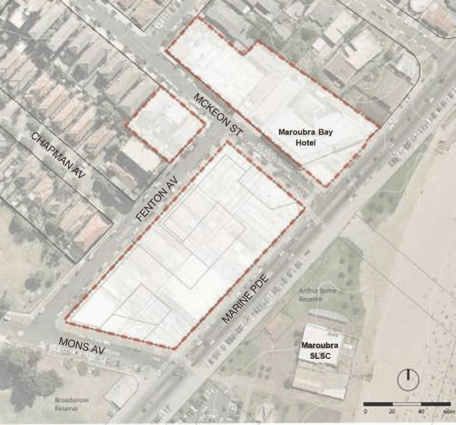
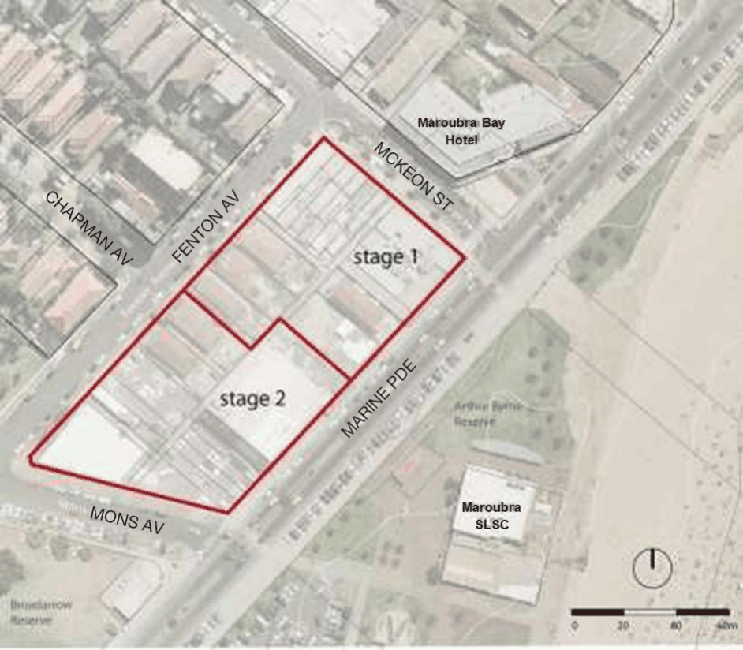

## 1. Introduction

This section of the DCP contains development controls for the Maroubra Beach commercial centre. This section of the DCP should be read in conjunction with:

• Part A - Introduction and Part B - General Controls

• Part D4

– Local Centres General Controls

• Other sections of the DCP for specific development types, locations or sites, if relevant to the application

The land to which this section of the DCP applies is shown in the following diagram:

Figure 1: Maroubra Beach commercial centre

> [Picture on page 4: a picture, saved as a picture (images/part-d6-maroubra-beach-page-4-12.gif, 150 dpi).]

There are two different potential development scenarios contained in this section of the DCP for the block bounded by Marine Parade, McKeon Street, Fenton Avenue and Mons Avenue. The Amalgamated Scheme allows greater building heights but only where lot consolidation is achieved and where a north-facing public square on the southern side of McKeon Street, public

open space and through-site links are provided. The intention is to create a heart for the Maroubra Beach commercial centre, focused on the area around a new public square. Development in the Amalgamated Scheme is to be staged as seen in Figure 2.

Figure 2: Amalgamation scheme

> [Picture on page 5: a picture, saved as a picture (images/part-d6-maroubra-beach-page-5-5.gif, 150 dpi).]

There is also a base scheme which contains controls to be used where sites are developed individually rather than being amalgamated. Due to the flooding constraints in the commercial centre, developing sites individually is unlikely as car park entries, ramping and driveway gradients will require larger development sites than currently provided for in the subdivision pattern. The Base Scheme includes the block bounded by Marine Parade, Mons Avenue, Fenton Avenue and McKeon Street and also the northern side of Mckeon Street between Hereward Street and Marine Parade and a portion of the southern side of McKeon Street to the west of Fenton Avenue. A range of uses, including residential, commercial and retail are permitted with consent in the E1 Zone of Randwick LEP 2012 which generally applies to the area covered by this section of the DCP. The controls in this section of the DCP further encourage development which will preserve the fine grain pattern of development in McKeon Street through a limit on the width of retail spaces. A mixture of residential and home/office uses on Fenton Avenue are to be provided so that there is a transition to residential development further to the west of the commercial centre.

### 1.1. Objectives

1\. Create a heart for the Maroubra Beach Commercial Centre by providing a north-facing public square on the southern side of McKeon Street

2\. Provide public open space and a though-site link between Fenton Avenue and Marine Parade

3\. Improve the amenity and safety of the public domain

4\. Maintain the existing fine-grain pattern of development

5\. Provide for a range of uses including small retail businesses, a mini-supermarket, commercial activities, home-offices and residential uses to create and support a vibrant community

6\. Ensure development is of a high quality contemporary architectural design providing high levels of amenity for residents and visitors and in a manner that enhances the character of the commercial centre.
