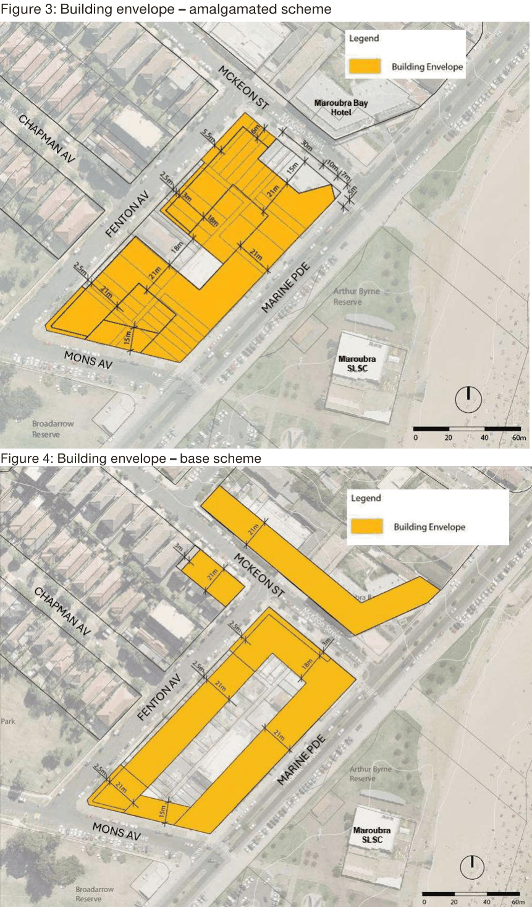

## 2. Building envelope

Explanation A building envelope is a three-dimensional space which defines the maximum extent within which development may occur. It describes maximum height, width, length and depth of a potential development. The envelope includes colonnades and balconies but does not include cantilevered awnings along retail/commercial shopfronts.

Objectives

1\. Determine the appropriate siting and scale of the built form

2\. Ensure that the built form and density of new development respects the desired future character of the commercial centre

3\. Determine the appropriate amount and siting of open space.

Controls

a) Figures 3 and 4 define the building envelopes for the Amalgamated and Base schemes

b) All development in the Amalgamated Scheme must demonstrate that the gross floor area achieved occupies not more than 80% of the maximum building envelope (Figure 3)

c) All development in the Base Scheme for the land bounded by McKeon Street, Marine Parade, Mons Avenue and Fenton Avenue (Figure 4) must demonstrate that the gross floor area achieved occupies not more than 70% of the maximum building envelope

d) Any development of the land on the northern side of McKeon Street and the south western corner of McKeon Street and Fenton Avenue is subject to a maximum Floor Space ratio of 2:1

e) Ensure that the built form contributes to a high quality urban environment by limiting building depth and height.

> [Picture on page 7: a picture, saved as a picture (images/part-d6-maroubra-beach-page-7-1.gif, 150 dpi).]
> Words printed on the picture (title and legend, copied from the PDF):
> – amalgamated scheme

Figure 3: Building envelope

Figure 4: Building envelope – base scheme
