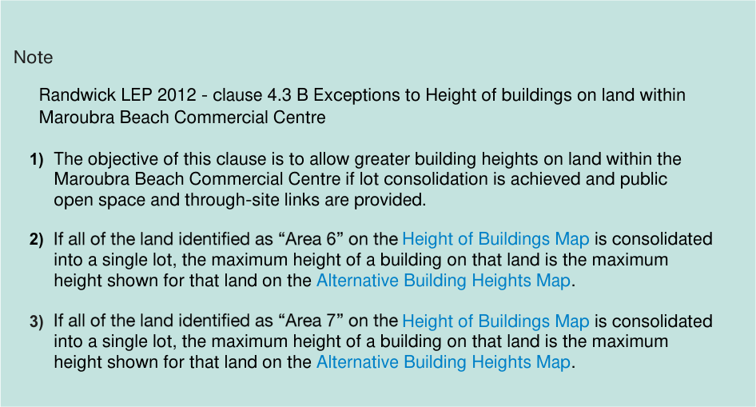
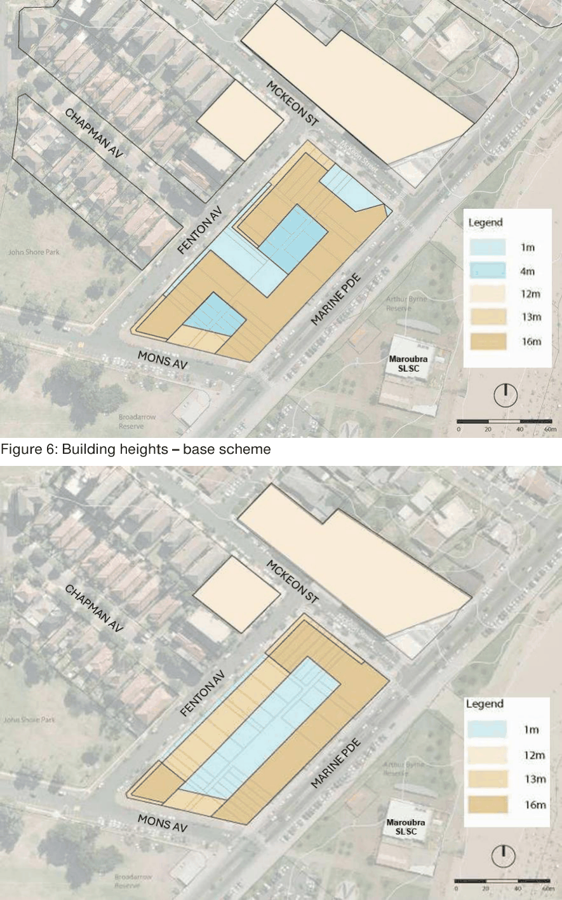

## 3. Building heights

Explanation Height is an important control as it has a major impact on the amenity of both the subject site and the surrounding neighbourhood, both physically and visually. Height controls are an important mechanism for achieving the desired future character of the site and area. The Amalgamated Scheme for the block bounded by Marine Parade, McKeon Street, Fenton Avenue and Mons Avenue allows for greater building heights but only where lot consolidation is achieved and where a north-facing public square on the southern side of McKeon Street, public open space and through-site links are provided.

> [Picture on page 8: a picture, saved as a picture (images/part-d6-maroubra-beach-page-8-10.gif, 150 dpi).]
> Words printed on the picture (title and legend, copied from the PDF):
> Note
> 2\) If all of the land identified as “Area 6” on the Height of Buildings Map is consolidated
> 3\) If all of the land identified as “Area 7” on the Height of Buildings Map is consolidated

Randwick LEP 2012 - clause 4.3 B Exceptions to Height of buildings on land within Maroubra Beach Commercial Centre

1\) The objective of this clause is to allow greater building heights on land within the Maroubra Beach Commercial Centre if lot consolidation is achieved and public open space and through-site links are provided.

into a single lot, the maximum height of a building on that land is the maximum height shown for that land on the Alternative Building Heights Map.

into a single lot, the maximum height of a building on that land is the maximum height shown for that land on the Alternative Building Heights Map.

Objectives

1\. Ensure development responds to the desired scale and future character of the street and locality

2\. Allow reasonable solar access to the public domain and within the development sites.

Controls

a) The maximum height for development in the Amalgamated Scheme must be in accordance with Figure 5 and is subject to Clause 4.3B of the Randwick LEP 2012

b) The maximum height for development that does not satisfy Clause 4.3B of the Randwick LEP 2012 must be in accordance with the Base Scheme in Figure 6.

Figure 5: Building heights

– amalgamated scheme

> [Picture on page 9: a picture, saved as a picture (images/part-d6-maroubra-beach-page-9-3.gif, 150 dpi).]
> Words printed on the picture (title and legend, copied from the PDF):
> – base scheme

Figure 6: Building heights
