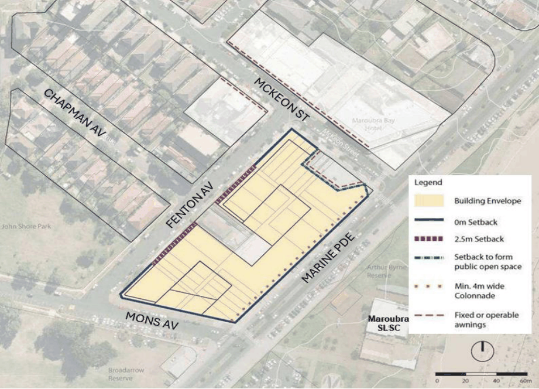
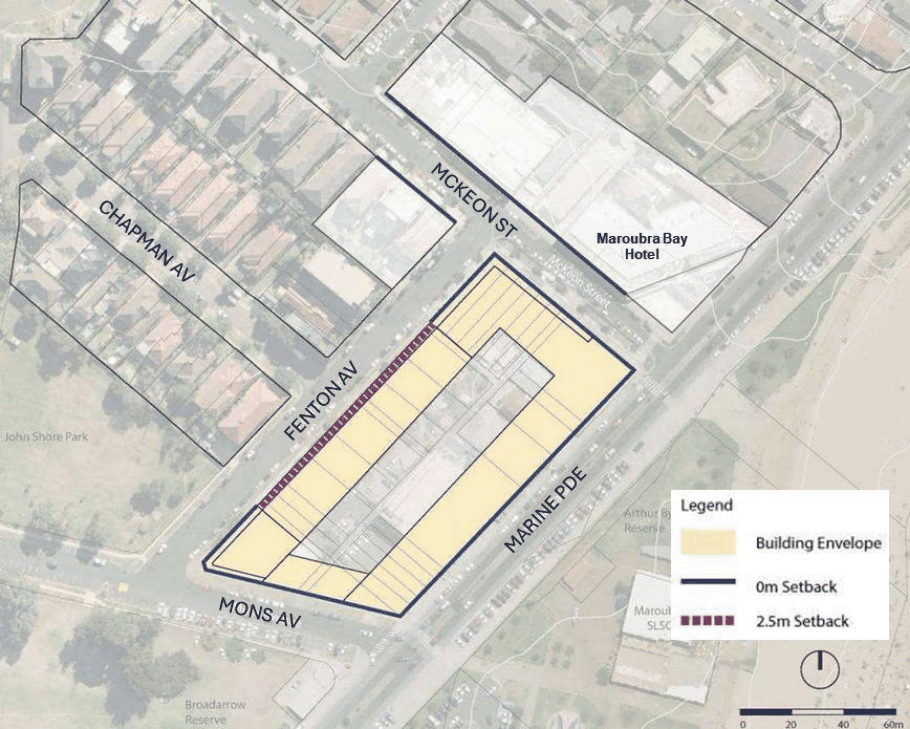

## 4. Street setbacks

Explanation Street setbacks establish the front building line. Setbacks generally reflect building use, with commercial buildings traditionally built to the front boundary and residential development setback from the street frontage. Setbacks allow for landscape areas, entries to ground floor apartments and provide room for balconies at upper levels. Objectives

1\. Allow retail/commercial development to be built to the street boundary to maintain an urban edge

2\. Provide a clear threshold by allowing a transition between public and private space

3\. Provide privacy to dwellings by providing residential setbacks

4\. Create a landscape character along the street

5\. Allow for quality entries to individual apartments and apartment building lobbies. Controls

a) Street setbacks for development that is subject to the Amalgamated scheme must be in accordance with Figure 7

b) Street setbacks for development that is subject to the Base Scheme must be in accordance with Figure 8.

Figure 7: Street setback

– amalgamated scheme

> [Picture on page 10: a picture, saved as a picture (images/part-d6-maroubra-beach-page-10-21.gif, 150 dpi).]

Figure 8: Street setback: base scheme

> [Picture on page 11: a picture, saved as a picture (images/part-d6-maroubra-beach-page-11-2.gif, 150 dpi).]
