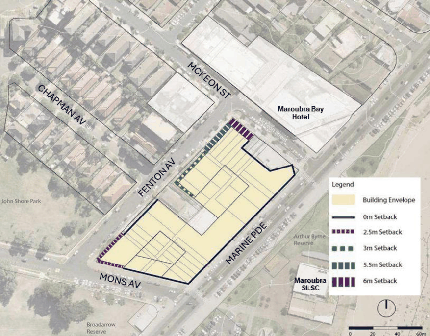
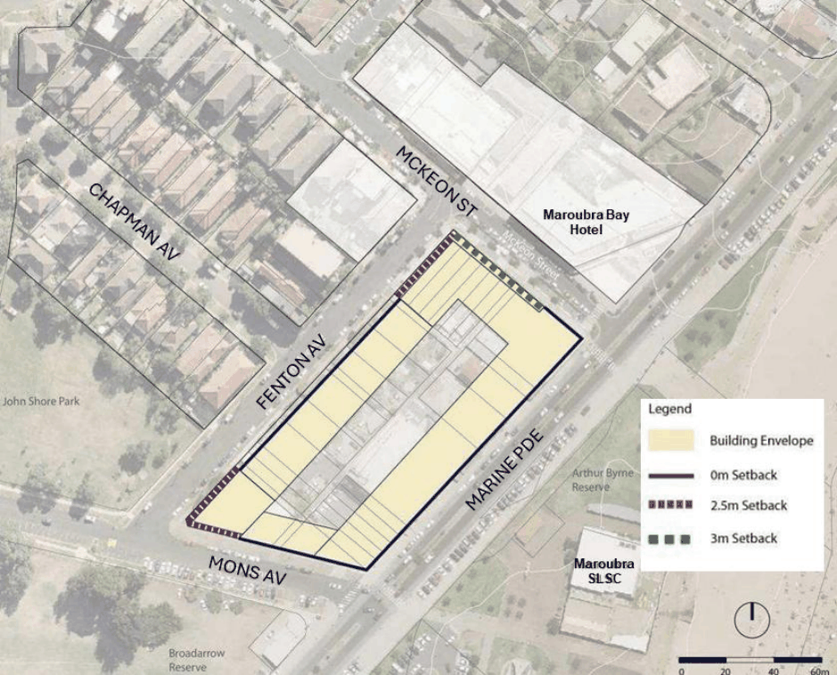

## 5. Upper setbacks

Explanation Street wall heights create the proportions of the street and contribute to the public domain. The height of street walls are designed to allow maximum solar access and limit overshadowing of the public domain and reduce the apparent scale of buildings to the street.

Objectives

1\. Establish the desired spatial proportions of the street and define the street edge

2\. Minimise the visual impact of development by setting back upper levels from the street in particular locations

3\. Minimise overshadowing.

Controls

a) The upper level setbacks for the Amalgamated scheme must be in accordance with Figure 9

b) The upper level setbacks for the Base scheme must be in accordance with Figure 10.

Figure 9: Upper setback: amalgamated scheme

> [Picture on page 12: a picture, saved as a picture (images/part-d6-maroubra-beach-page-12-16.gif, 150 dpi).]

Figure 10: Upper setback: base scheme

> [Picture on page 13: a picture, saved as a picture (images/part-d6-maroubra-beach-page-13-2.gif, 150 dpi).]
