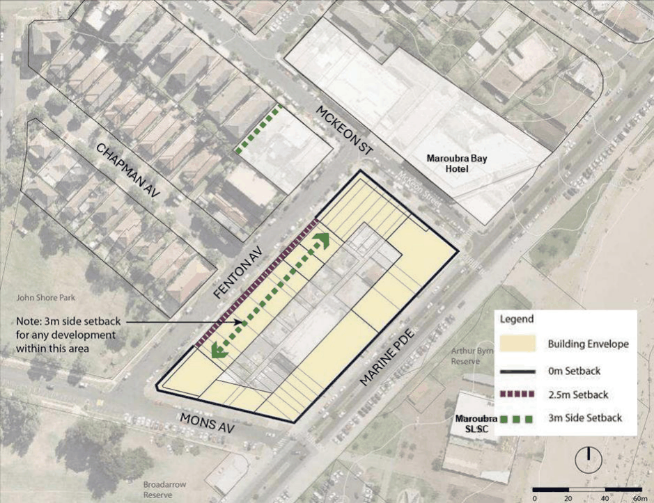

## 6. Side setbacks – base scheme

Explanation Side setbacks ensure that building height and separation of the built form from boundaries maintain the amenity of neighbouring land. Minimum side setbacks of 3 metres are required for development in the Base Scheme fronting Fenton Avenue and for development on the southern side of McKeon Street adjacent to the western boundary of the area covered by this section of the DCP. These setbacks are necessary to minimise the impact on the amenity of existing properties in terms of daylight and visual bulk given that consolidation of lots is unlikely to occur in the Base scheme.

Objectives

1\. Protect the amenity of existing development by requiring adequate side setbacks

2\. Ensure existing development receives adequate light and is not adversely impacted in terms of visual bulk and scale.

Controls

a) Minimum side setbacks for development subject to the Base scheme must be in accordance with Figure 11.

Figure 11: Side setbacks

– base scheme

> [Picture on page 14: a picture, saved as a picture (images/part-d6-maroubra-beach-page-14-19.gif, 150 dpi).]
