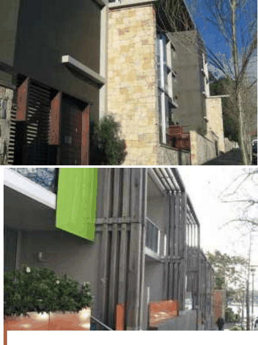

## 7. Building appearance and façade articulation

Explanation Building facades are to be articulated in order to reduce perceived building bulk and to provide visual interest. Blank walls, exposed car parks, large basement car park entries and the use of reflective glass are not appropriate. Clause 6.11 of RLEP 2012 requires the demonstration of design excellence if the development:

> [Picture on page 15: a picture, saved as a picture (images/part-d6-maroubra-beach-page-15-7.gif, 150 dpi).]

• Has an area of 10,000 square metres or greater

• Requires the preparation of a development control plan

• Is greater than 15 metres in height Objectives

1\. Incorporate architectural features which reduce the visual bulk of a building

2\. Promote high architectural quality

3\. Define and enhance the public domain and character of the locality.

Controls

a) Building facades must be articulated and modulated within a 2.5 metre articulation zone to allow visual depth to the facade. Balconies are permitted within the articulation zone

b) Building facades must have well balanced vertical and horizontal proportions

c) Development over a number of lots should

Examples of acceptable use of materials and façade articulation

provide building facades that present as a street of buildings whilst still maintaining a coherent architectural language

d) The selection of exterior colours and materials must be harmonious with and complement the coastal character of the area. Materials used are to be suitable for the local climatic conditions and are to be able to withstand natural weathering

e) External walls must have a high material quality and be durable

f) Large expanses of any single material should be avoided. Highly reflective finishes and curtain wall glazing are prohibited

g) All windows not facing balconies are to have external shading appropriate to their orientation

h) Entries to basement car parks are to be designed as part of the overall development and are to be kept to a minimum in size and number

i) Express important corners by giving visual prominence to part of the façade by a change in building articulation, material, colour and roofing.
