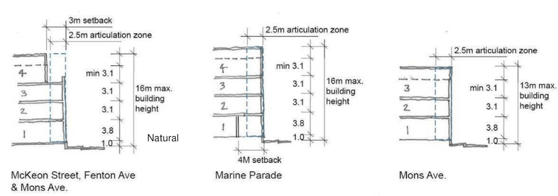

## 8. Floor to ceiling heights

Explanation Ceiling heights are design elements for controlling the amenity of residential and commercial spaces and also allow for the use of spaces to be varied, for example from residential to commercial use. Objectives

1\. Ensure that interior spaces have a high level of amenity and sense of space

2\. Allow for the flexibility of use of ground level spaces on Fenton Avenue

3\. Allow for sunlight penetration into apartments.

Note Flood study investigations require ground floor levels to be set a minimum of 1.0m above natural ground level. Refer to Part B8 for further flood related controls.

Controls

a) Minimum floor to ceiling heights must be in accordance with Figure 12.

Figure 12: Floor to ceiling heights for amalgamated and base schemes and articulation zones

> [Picture on page 16: a picture, saved as a picture (images/part-d6-maroubra-beach-page-16-17.gif, 150 dpi).]
> Words printed on the picture (title and legend, copied from the PDF):
> Natural
> ground
