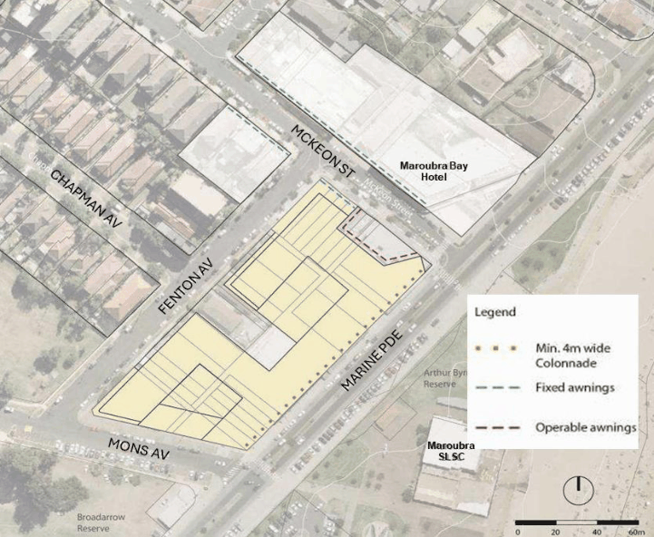
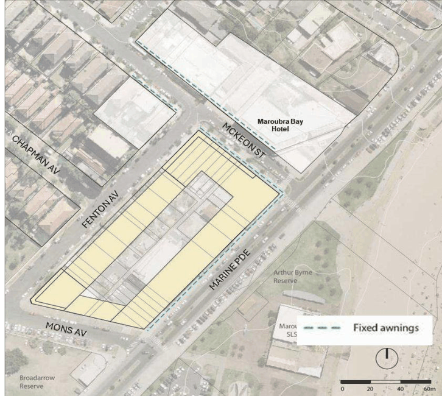

## 9. Awnings and colonnades

Explanation Continuous cantilevered awnings currently run the length of the southern side of McKeon Street between Marine Parade and Fenton Avenue and return partly onto Marine Parade. The Maroubra Bay Hotel has an awning, as does the development to the west of this on McKeon Street. Awnings and colonnades are required to preserve this character, provide weather protection and to give a pedestrian scale to retail/commercial areas. The construction of a colonnade along Marine Parade will also address flooding levels and provide disabled access. Objectives

1\. Provide weather protection to pedestrians both from rain and to provide shade

2\. Give a pedestrian scale to retail/commercial streets

3\. Awnings and colonnades are to be designed to complement the building to which they are attached.

Controls

a) Colonnades and awnings must be provided in accordance with Figures 13 and 14

b) Awnings must be constructed to provide continuous cover and protection from sun and

rain. Awnings must not be constructed in glass and other transparent materials.

Figure 13: awnings/colonnades amalgamated scheme

> [Picture on page 17: a picture, saved as a picture (images/part-d6-maroubra-beach-page-17-19.gif, 150 dpi).]

Figure 14: Awnings base scheme

> [Picture on page 18: a picture, saved as a picture (images/part-d6-maroubra-beach-page-18-2.gif, 150 dpi).]
