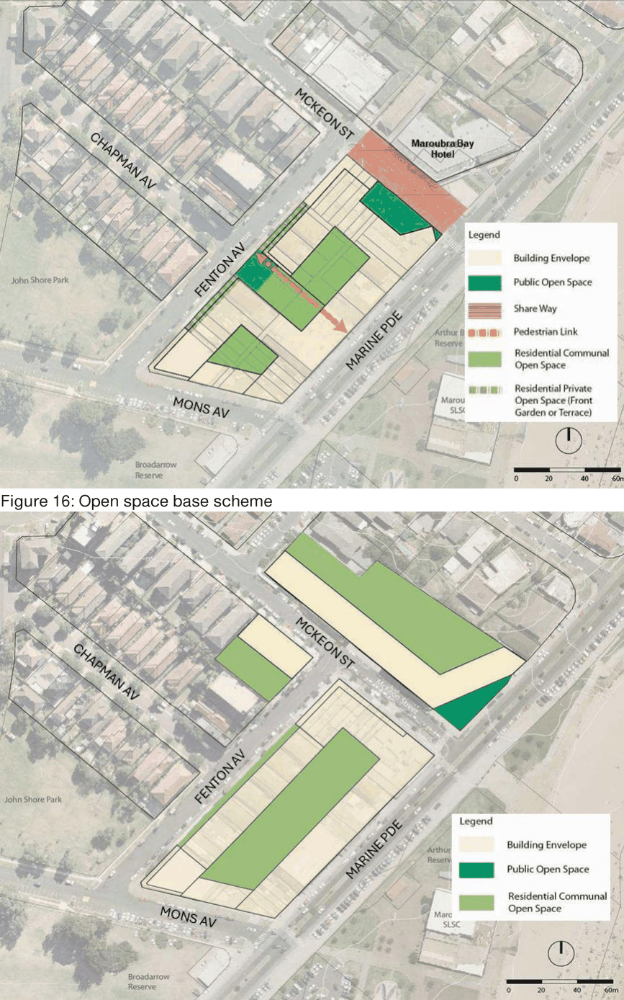

## 10. Open space

Explanation The primary function of open space is to provide amenity to the public domain and to a development. To meet this need the amalgamated scheme provides for the construction of a north- facing public square on the southern side of McKeon Street, public open spaces and a through-site link between Fenton Avenue and Marine Parade. This will create a heart to the Maroubra beach commercial area. A shared pedestrian/vehicular zone on McKeon Street will further enhance this area. Open space should be considered as an integral part of a development. It provides amenity by creating areas for landscaping and recreation. The provision of open space areas also facilitates the separation of buildings to allow for sunlight access and visual privacy.

Objectives

1\. Provide for the construction of a north-facing public square on the southern side of McKeon Street

2\. Provide on-site public open space on Fenton Avenue opposite Chapman Avenue with a public through-site link to Marine Parade from Fenton Avenue

3\. Create a residential scale and form of development to Fenton Avenue by providing for front gardens on the Fenton Avenue frontage

4\. Provide for a shared pedestrian and vehicular area with removable bollards to enable closure of the road when required, on McKeon Street adjacent to the Maroubra Bay Hotel.

Controls

a) Public open space, communal and private open space areas must be provided in accordance with Figures 15 and 16

b) A shared pedestrian/vehicular zone with removable bollards must be constructed on McKeon Street in accordance with Figure 15

c) A pedestrian link must be provided between Fenton Avenue and Marine Parade in accordance with Figure 15. The entry and passage through the building envelope at Marine Parade must have a minimum width of 4.2m

d) Public open must be provided on the southern side of McKeon Street in accordance with Figure 15 to create a public square.

Figure 15: Open space amalgamated scheme

> [Picture on page 20: a picture, saved as a picture (images/part-d6-maroubra-beach-page-20-2.gif, 150 dpi).]

Figure 16: Open space base scheme
