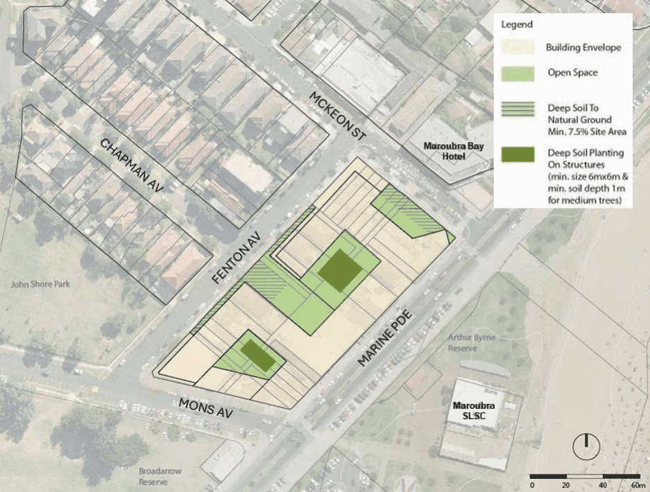

## 11. Deep soil zone landscape requirements

Explanation Deep soil zones are areas of natural ground retained within a development which allows for soft landscaping and the planting of large canopy trees. Deep soil areas provide environmental amenity by promoting healthy growth of trees while providing a pervious surface allowing rainwater infiltration and therefore reducing stormwater runoff.

Objectives

1\. Improve the amenity of the development by providing a soft landscape area for the planting of canopy trees

2\. Assist in stormwater management and quality.

Controls

a) Deep soil zones must be provided in accordance with Figure 17

b) Deep soil planting on structures must be provided in accordance with Figure 17 and must have minimum dimensions of 6 metres by 6 metres with a minimum soil depth of 1 metre.

Figure 17: Deep soil zone landscape requirements

– amalgamated scheme

> [Picture on page 21: a picture, saved as a picture (images/part-d6-maroubra-beach-page-21-18.gif, 150 dpi).]
