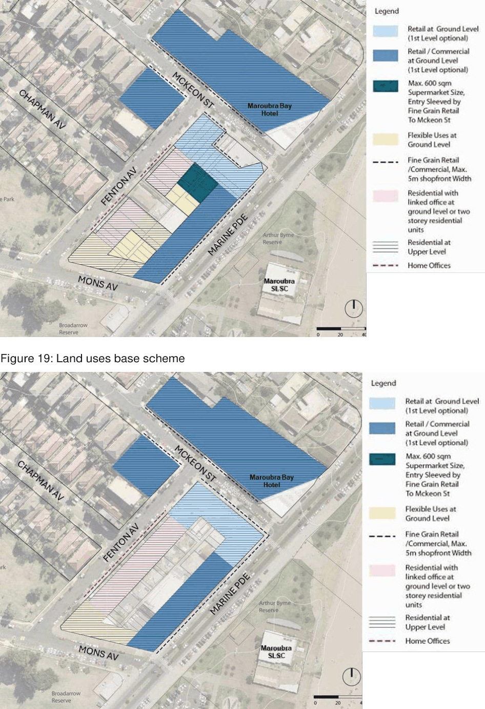

## 14. Uses

Explanation The E1 Local Centre zone allows for a range of small- scale retail and business uses By further controlling land use through limiting the size of shop fronts on Mckeon Street and Marine Parade, this DCP will ensure that a variety of small business can establish in this location, contributing to the on-going economic viability of the commercial centre Small commercial and home offices are provided for on Fenton Street to provide a transition from commercial uses to residential uses located to the west of the commercial centre Residential development is also allowed which integrates with and supports the adjacent commercial uses A 600 square metre supermarket is provided for in order to provide good access to services for residents in the locality.

Objectives

1\. Maintain the scale and proportion of the existing fine- grain, narrow lot shopfronts which give McKeon Street its distinctive character

2\. Provide for a mini-supermarket located behind the McKeon Street frontage with a maximum floor area of 600 sqm

3\. Allow for mixed-use development with upper-level residential use

4\. Restrict the uses on Fenton Avenue to smaller commercial/home office development as a transition to residential development to the west of the commercial centre.

Controls

a) Land uses for the amalgamated scheme must be in accordance with Figure 18

b) Land uses for the base scheme must be in accordance with Figure 19.

Figure 18: Land use amalgamated scheme

> [Picture on page 24: a picture, saved as a picture (images/part-d6-maroubra-beach-page-24-2.gif, 150 dpi).]

Figure 19: Land uses base scheme
