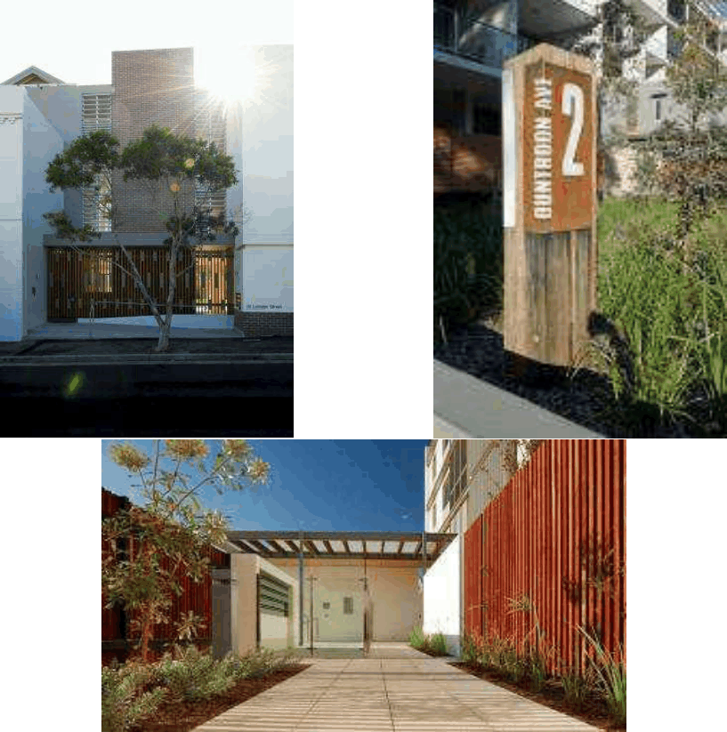

## 16. Building entries

Explanation Building entries define the transition between the public and private domain. Entries differ with building use. Retail and commercial building entries are generally accessed directly from the street, whereas residential developments are generally setback to ensure a degree of privacy.

Objectives

1\. Contribute positively to the streetscape and building façade design

2\. Orient the visitor

3\. Create residences with a desirable residential identity.

Control

a) Building entries must be prominent and marked with an awning or colonnade.

Examples of good building entries

> [Picture on page 26: a picture, saved as a picture (images/part-d6-maroubra-beach-page-26-2.gif, 150 dpi).]
