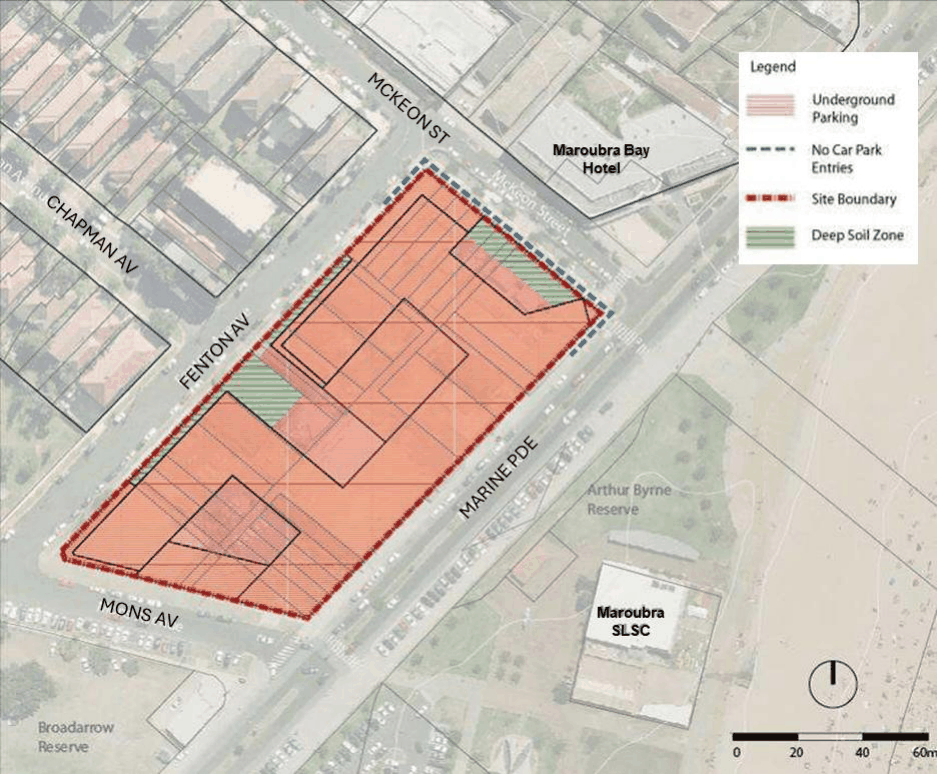

## 19. Parking

Objectives

1\. Limit the impact of basement car parking and allow for deep soil planting

2\. Ensure adequate parking is provided to meet additional parking demand resulting from development.

Controls

a) Basement car parking must be provided in accordance with Figure 20

b) Car parking must be provided in accordance with the controls detailed in Part B7 of the DCP.

Figure 20: Underground car parking

> [Picture on page 28: a picture, saved as a picture (images/part-d6-maroubra-beach-page-28-2.gif, 150 dpi).]
