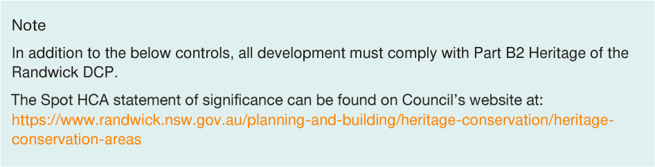
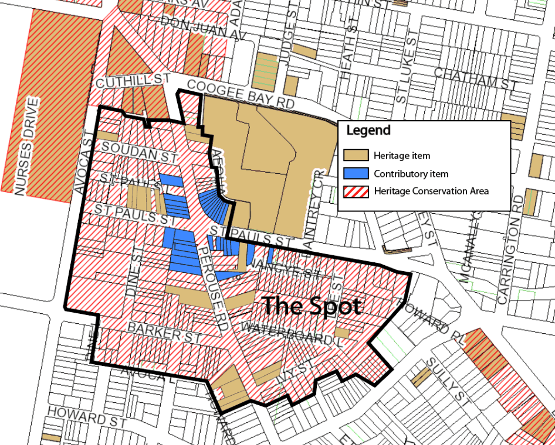

## 2. Heritage

Explanation The Spot Heritage Conservation Area (HCA) showcases a rich diversity of streetscapes. In the commercial centre, buildings are predominantly two-storey, continuous, and aligned to the street, creating a distinctive urban character —especially at the curved corner of Perouse Road and St Pauls Street. Architectural styles include Victorian Italianate, Federation Free Classical, and Inter-War Art Deco, with the Randwick Ritz cinema (39 St Pauls Street) standing out as a prime Art Deco example. Residential areas feature representative buildings from the Victorian, Federation, and Inter-War periods, with Federation Bungalows being the most common. Notable groupings include the detached houses at 77 –93 Perouse Road and several others throughout the HCA. The Spot HCA

has historic significance for its origins as “Irishtown”, a poor working area on the

fringe of Randwick Village, dominated by Irish Catholics. It came to be considered a settlement in opposition to Simeon Pearce’s “Struggletown”, the housing area he develo ped for his own workers. The original group maintained a long association with the area and contributed to its strong sense of local identity. The Spot is now a cohesive residential and commercial neighbourhood. It demonstrates the later processes of large-scale urban subdivision and development, which began after the establishment of the tramway route between Randwick and Coogee in 1883, where the commercial centre developed around a tram stop at the intersection of Perouse Road and St Pauls Street.

Themes represented in the HCA The following historical themes, identified in The Spot HCA include:

• Speculation and promotion

• Industry and commerce

• Transport and communications

• Suburbanisation

• Modifying the landscape

• Promotion, culture, religion and education

• Recreation, entertainment and leisure

> [Picture on page 5: a picture, saved as a picture (images/part-d7-the-spot-page-5-31.gif, 150 dpi).]
> Words printed on the picture (title and legend, copied from the PDF):
> The Spot HCA statement of significance can be found on Council’s website at:
> https://www.randwick.nsw.gov.au/planning-and-building/heritage-conservation/heritage-
> conservation-areas

Note In addition to the below controls, all development must comply with Part B2 Heritage of the Randwick DCP.

Heritage and Contributory Buildings identified within the local centre and surrounds are listed in Table 1 and also mapped in Figure 1 below.

Figure 1: The Spot heritage and contributory buildings

> [Picture on page 6: a picture, saved as a picture (images/part-d7-the-spot-page-6-2.gif, 150 dpi).]

Source: Randwick City Council 2025

Table 1: Contributory buildings within the local centre

| 22-30 Perouse Road | 66-68 Perouse Road |
|---|---|
| 36-38 Perouse Road | 22 St Pauls Street |
| 40-44 Perouse Road | 28-32 St Pauls Street |
| 41 Perouse Road | 29-37 St Pauls Street |
| 43-51 Perouse Road | 34 St Pauls Street |
| 46-50 Perouse Road | 36-40 St Pauls Street |
| 52-56 Perouse Road | 42 St Pauls Street |
| 60 Perouse Road | 39-47 St Pauls Street |
| 62-64 Perouse Road | 44-46 St Pauls Street |
| 65-71 Perouse Road | 52 St Pauls Street |

Objectives The objectives for heritage are to:

1\. Conserve and enhance the character and heritage significance of heritage items

2\. Retain and conserve the distinctive and significant physical fabric of heritage items and contributory buildings

3\. Ensure surrounding or infill development is designed to respond sympathetically to the historic scale, built form, character and detailing of nearby heritage items and contributory buildings

4\. Ensure that the heritage significance of heritage items and The Spot HCA are considered in the assessment of Development Applications (DA).

Controls

a) All development involving heritage items are to be in accordance with requirements for heritage set out in Part B2

– Heritage of the Randwick DCP

b) All development involving heritage items and contributory buildings are required to:

i. Adhere to the principles of the Burra Charter

ii. Include the submission of a Heritage Impact Statement (or Heritage Impact Assessment) which considers the heritage significance of the item or contributory building, the impact of the proposal on the heritage significance of the building or heritage items within the vicinity, the rationale for the proposed development, and the compatibility of the development with the objectives and controls, and/or recommended management within relevant conservation management plans, planning instruments or heritage inventories

c) Alterations and additions to heritage items and contributory buildings should conserve original characteristic-built form, and not significantly alter the appearance of principal, or historically significant facades, except to remove detracting elements

d) Development adjacent to heritage items and contributory buildings (infill development) should:

i. Reflect the scale, proportions, articulation and alignment of adjacent buildings including maintaining vertical articulation, avoiding dominant horizontal forms and reinforcing historic height lines at corners and intersections

ii. Incorporate design that responds to historic streetscape patterns. Contemporary signage and finishes should complement existing detailing and side elevations should preserve the massing and profile of contributory and heritage items.
