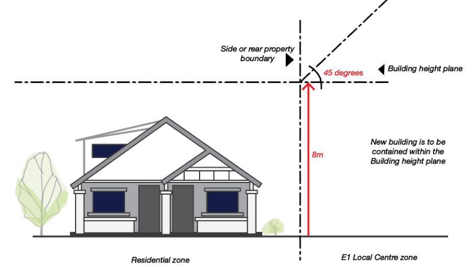
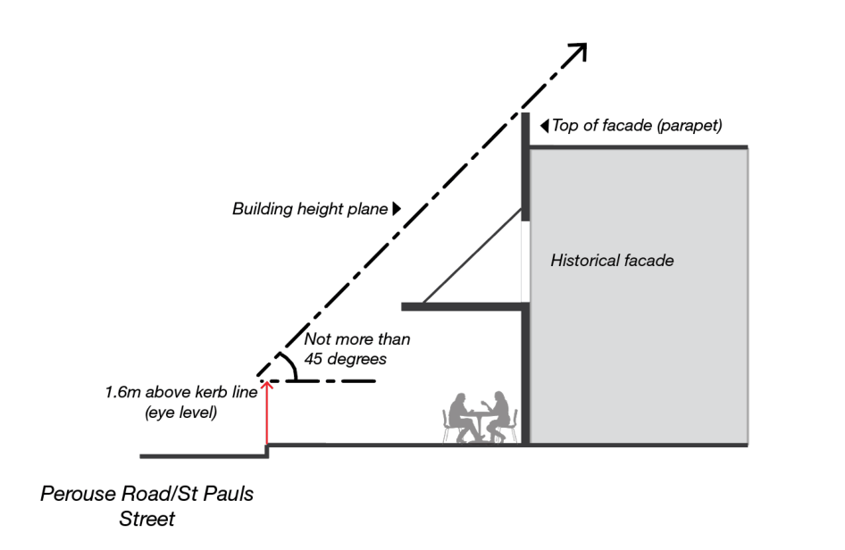

### 4.1. Application of building envelope planes/space- commercial development

Explanation The building height plane defines the envelope or space within which a building can be built. The following explains each of the building height planes. Figure 2 shows an example application of the building height plane control. The building height plane for new commercial development adjacent to existing residential development applies throughout the Local Centre zone (at side and rear of property boundaries). This building envelope plane also applies where any proposed development shares a boundary with an existing residential property and is overlooked by proposed development. The building height plane applies regardless of the location of the residential development. The reason for this building height plane is to minimise the effects of overshadowing and overlooking of existing residential development surrounding the local centre. This building height plane is illustrated in Figure 2. Figure 2: Application of building height plane control

> [Picture on page 9: a picture, saved as a picture (images/part-d7-the-spot-page-9-24.gif, 150 dpi).]

Source: Randwick City Council 2025

Building envelope plane

– heritage items and contributory buildings

An additional building height plane applies to heritage items and contributory building facades shown on Figure 3. The purpose of this building height plane is to reduce the prominence of new building additions and alterations behind existing conserved heritage and contributing facades and to ensure new buildings will not necessarily or unreasonably intrude upon:

he existing character of buildings in the locality built between the late 1880’s to the mid

• A heritage item

• The existing streetscape

• T 1930’s

This height plane is measured at right angles to the building alignment and is projected from a point 1.6m above the kerb line. Its angle is determined by the height of the retained buildings, but not more than 45o as indicated in Figure 3.

Control

a) All commercial development within The Spot adjacent to residential development must comply with the building envelope planes in addition to the relevant FSR and building height controls set by RLEP 2012

b) No part of a building may penetrate the plane except for minor architectural features including parapets, eaves, chimneys, etc.

Figure 3: Building height plane

– historic buildings and contributory facades

> [Picture on page 10: a picture, saved as a picture (images/part-d7-the-spot-page-10-23.gif, 150 dpi).]

Source: Randwick City Council 2025
