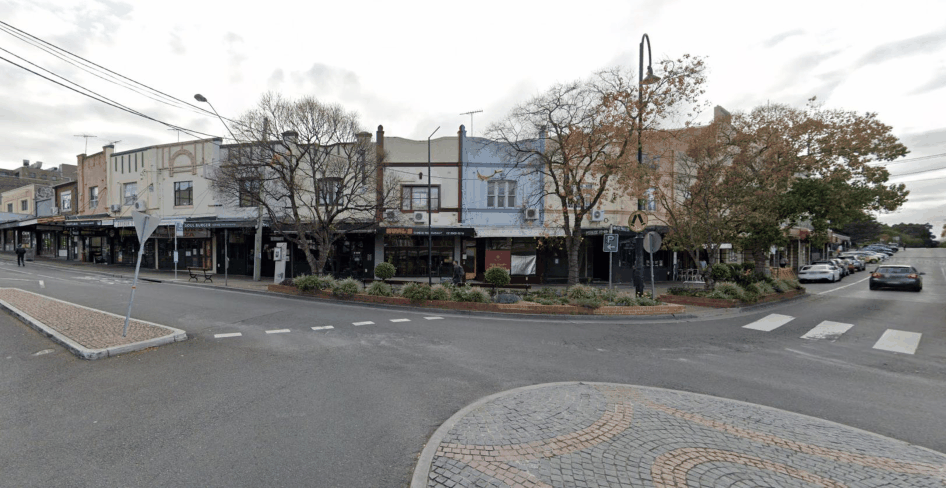

## 5. Commercial area – building design

Explanation The distinctive character of The Spot is largely determined by the existing built form of heritage and contributory buildings (refer to Figure 4). It is envisaged that development will remain consistent with the existing built form and character of the HCA. New development is envisaged to incorporate a number of design elements that contribute to the existing appearance, function and impact of the surrounding area including:

• Shopfronts

• Awnings

• Upper level facades

• Materials and colours

• Outdoor advertising and signage

• Car parking and access

Figure 4: Building design

> [Picture on page 11: a picture, saved as a picture (images/part-d7-the-spot-page-11-15.gif, 150 dpi).]

Source: Randwick City Council 2025

Objectives The objectives for building design are to:

1\. Ensure that new development is consistent with the distinctive character, aesthetic qualities and heritage significance of the precinct

2\. Ensure that any new development respects the detailing, materials and finishes of surrounding heritage and contributory buildings

3\. Conserve and enhance the existing commercial streetscape, in particular above the awning level

4\. Encourage reinstatement of original features such as awnings and windows and remove inappropriate alterations and additions

5\. Ensure materials, painting/colour schemes of buildings are appropriate to the heritage streetscape.
