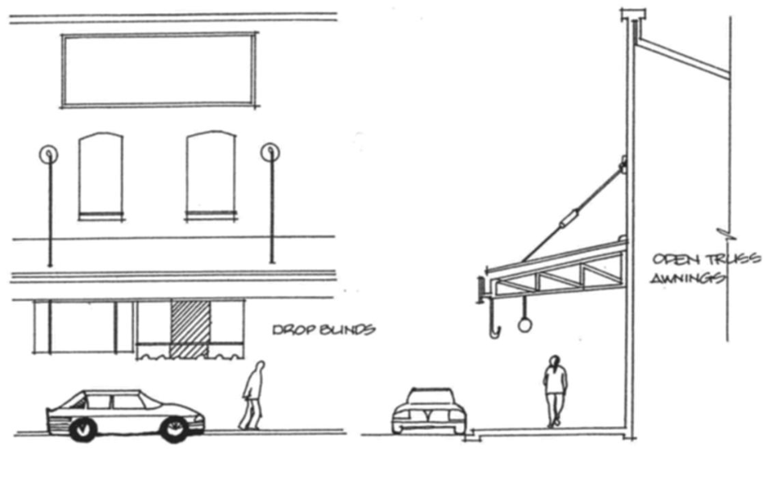

### 5.2. Awnings

Controls

a) Continuous awnings attached to buildings and covering all main pedestrian routes must be provided for pedestrian comfort (refer to Figure 5)

b) Provide, steel-framed awnings, suspended from wall brackets, covering the 3.5m wide footpath

c) The traditional box awnings are acceptable as they consolidate the centre’s overall character

d) New development should include a flat suspended/cantilevered awning to provide continuous pedestrian shelter

e) Awning fascias should align with the awning of adjoining buildings, matching the established height above footpath level

f) The depth of the fascia should be uniform with adjoining properties. Design and materials should be light weight to complement the building to which the awning is to be attached

g) New development should provide an awning across its street frontage, setback 600mm from the kerb, between 3.5m and 4.5m above the footpath. Gaps between awnings should be closed

h) Glass or translucent roofing must not be used as these materials provide no shade and facilitate heat transfer. Opaque materials such as ribbed sheet steel are encouraged

i) Drop blinds protecting shopfronts and shoppers from low sun angles should be included at the outer edge of awnings

j) Advertising space should be used to diversify the street appearance. The underside of drop blinds must be at least 3m above the footpath level. In cases where it is impractical or unreasonable to require continuous awnings other forms of providing shade and shelter may be considered.

Figure 5: Awning examples

> [Picture on page 13: a picture, saved as a picture (images/part-d7-the-spot-page-13-2.gif, 150 dpi).]

Source: Randwick City Council 2023
