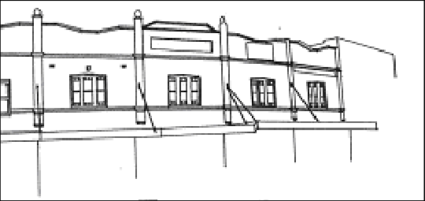
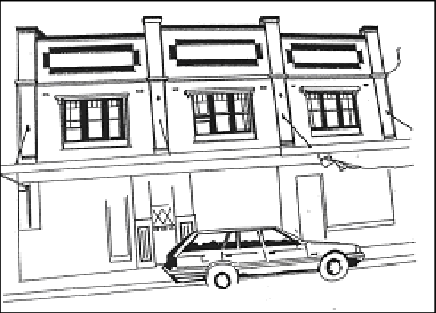
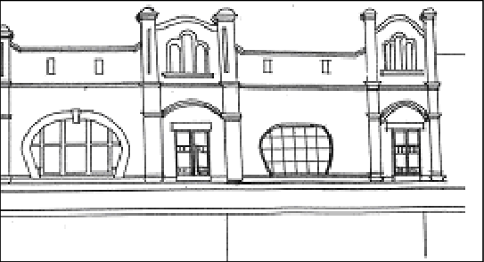

### 5.3. Upper level facades

Explanation The building façade is one of the strongest elements which contributes to the character and image of The Spot. Changes to individual buildings should respect the built heritage of the business centre (refer to Figure 6).

Note Council encourages the retention and reinstatement of early verandah and balcony forms for historic buildings (including commercial buildings) to improve the local streetscape.

Elements which contribute to the character of The Spot include:

• Building facades that incorporate a vertical emphasis which is reinforced through window design, parapet details, etc.

• Buildings that incorporate a parapet roof form which obscures views of the roof.

Figure 6: Examples of parapet roof forms

> [Picture on page 14: a picture, saved as a picture (images/part-d7-the-spot-page-14-2.gif, 150 dpi).]

> [Picture on page 14: a picture, saved as a picture (images/part-d7-the-spot-page-14-3.gif, 150 dpi).]

> [Picture on page 14: a picture, saved as a picture (images/part-d7-the-spot-page-14-4.gif, 150 dpi).]

Source: Randwick City Council 2023

Controls

a) Upper floor windows should be returned to original detailing through replacement of sympathetic frames or the reinstatement of timber frames and mouldings

b) The character of the area can be improved with the removal of inappropriate alternations and additions from the facades

c) New development should adopt a fenestration pattern and architectural design elements which emphasise the vertical proportions of the existing facades

d) A parapet roof form should be included which creates an interesting skyline and harmonises with the existing parapets (refer Figure 6)

e) New parapets should align with the parapets of adjoining buildings and a design that generally relates in bulk and scale

f) For new development, façade alterations and infill buildings, verandahs and upper storey balcony design and materials should be compatible to the heritage items and contributory building facades within the area

g) Cantilevered balconies should not be used on new buildings

h) Balconies should be sized and arranged so that strong horizontal lines do not dominate the façade of the development

i) Recessed balconies which modulate the façade should be incorporated in the design of new development

j) Balconies should be designed to protect the visual amenity of occupants, neighbours and the street and should therefore have a solid appearance.
