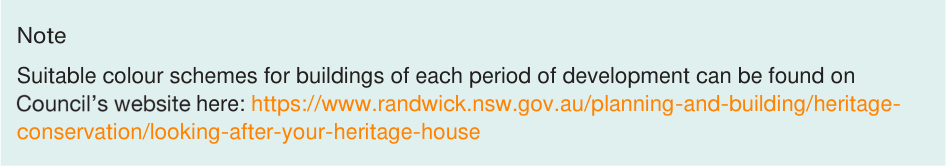

### 5.4. Materials and colours

Controls

a) Materials and finishes for new development should be compatible with adjoining and nearby development. Sympathetic use of building materials can reduce the impact of a modern shopfront on the streetscape

b) Acceptable materials include face brickwork (traditional reds, browns and manganese) and rendered masonry. The use of precast concrete is to be avoided. Acceptable roof materials include corrugated iron and Marseilles tiles

c) Original face brickwork or stone should not be painted or rendered

d) Colours should enhance the locality and be appropriate to the architectural style of the building.

> [Picture on page 15: a picture, saved as a picture (images/part-d7-the-spot-page-15-22.gif, 150 dpi).]
> Words printed on the picture (title and legend, copied from the PDF):
> Council’s website here: https://www.randwick.nsw.gov.au/planning-and-building/heritage-
> conservation/looking-after-your-heritage-house

Note Suitable colour schemes for buildings of each period of development can be found on

Randwick City Council 30 Frances Street Randwick NSW 2031

1300 722 542 council@randwick.nsw.gov.au www.randwick.nsw.gov.au
