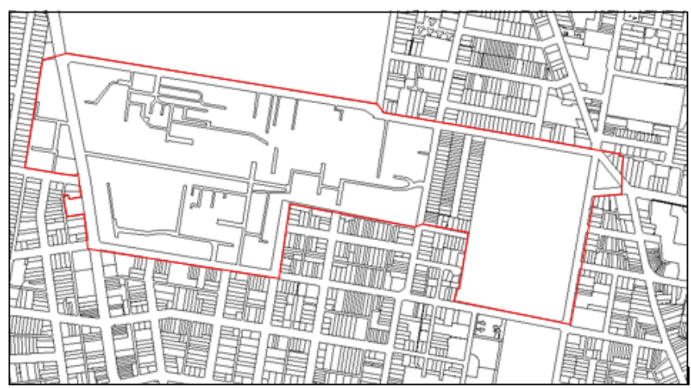

### 1.1. The centre

The Randwick Education and Health Specialised Centre is located at the intersection of the suburbs of Randwick, Kensington and Kingsford.

Figure 1: Application of this Section

> [Picture on page 5: a picture, saved as a picture (images/part-d9-randwick-education-and-health-specialised-page-5-20.gif, 150 dpi).]

Th e Centre is identified in the NSW Government’s Metropolitan Plan and Eastern City District Plan (2018) as a Collaboration Area, given its significant cluster of specialised health, education and research activities playing a vital economic and employment role within the Greater Sydney region and beyond. It is formed by several major institutions and destinations, including the University of NSW, the Randwick Health Campus with four major hospitals forming Australia’s largest complex of teaching hospitals, and some of Australia’s premier research institutions including Neuroscience Research Australia.

It is bound by Royal Randwick Racecourse, Sydney’s oldest continually operating racecourse. While not operationally a component of the Specialised Centre the racecourse shares its High Street boundary with the University.

Note The Eastern City District Plan (2018) identifies the broader Randwick Health and Education Precinct as a future collaboration area given its significant cluster of specialised health, education and innovative land uses. This DCP provides the site-specific controls for the institutions situated within the Randwick Health and Education Precinct comprising UNSW and the Randwick Hospital Campus.
