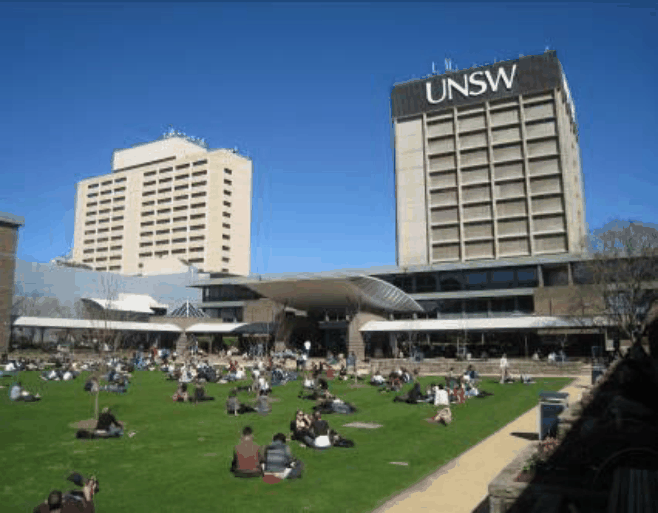

#### 1.1.1. Economic and social significance

Collectively, the University and Health Campuses are the largest employers in Randwick City, with almost 40 percent of its workforce. Strong growth in health, research and education activities and employment is predicted to continue. The large workforce, students and visitors provide substantial local economic benefits to the nearby commercial centres. For Randwick City itself, in addition to the employment and economic benefits generated by these institutions the Centre provides a variety of social, cultural and community facilities and services that are available to the local community.

> [Picture on page 6: a picture, saved as a picture (images/part-d9-randwick-education-and-health-specialised-page-6-18.gif, 150 dpi).]
