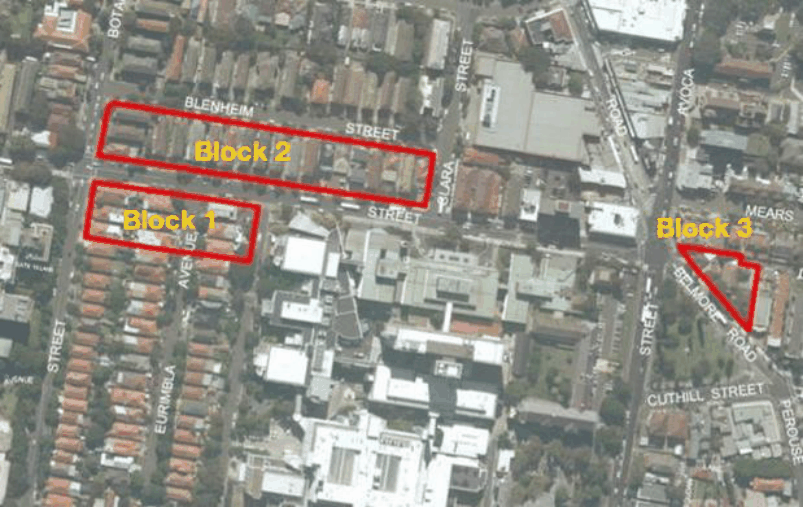
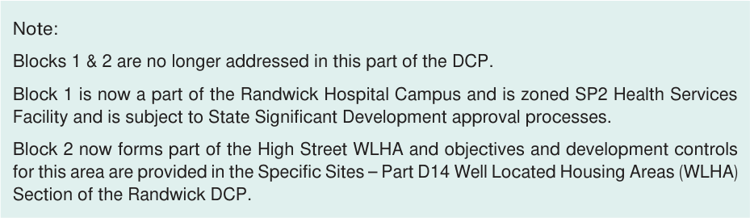
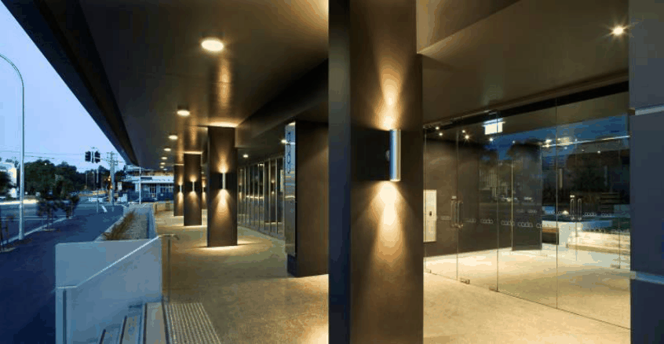
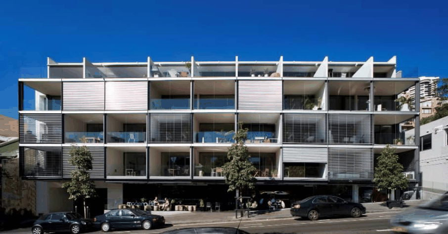

## 2. High Street area

### 2.1. General

Site identification The High Street Area is located in the east of the Randwick Education and Health Specialised Centre. Figure 2: Site identification map

> [Picture on page 10: a picture, saved as a picture (images/part-d9-randwick-education-and-health-specialised-page-10-7.gif, 150 dpi).]

Block 1: High Street/Botany Street

Block 2: Blenheim Street/High Street Block 3: Belmore Road/Don Juan Avenue

> [Picture on page 10: a picture, saved as a picture (images/part-d9-randwick-education-and-health-specialised-page-10-11.gif, 150 dpi).]

Note: Blocks 1 & 2 are no longer addressed in this part of the DCP. Block 1 is now a part of the Randwick Hospital Campus and is zoned SP2 Health Services Facility and is subject to State Significant Development approval processes. Block 2 now forms part of the High Street WLHA and objectives and development controls for this area are provided in the Specific Sites

– Part D14 Well Located Housing Areas (WLHA)

Section of the Randwick DCP.

Explanation These sites have been identified as having potential to contribute to the Specialised Centre’s demands for growth in health and medical related uses and the related demands for key worker and student accommodation in an accessible location, with strong proximity to the Hospitals Campus and University of NSW, local services and public transport.

The objectives and controls for this section apply to all DAs for new buildings on these sites.

Objectives The objectives for the High Street area are to:

1\. Facilitate commercial space that is suitable for health services facilities within the Centre

2\. Facilitate residential uses including affordable housing to reflect the needs of key workers and students within the Centre

3\. Provide building forms and layouts that are capable of adapting to both residential and health service facilities above ground floor

4\. Provide active street frontages to streets at ground floor

5\. Increase pedestrian permeability and amenity where possible

6\. Minimise vehicular crossings on primary street frontages, including High Street, Botany Street and Belmore Road.

Controls

a) Buildings are to have a minimum floor to ceiling height in order to provide suitable ceiling heights to suit health and medical related uses of:

i. 3.3m on the ground floor

ii. 2.7m on the first floor

b) Provide an active ground floor setback zone, free of columns, balustrades and other visual barriers to the primary street front

c) If three-bedroom units are provided, units should be capable of being converted into a dual key apartment (i.e. two bedroom + studio)

d) The design of the first floor and above is to be flexible with multiple configurations possible that enable residential or health service uses

e) Locate car parking below ground under the building footprint.

> [Picture on page 11: a picture, saved as a picture (images/part-d9-randwick-education-and-health-specialised-page-11-26.gif, 150 dpi).]

Example of an active ground floor setback zone, with cantilevered upper floors providing a covered entry and circulation area. (source: Stanisic Architects)

> [Picture on page 12: a picture, saved as a picture (images/part-d9-randwick-education-and-health-specialised-page-12-1.gif, 150 dpi).]

Example of a mixed use building providing an open, active streetfront at ground level. (source: Stanisic Architects)
