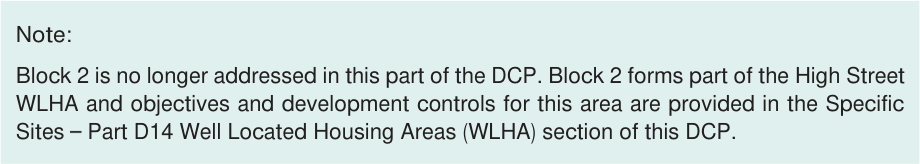

### 2.3. Block 2: High Street/Blenheim Street

> [Picture on page 14: a picture, saved as a picture (images/part-d9-randwick-education-and-health-specialised-page-14-2.gif, 150 dpi).]

Note: Block 2 is no longer addressed in this part of the DCP. Block 2 forms part of the High Street WLHA and objectives and development controls for this area are provided in the Specific Sites

– Part D14 Well Located Housing Areas (WLHA) section of this DCP.
