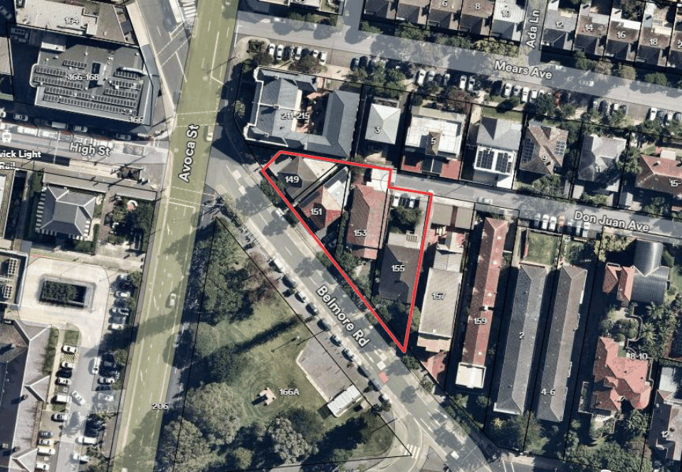
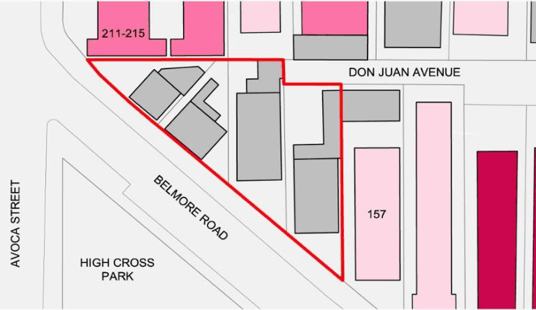
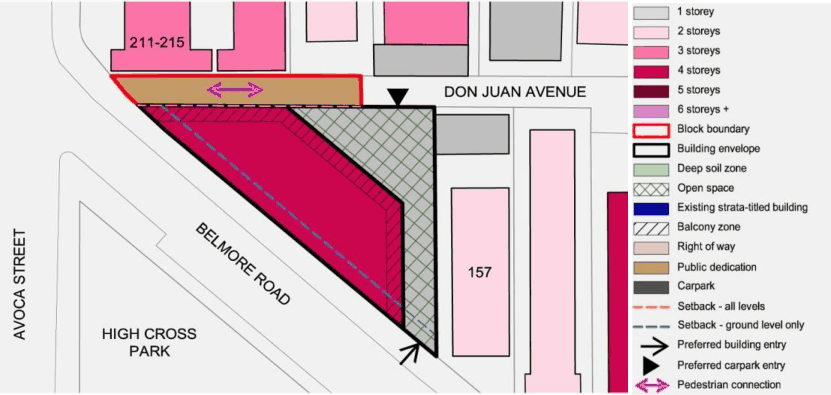
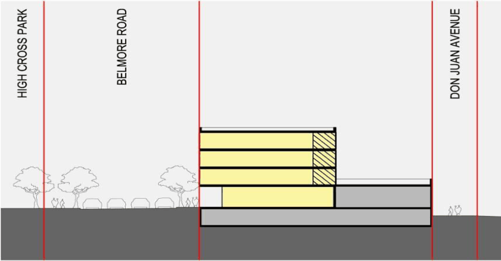
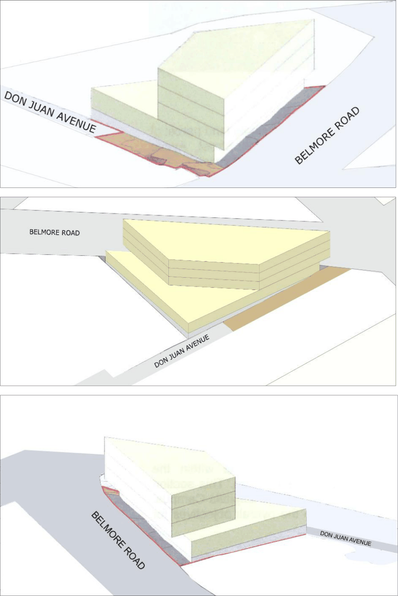

### 2.4. Block 3 – Belmore Road / Don Juan Avenue

Description Block 3 is triangular in shape and is bound by Belmore Road to the southwest, the terminus of Don Juan Avenue to the north, a pair of two storey heritage listed late Victorian Terraces ‘Hygena’ and ‘Corona’ to the north currently used as lodging accommodation, and a two-storey residential flat building to the south east. There are four existing single storey detached houses within the block - three comprising health services. The block is opposite to High Cross Park. The block falls approximately 1 to 2 metres from the intersection of Avoca Street / Belmore Road along Belmore Road.

Figure 3: Block 3

> [Picture on page 15: a picture, saved as a picture (images/part-d9-randwick-education-and-health-specialised-page-15-12.gif, 150 dpi).]

Objectives The objectives for block 3 are to:

1\. Create a strong built edge to Belmore Road

2\. Provide a pedestrian connection from Belmore Road to Don Juan Avenue

3\. R

espect and enhance the heritage value of ‘Hygena’ and ‘Corona’ located adjacent to the block

4\. Provide an active street frontage to Belmore Road at ground floor.

Controls

a) Building Envelope Plan:

i. The building envelope plan shows the maximum envelope including balconies, but excluding the roof structure and envelope. DAs are to demonstrate that the proposed building fits within the envelope

b) Building Height:

i. RLEP identifies a maximum height for this block of 15m. Building envelope illustrations show 4 storeys, excluding the roof envelope and structure

ii. Any habitable roof space provided above the maximum building envelope must be setback an additional 4 metres from the building frontage along Belmore Road

c) Amalgamation:

i. All existing individual lots will need to be amalgamated and comprise a single development in order to achieve the maximum building envelopes and building heights

d) Building Depth:

i. 18m maximum above ground floor

Figure 4: Block 3 - Existing site plan

> [Picture on page 16: a picture, saved as a picture (images/part-d9-randwick-education-and-health-specialised-page-16-19.gif, 150 dpi).]

e) Building Uses:

| Ground floor | Health services facilities. |
|---|---|
| First floor and above | Residential / Health services facilities. |
| f) Mix: |  |
| i. For any proposed residential uses, provide the following mix of dwellings: |  |
| Studio | 50% maximum. |
| 1 Bed | 50% maximum. |
| 2 Bed | 50% maximum. |
| 3 Bed | No requirement. |

g) Parking and access:

i. Access to parking is to be provided via Don Juan Avenue. All parking is to be provided in a basement level, located under the building footprint

h) Open space:

i. Refer to section C2: Medium Density Residential uses for open space and landscaping requirements for any residential component

i) Setbacks:

i. Comply with the setbacks in the table below, and as illustrated on Figure 13

| Frontage | Setback |  |
|---|---|---|
| Belmore Road | 3m 0m | Ground floor. First floor and above. |
| East Boundary | 0m 6m | Ground floor podium. First floor and above. |
| North Boundary | 6m wide land dedication to align with Don Juan Avenue. |  |

j) Public dedication/public access

ii. A public dedication is to be provided in the form of a 6 metre wide pedestrian laneway extension to connect Don Juan Avenue to Belmore Road. (An easement for public access may be considered in lieu of dedication).

Figure 5: Building envelope plan

> [Picture on page 17: a picture, saved as a picture (images/part-d9-randwick-education-and-health-specialised-page-17-12.gif, 150 dpi).]

Figure 6: Building envelope sections

> [Picture on page 17: a picture, saved as a picture (images/part-d9-randwick-education-and-health-specialised-page-17-14.gif, 150 dpi).]

Figure 7 Block 3 - Illustrative 3D envelopes

> [Picture on page 18: a picture, saved as a picture (images/part-d9-randwick-education-and-health-specialised-page-18-2.gif, 150 dpi).]
