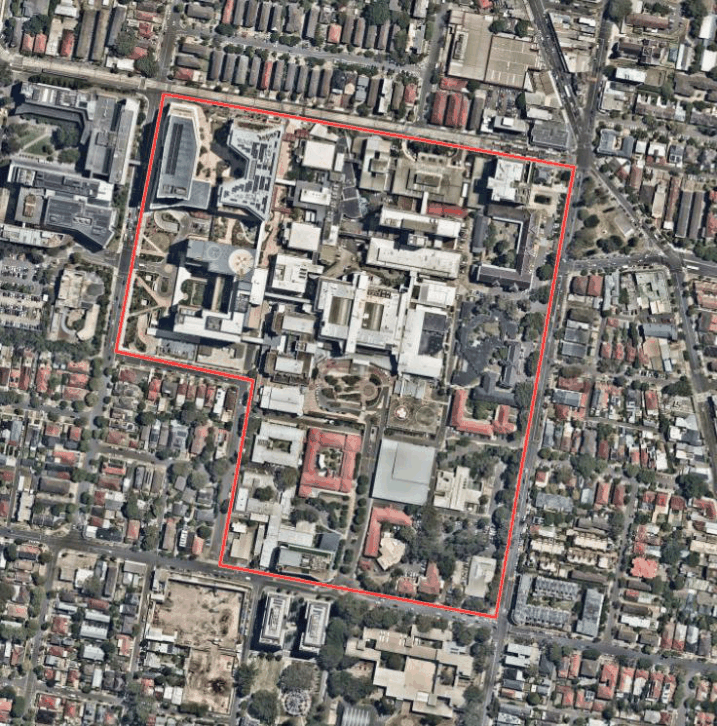

## 3. Randwick hospitals campus

### 3.1. Introduction

The Randwick Hospitals Campus is a major site within the Randwick Education and Health Specialised Centre. This sub-section includes objectives and controls specific to the Hospitals Campus that should be considered in addition to the overall objectives for the Specialised Centre.

Figure 8: Randwick Hospitals Campus

> [Picture on page 19: a picture, saved as a picture (images/part-d9-randwick-education-and-health-specialised-page-19-8.gif, 150 dpi).]

Site description The Randwick Hospitals Campus comprises a single land parcel of approximately 13.26 hectares, bordered by high Street, Avoca Street, Barker Street and Hospital Road in Randwick. The campus is a seven day a week, 24 hour per day operation with large volumes of people, vehicles, equipment and supplies moved around the campus There are four major hospitals on the site, being: the Prince of Wales Hospital, Sydney Children’s Hospital, Royal Women’s Hospital and Prince of Wales Private Hospital. These comprise the largest complex of teaching hospitals in Australia providing comprehensive health services ranging from specialised state-wide tertiary health services to metropolitan, local and community outreach services. In addition, the site has a major medical research presence, including a Neuroscience research precinct.

Background: Master planning process Preliminary masterplan principles for the Randwick Health Campus were commissioned and endorsed by the South East Sydney and Illawarra Area Health Service (SESIAHS) in 2008, concurrent with a broader precinct planning exercise being undertaken for the Randwick Education and Health Specialised Centre. These principles recognise that planning for the campus is a complex and ongoing process, with campus decisions requiring a balance between clinical and operational requirements, available resources, community and stakeholder expectations, and site opportunities and constraints. These Principles form the basis of this section of the DCP.
