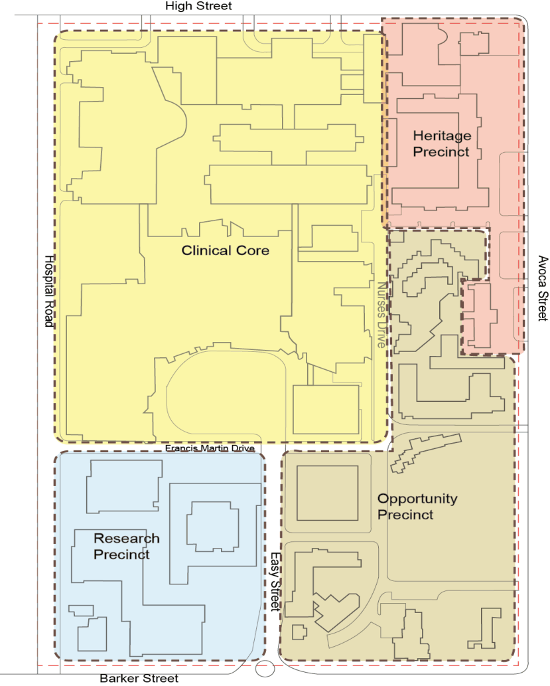

### 3.3. Master plan principles

While the Randwick Health Campus is long established on this site, incremental development has proceeded without the benefit of a master plan. A masterplan provides a framework for planning review of complex and potentially conflicting opportunities on site.

Objectives The objectives for the master plan principles are to:

1\. Optimise campus potential with a shared view for all organisations on the overall development framework

2\. Provide a context for testing strategies and options to accommodate short, medium and long-term needs

3\. Support a staged implementation program within capital and investment constraints

4\. Define a broad campus planning framework, identifying key campus-wide opportunities and improvements to be achieved via new development.

Masterplan Principles All DAs on the health campus are required to address the seven master plan principles described below:

1\. Define campus activities and functional zones

2\. Provide strong logic and legibility

3\. Incorporate efficient access and circulation

4\. Provide pleasure, interest and delight

5\. Build in flexibility and robustness

6\. Address safety and security

7\. Relate to the wider community.

1\. Define Campus Activities and Functional Areas Clearly identified campus activity or functional zones contribute to service delivery efficiencies and legibility. The Randwick Health Campus comprises four key activity areas as illustrated on Figure 9 below. Clinical Core The clinical core is the central service hub of the campus. It comprises the four hospitals (Prince of Wales Public, Sydney Children’s Hospital, Royal Hospital for Women, Prince of Wales Private) and a broad range of services and activities, which are key destinations for a range of staff, patients, service providers and visitors.

Figure 9: Campus functional areas

> [Picture on page 22: a picture, saved as a picture (images/part-d9-randwick-education-and-health-specialised-page-22-2.gif, 150 dpi).]

Research precinct The research precinct accommodates the main research related activities on the campus plus an acute mental health facility. The Randwick Ambulance Station is located in the south western corner of the precinct Heritage precinct The precinct comprises the Edmund Blackett Building, the Medical Superintendent’s Cottage, the Catherine Hayes Building, surrounding fences and associated curtilage forming this significant heritage precinct. It supports a range of community health activities, meeting/teaching spaces and administrative functions.

Opportunity precinct The southeastern corner of the site is currently occupied by a range of support activities including children’s medical services, a childcare centre, residential accommodation (Ronald McDonald House) and administrative functions. Some of these functions are directly related to activities in the core campus precinct.

2\. Provide strong logic and legibility A clear sense of orientation helps to navigate around a complex group of buildings. Opportunities for orientation to recognisable features such as a significant landmark, a park, distant view or street should be incorporated into major entries, circulation nodes and public areas.

3\. Incorporate efficient access and circulation Access and circulation around the campus is complex and multi-layered. It incorporates the internal movements of people and goods, their different purposes, and the different clinical categories of emergency, critical and non-critical. It also includes external movements at access and entry points, and the external travel paths of pedestrians, cyclists and vehicles. A well-functioning campus will have an accessible, clear and legible movement network, with linked related functions, separation of incompatible routes and users, and prioritisation of emergency/critical movement.

4\. Provide pleasure, interest and delight The nature of the physical surroundings and the experience of arriving there can have a major impact on the wellbeing and peace of mind of patients and their loved ones, and on the effectiveness of staff charged with their care. Open spaces, external views, access to daylight, fresh air and gardens can provide positive well-being outcomes for all users. Incorporation of art, colour and finishes can provide interest, and help to break down a hospital’s institutional character.

5\. Build in Flexibility and Robustness Both medical and building technologies are rapidly changing. The organisational structure of the hospitals and their departments may well change. Buildings and spaces provided now should be designed with future adaptation in mind. In such a changing environment some spaces may be regularly in need of alteration and adaptation. Some may need considerable modification to house complex equipment with significantly different dimensions and service needs while other areas such as wards may remain much the same only housing a different classification of patient.

6\. Address Safety and Security While on the one hand the hospitals aim to welcome all people with a valid reason to be on the campus, on the other there is a duty of care to protect patients and staff from harm and an interest in protecting buildings and equipment from vandalism or theft. This is a particular issue at night when the hospitals are still functioning. Inpatients and their carers deserve the same level of security but the level of activity around the hospital is greatly reduced and hence there is a reduced level of passive surveillance.

7\. Relate to the wider community Fulfilling its role as a regional centre of excellence. Being a ‘good neighbour’, serving the medical needs of the local community; exploring ways in which it can share resources with the local community, exploring its links with UNSW both physically and intellectually as a learning and research venue. There are opportunities to introduce greater permeability, while being mindful of the operational and safety needs of the campus.
