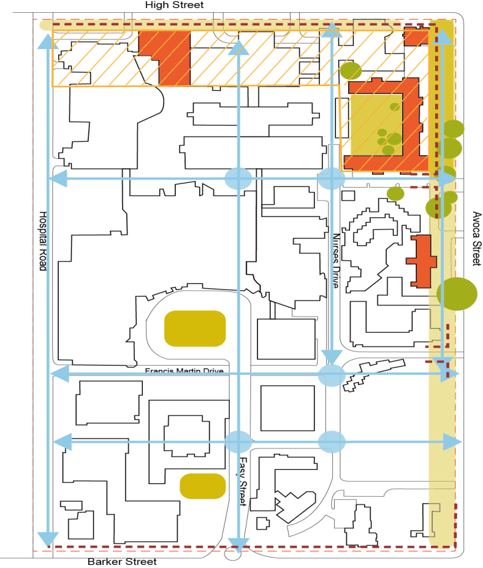

#### 3.4.2. Site planning

Explanation A holistic approach to site planning will guide appropriate siting of facilities in relation to their surrounds, improved coordination of access, servicing and circulation, and preservation of key campus connections, open spaces and landscaped areas.

Objectives The objectives for site planning are to:

1\. Establish clear site planning criteria that can apply to changing health services needs while providing consistent and complementary relationships with the surrounding uses, adjacent properties and public domain

2\. Identify long term opportunities for key campus connections and open spaces to be incorporated with campus development

3\. Ensure small scale, incremental or staged development positively contributes to the overall function of the campus

4\. Achieve a clear hierarchy and definition of gateways and connections between the external and internal circulation networks.

Controls

a) Development involving new buildings or extensions to existing buildings shall meet the street setback requirements below. Exceptions may be considered for primary public entry points and associated awnings/ canopies, or architectural features, or at locations of campus entries/internal street connections with the public domain

i. Street front Setbacks:

- High Street: 6m,

- Otherwise to align with existing building frontages as noted in Figure 10

b) Avoca Street: to align with the primary frontages of the Catherine Hayes and Edmund Blackett Buildings

c) All development shall ensure that the opportunity to achieve key campus connections, public domain/landscaped areas and open spaces is maintained or improved

d) Large scale developments shall provide any campus connections, nodes, public domain/landscaped areas and open spaces within or adjacent to the development footprint

e) Provide high quality design of key campus connections, landscaped areas and open spaces.

Figure 10: Site planning principles

> [Picture on page 26: a picture, saved as a picture (images/part-d9-randwick-education-and-health-specialised-page-26-2.gif, 150 dpi).]

Notes

• Provide a primary active frontage to High Street and Avoca Street

• High public interface area shown hatched

• Orange buildings denote precedent for alignment of building street setbacks

• Green areas are significant existing open space areas, significant trees and gardens to be preserved and incorporated into the circulation network

• Blue grid denotes the preferred primary circulation and open space network, with key connections to campus boundaries.

• Connections at campus boundaries provide opportunities for enhanced main entries

• Landscaping shall be provided along the primary circulation network, and link to existing landscaped areas

• Blue circles denote potential nodes to be reinforced as orientation devices, providing views to key spaces and corridors, and including access to daylight and open space

• Development fronting Barker Street shall provide an active frontage at street level

• Enhance the pedestrian connections along Hospital Road, and provide a continuous accessible footpath
