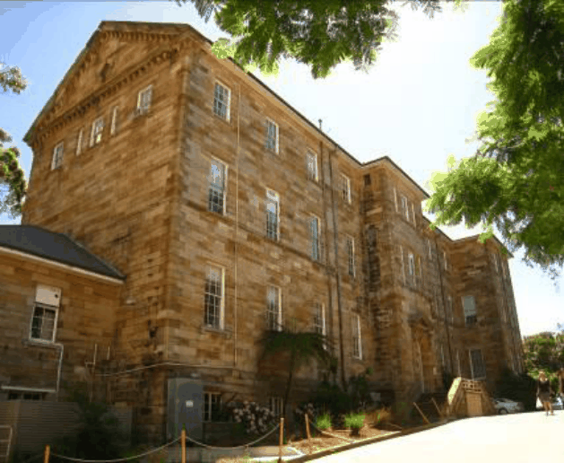
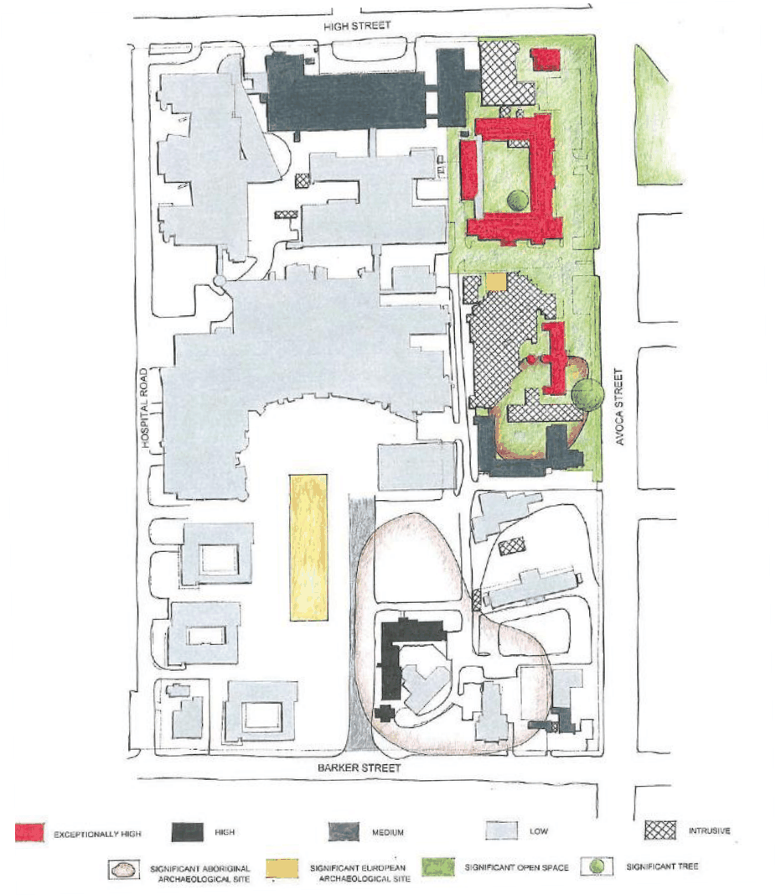

#### 3.4.3. Heritage conservation

Explanation The Randwick Hospitals Campus contains several items of state heritage significance. Development on the site dates back to the 1850’s with construction of the Destitute Children’s Asylum (now known as the Edmund Blackett Building). The buildings fronting Avoca Street and High Street are part of a significant precinct, and the High Cross Park Heritage Conservation Area extends into this Heritage Precinct of the Campus. This sub-section should be read in conjunction with the Heritage Section of the DCP.

> [Picture on page 27: a picture, saved as a picture (images/part-d9-randwick-education-and-health-specialised-page-27-9.gif, 150 dpi).]

Catherine Hayes Building, Avoca Street

Objectives

1\. To conserve, manage and interpret the heritage significance of the hospitals campus, heritage conservation area and its items of heritage significance

2\. To manage built, landscape and archaeological components, historic views and spaces in accordance with their assessed significance

3\. To ensure new development respects and enhances the heritage significance of the site and its setting

4\. To actively interpret and promote the heritage values of the site.

Controls

a) Conserve and manage heritage components identified in Figure 11

b) Re-establish the formal Avoca Street frontage.

Note: Refer also to the Heritage Chapter in Part B - General Controls for further detail on the High Cross Park Heritage Conservation Area and requirements for development of or near heritage items.

Figure 11: Heritage significance of elements in the Hospitals Campus

> [Picture on page 28: a picture, saved as a picture (images/part-d9-randwick-education-and-health-specialised-page-28-2.gif, 150 dpi).]

Source: Randwick Hospitals Conservation Management Plan, prepared by Graham Brooks and Associates for NSW Health
