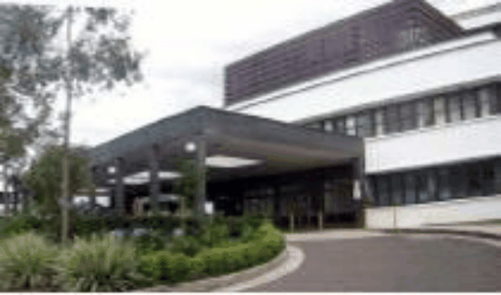
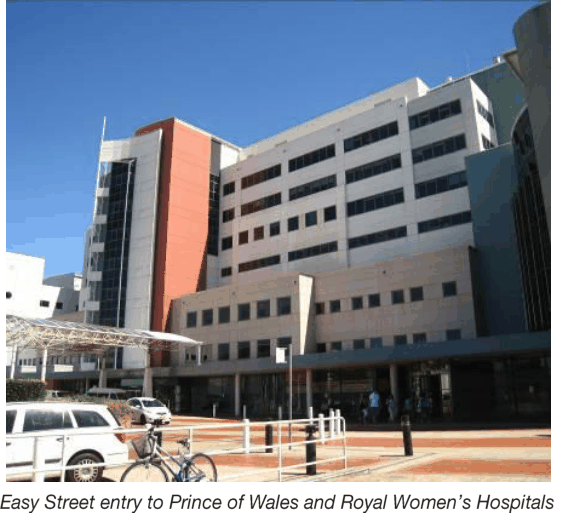
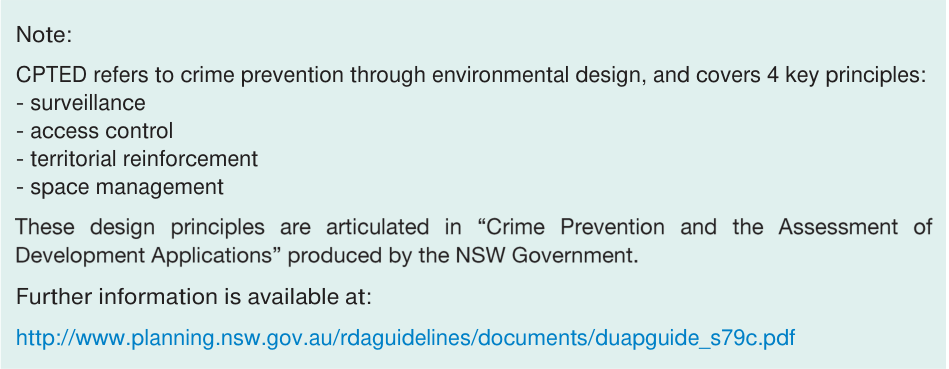

#### 3.4.5. Built form

Explanation Existing development on the Hospitals Campus comprises a wide variety of built form, with varying heights, floorplates and envelopes reflecting their different uses, and the evolution in healthcare facilities over time. Future development has the opportunity to improve the coherence, legibility and scale relationships of buildings within the Campus. RLEP contains maximum height controls for the perimeter of the Campus. These objectives and controls provide further guidance for the built form of all buildings within the Campus.

> [Picture on page 29: a picture, saved as a picture (images/part-d9-randwick-education-and-health-specialised-page-29-24.gif, 150 dpi).]

High Street entry to Prince of Wales Hospital Objectives

1\. To integrate new buildings consistent with the siting, form, scale and character of existing heritage components and their setting

2\. To relate the design, siting and scale of new buildings to the wider context beyond the campus boundaries

3\. To establish a consistent/coherent scale and building alignment on Avoca Street, with specific reference to the Edmund Blackett Building

4\. To achieve high quality design that balances the institutional nature of the use with human scale

5\. To provide a safe environment for staff, visitors and patients.

> [Picture on page 30: a picture, saved as a picture (images/part-d9-randwick-education-and-health-specialised-page-30-4.gif, 150 dpi).]
> Words printed on the picture (title and legend, copied from the PDF):
> Easy Street entry to Prince of Wales and Royal Women’s Hospitals

Controls

a) Provide covered entries such as awnings, canopies or porte cocheres to main entries of all public facilities

b) Minimise large expanses of blank walls through articulation, fenestration, use of a variety of materials and construction details

c) Building expression at ground floor level shall relate to the human scale through inclusion of windows where possible, and clear horizontal articulation of building elements and storeys

d) Roof design shall minimise the visual bulk of services and plant

e) Incorporate passive surveillance and CPTED design principles, especially in 24-hour operational areas.

> [Picture on page 30: a picture, saved as a picture (images/part-d9-randwick-education-and-health-specialised-page-30-16.gif, 150 dpi).]
> Words printed on the picture (title and legend, copied from the PDF):
> These design principles are articulated in “Crime Prevention and the Assessment of
> Development Applications” produced by the NSW Government.

Note: CPTED refers to crime prevention through environmental design, and covers 4 key principles:

- surveillance

- access control

- territorial reinforcement

- space management

Further information is available at: http://www.planning.nsw.gov.au/rdaguidelines/documents/duapguide_s79c.pdf
