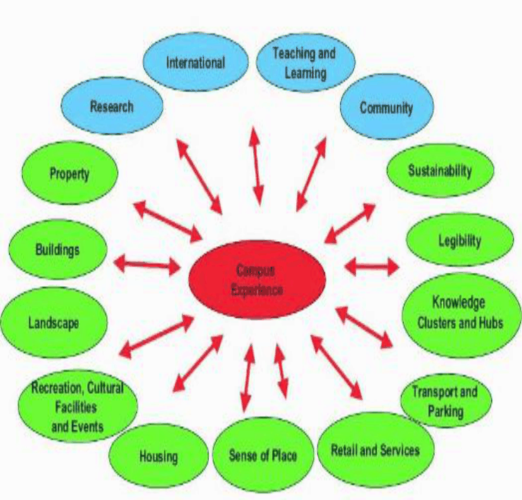
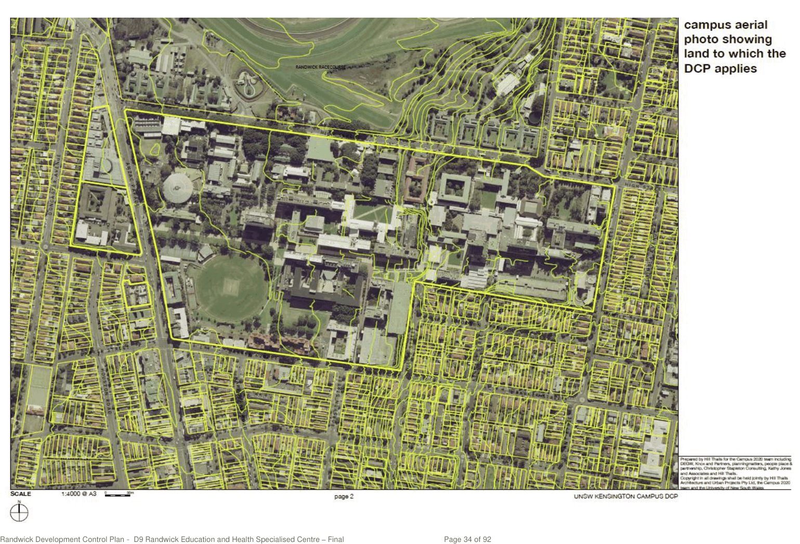

#### 4.1.2. Strategic framework: campus experience

The University of New South Wales (UNSW), one of Australia ’s foremost academic institutions, has its principal campus at Kensington. In 2004 the University commissioned the Campus 2020 Master Plan as the opportunity to address a range of strategic issues looking toward 2020. The Campus 2020 Master Plan complements the broader UNSW Strategic Plan 2005 that focuses on UNSW’s vision, purpose, values and priorities (guiding principles):

• Teaching and learning

• Excellence in research

• International engagement

• Community interaction. The Master Plan process commenced with a Strategic Brief that identified the elements that contribute to the success of UNSW. These include the guiding principles and the concept of “Campus Experience” , the built form and landscape, together with the sense of place and experience of the site, that all combine to create a positive experience of the campus that draws staff, students and visitors to the University, and satisfies their needs and aspirations. The vision for Kensington Campus, as set out in the Master Plan, is to create a high quality university campus that facilitates the achievement of the guiding principles by focusing on the

concept of a positive Campus Experience. This focus provides a basis for the University to develop the campus to its optimal capacity while maintaining and enhancing its character, and also responding to its strategic location between three town centres, a major hospital complex and recreation facility, near the Sydney CBD and the airport. The diagram below shows the elements of Campus Experience that the Campus 2020 Master Plan Team identified at the Strategic Brief stage to direct the detail of the Master Plan. The blue elements are common priority goals from the UNSW Strategic Plan. The green elements resulted from research, information collation, consultation and feedback.

> [Picture on page 33: a picture, saved as a picture (images/part-d9-randwick-education-and-health-specialised-page-33-9.gif, 150 dpi).]

4.1.3. Key design features of campus 2020 To achieve the vision and guiding principles, to improve the Campus Experience, the Master Plan contains the following key design features:

• A commitment to sustainability in the planning, design and management of all new buildings

and other improvements and encompassing all of the University’s operations

as described in the UNSW Environment Policy and Environmental Management Plan

• An explicit desire to reinforce the sense of place, inspirational and valued spaces that draw people to the campus, extend their stay and linger in their memory after they have left, giving the campus a competitive edge

• A safe and legible network of paths, shared ways and campus streets that innately guide movement around the campus, in particular connecting campus entrances, gathering spaces and “public rooms”

• Identification of lively Hubs in specific locations with sufficient density and range of uses to enable them to become key destinations and activity centres fostering the informal and formal interchange of ideas and shared learning

• Encouragement of the formation of Knowledge Clusters of Schools and Faculties around Hubs to promote synergies and encourage collaboration in teaching and research

• Identification of new open spaces and related building opportunities to increase the capacity and amenity of the campus, particularly along High Street, at major campus entrances and at Hubs

• Improvement of the landscape quality of the campus by identifying and protecting significant plantings, redefining and improving existing open spaces, re-evaluating campus boundaries and ensuring the landscape character reflects the aspirations of the campus community

• Definition of key building alignments/setbacks and heights to establish, reinforce and protect the legibility and amenity of the campus, its Hubs, landscaped open spaces and outward presence to the community

• Expansion of housing on campus, particularly along High Street, to increase the sense of community, increase patronage of campus services and reduce transport costs and impacts

• Preferred locations for retail and other services such as child care to support the social life of the campus

• Encouragement of the extension and better management of recreation and cultural facilities and events

• A major re-evaluation of the approach to transport and parking that will over time reduce both on-site and on-street parking in favour of improved public transport and encourage walking and cycling

• Identification of key architectural design elements and types to promote high quality architecture which is fit for purpose, responsive to future needs and embodies the principles of sustainability.

> [Picture on page 35: a picture, saved as a picture (images/part-d9-randwick-education-and-health-specialised-page-35-1.gif, 150 dpi).]
