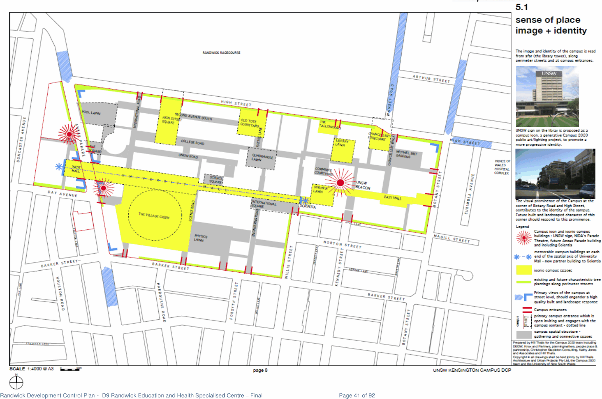

#### 4.2.2. Sense of place

The sense of place of UNSW is to be reinforced to improve its identity and inspirational role for positive memories of campus life. Certain physical features already characterise the campus, such as significant buildings (e.g. Scientia, Library, Red Centre, Roundhouse) and spaces (e.g. University Mall and its entry on Anzac Parade, Library Lawn), the “UNSW” sign on the Library and the strong presence of fig trees on Anzac Parade and High Street. These important features need to be respected as the campus evolves. They will also be supplemented with new memorable places and ensembles to create a high quality campus environment within the Randwick context and to generate memorable experiences, both of which will improve the campus’ competitive edge.

Objectives

1\. Create a strong sense of place for the campus which relates to both its prominence and character within its local context, and to particular characteristic features or spaces on the campus itself, which are valued and draw people to the campus, extend their stay, increase their sense of connection, linger in their memory, and increase their pride in the campus

2\. Create a sense of place which maximises the character of the campus but also ensures that it is seamless in terms of its public domain spatial structure and accessibility to/from its local neighbourhood

3\. Establish a sense of place which emphasises arrival, memorable buildings and landscapes, vistas, topography, vegetation, a legible, safe and “green” campus, and a wide variety of culturally relevant and inspiring public art.

Controls

a) The key features which define sense of place to be protected and promoted in all future development are identified on Figure 5.1. These focus on:

i. identification of the campus from afar, such as the building silhouettes and icon signage

ii. perimeter tree planting

iii. the sense of arrival, particularly along Anzac Parade, High Street and Botany Street

iv. primary entrances from all streets

v. major existing and new gathering places

vi. the network of connective spaces

b) The achievement of sense of place is also based on the pursuit of the issues and provisions of other campus design principles, particularly Legibility, the “public rooms” and specific characters of each Hub, Landscape, Buildings, Retail and Recreation and Cultural Facilities

c) The interface of the campus with the surrounding community also determines its sense of place. The desired future character of these interfaces are to be as follows: Anzac Parade

• Distinctly passing through the campus; differentiated from the “built to property line” development of the adjacent town centres of Kensington and Kingsford

• Buildings to be set back from the street within a pattern of buildings/open space, especially at the extended University Mall that is to unite the divided campus

• Existing major trees to be retained, as set out in 4.2.5

• Pedestrian crossing to be at grade and of a distinctive hard-wearing material that signifies the University

• Additional trees to be added to median opposite University Mall

• New small footprint towers, of quality architecture and appropriate form, sited to avoid adverse environmental effects, to mark the UNSW gateway at University Mall, including icon building

• Mainly public/university uses at ground level; potential for university housing at upper levels, including for accommodation for visiting students, academics and staff of educational institutions and their families.

West Kensington Residential Interface

• Lower buildings to be set back from the boundaries to provide a transition to adjoining residential scale and minimise adverse environmental impacts

• Existing major trees on campus to be protected as set out in 4.2.5. High Street

• Improve frontage with major new buildings that are to define major new gathering spaces

• Variety of uses including university, housing and publicly accessible facilities

• Numerous new entries to relate to public transport and north-south connections to campus Hubs

• Buildings to be set back to maintain existing mature trees as noted in 4.2.5

• Building heights to optimise capacity, northern aspect and views. Botany Street

• Major buildings to define frontage, particularly High/Botany Street corner

• Extended East Mall to create new major eastern entry to campus (with possible future extension to hospital complex).

Barker Street

• Predominantly residential frontage with an increased scale of building

• Existing entries to be reinforced

• Landscaped set back to frontage.

Willis Street

• Residential uses up to 4 storeys at street edge above university uses at lower levels

• Uses at street level to engage with street

• Landscaped set back to frontage.

d) Other physical elements important to be reinforced for sense of place are topography, significant buildings and spaces including the Old Tote Courtyard Heritage Conservation Area (HCA), views and prospect, and existing trees

e) The design of individual capital works projects are to detail how these characteristics and features will contribute to the desired sense of place.

Note: The specific controls to achieve these characters are detailed in subsections 4.2.3, 4.2.5,

4.2.6 and figures, 5.2, 5.6b, 5.7, 5.8 and 5.9.

> [Picture on page 42: a picture, saved as a picture (images/part-d9-randwick-education-and-health-specialised-page-42-1.gif, 150 dpi).]
