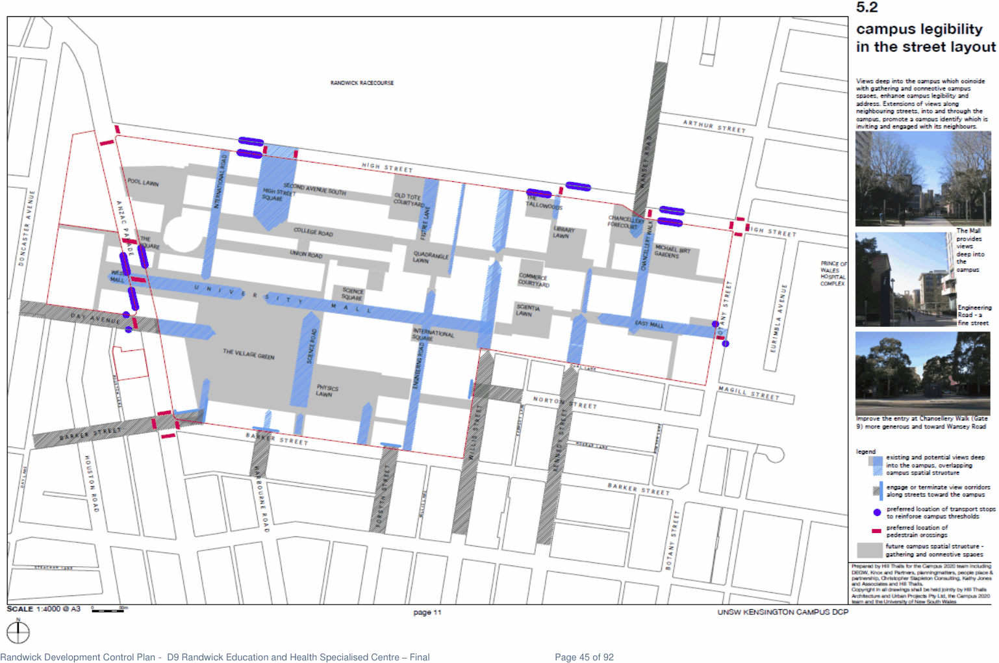
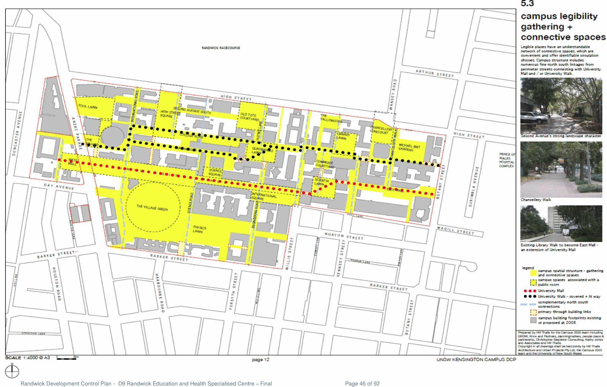
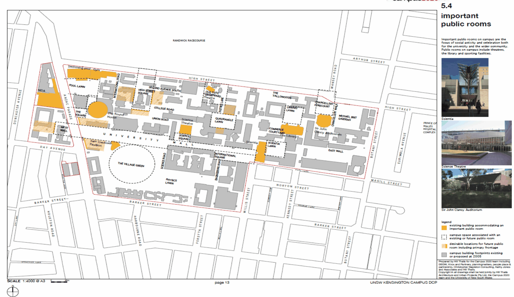

#### 4.2.3. Legibility

The legibility of the campus relates to its overall spatial structure, particularly the pattern of open spaces and the clarity of the network of paths, shared ways and campus streets that innately guide movement and orientation. Legibility is to be reinforced by a series of spaces:

• major gathering spaces

• supportive gathering spaces

• connective spaces for movement around the campus

• contemplative places for quiet retreat and relaxation. These will increase the quantum of open space, provide new foci in the spatial structure and life of the campus, and emphasise campus entrances. Clear connections between campus entrances and functional areas are fundamental. The pattern of buildings, especially their alignments and ground floor uses, also help to define legibility. Objectives

1\. Ensure that the legibility of the campus is optimised for the benefit of all students, staff and visitors through:

i. clear and welcoming campus entries/address points and their links to neighbourhood activities and services

ii. public spaces and clear routes evenly distributed throughout the campus within a grid of north-south and east-west links

iii. clear definition of public and private spaces

iv. achievement of good sight lines and visual connections

v. high quality consistent signage across the campus

2\. Provide a campus public domain which appropriately serves its various functions, such as gathering places, connections/ circulation spaces, recreation activities and green spaces

3\. Ensure that buildings define and address the public domain in a manner which is appropriate for the specific location and function of the building and public space

4\. Achieve equity of access across the campus through identifiable and dignified routes for people with disabilities

5\. Provide generous and robust connective campus spaces, to realise high quality pedestrian spaces which also accommodate the requirements of slow speed emergency and service vehicles.

Controls

a) New projects are to maintain and enhance the views into the campus identified in Figure 5.2 to ensure the legibility of the campus in the street layout

b) Major and minor entries to the campus, and the varying permeability of campus boundaries, are to be achieved as identified in Figures 5.1 – 5.3

c) New development and refurbishment projects are to over time achieve the pattern of public domain identified on Figure 5.3 which comprises a network of well defined major gathering spaces and a grid of smaller connective spaces which link the gathering spaces and campus entrances

d) The boundaries of most existing spaces are well defined by building alignments or landscape elements, however those of new spaces are to be subject to refinement during further design studies. These aspects are further documented in Figures 5.6b,

5.7 and 5.8

e) Major new gathering spaces, as set out below, are to provide new public open spaces and refine the spatial pattern and built form (see Figure 5.3) Refer also Hubs (4.2.4) and Landscape (4.2.5)

i. An extension of University Mall to the west of Anzac Parade, “West Mall”, as a key structuring element for the campus as a whole, the detailed design and functioning of the western campus, and improving the address and landscape character of the Anzac Parade interface

ii. An improved entry square on Botany Street at Gate 11 as “East Mall”, to provide a major eastern address and campus-community interface, to increase the connectivity of University Mall as a continuous east-west link and encourage a future connection through to the hospital complex. This square has greater potential if vehicle access is removed and future redevelopment of buildings is focused on the space

iii. A new “High Street Square” at Gate 2 to provide a major focus for lower campus and a new gateway as a campus-community interface, based on existing fig trees, Io Myers Theatre, future new housing, cultural and academic uses, solar access, a green park, and vehicle access

iv. An enlarged square at Old Tote Courtyard to provide a major focus for future housing and new gateway as a campus-community interface, capitalising on the existing figs, heritage buildings, theatre and community uses

v. An upgraded entry space, “The Tallowoods”, to provide a direct connection to Library Lawn and the Morven Brown Courtyard from the bus stops at Gate 8 on High Street maximising the benefits of the existing trees and the prospect to the CBD

vi. A new focus on Chancellery Forecourt at Gate 9 to emphasise its entry and ceremonial importance

vii. A new “Kingsford Gate” as a key to improving the campus address and community interface towards Kingsford, improving sight lines, opening the experience of the Village Green, redeveloping the child care centre and broadening uses in the southwest corner of the campus

f) Gathering spaces are to be joined by a network of east-west links, the enhanced and extended University Mall and University Walk and north-south connections as shown in Figure 5.3

g) Significant places are to be achieved at the intersections of major pedestrian routes by the creation of:

i. a gathering space (see Figure 5.3), and/or

ii. a public room (see Figure 5.4) and/or

iii. a Hub (see Section 5.4 and Figure 5.5)

iv. memorable features such as landscape elements (see Figure 5.6b), building design, uses, and/or public art.

h) A subset of the public domain, including courtyards within buildings, is to be developed as quiet contemplative spaces (see Section 5.5 and Figure 5.6b)

i) Covered access is to be provided along University Walk (refer Figure 5.3), preferably by awnings or colonnades as part of buildings along the route or alternatively as free-standing canopies

j) Lighting of the public domain is to contribute to legibility and ensure safety, with particular emphasis on open spaces at Hubs, University Walk and its intersections with north-south connections, and all routes to campus entrances with public transport stops

k) Paving selections for the connective spaces are to contribute to legibility, with particular emphasis on the routes between Hubs and to campus entrances with public transport stops

l) All new campus projects are to incorporate consistent high quality signage throughout the public domain in accordance with the adopted UNSW Signage Code. Icon signage is to contribute to identification of the campus from afar but not adversely impact on adjoining properties

m) Equal access to the public domain is to be achieved through implementation of the findings of the UNSW Disability Access Audit. This is to include a “shoreline” for the vision impaired through the campus

n) All connective spaces are to provide for service vehicles and emergency access within a generously sized, obstacle free environment compatible for pedestrians and the slow movement of vehicles.

> [Picture on page 46: a picture, saved as a picture (images/part-d9-randwick-education-and-health-specialised-page-46-1.gif, 150 dpi).]

> [Picture on page 47: a picture, saved as a picture (images/part-d9-randwick-education-and-health-specialised-page-47-1.gif, 150 dpi).]

> [Picture on page 48: a picture, saved as a picture (images/part-d9-randwick-education-and-health-specialised-page-48-1.gif, 150 dpi).]
