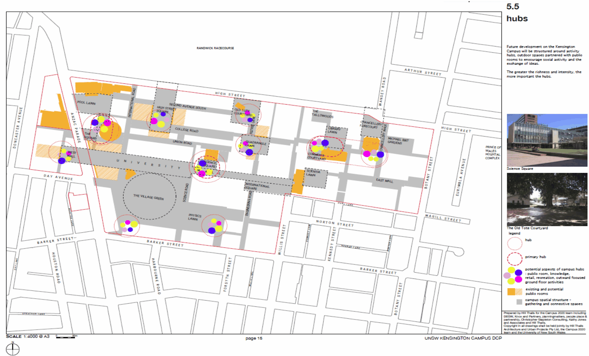

#### 4.2.4. Knowledge clusters and hubs

A fundamental link between research, teaching and learning activities and the physical form of the campus is to be achieved through the concept of Hubs and Clusters. The creation of lively Hubs in specific locations with sufficient density and range of uses, including retail, will form key destinations and activity centres, thereby fostering the informal interchange of ideas and shared learning. Clusters are encouraged around these Hubs by grouping Schools and Faculties that can utilise synergies and share knowledge. Such Knowledge Clusters of teaching and research will occur over time as different disciplines come together. The DCP does not dictate the location and extent of Knowledge Clusters as it does not seek to differentiate academic uses, focussing instead on the physical form and the location of support facilities. Objectives

1\. Encourage informal and formal interchange of ideas and shared learning by structuring the campus around a series of Hubs and Knowledge Clusters

2\. Co-locate Schools and Faculties in Clusters around Hubs to promote synergies and encourage collaboration in teaching and research, in inter- and multi-disciplinary contexts rather than “learning silos”

3\. Establish sufficient density and range of uses at Hubs to enable them to become key destinations and activity centres on campus with environmental, economic, social and academic benefits

4\. In areas dominated by housing and student association facilities, Clusters may be mainly non-academic but should be diversified where possible to include a range of uses to encourage social interaction.

Controls

a) The identified Hubs for the concentration of key activities are documented in Figure 5.5. The location of Clusters is to be focussed on the Hubs

b) Hubs are to consist of a collection of uses and spaces, including:

i. a “public room” such as a theatre, auditorium, hall or exhibition space

ii. a range of retail outlets, particularly food and beverage as a fundamental economic and social driver

iii. a gathering space with active ground floor

iv. at least one major connective pedestrian link

v. preferably also an intersection of north-south and east-west pedestrian links

vi. e-learning spaces

vii. wireless connectivity

viii. branch libraries or electronic access to library services

ix. other student services

x. indoor and outdoor ‘free’ seating not associated with retail facilities

xi. CATS (centrally allocated teaching space) and lecture rooms in close proximity

xii. address points of Faculties and Schools around or in close proximity to a gathering space.

c) Primary Hubs already exist. These are to be refined with increased diversity of uses, refined layouts, and improved design quality (see also 4.2.8).

d) Other Hubs are to be consolidated/enlivened or emerge as redevelopment occurs: Library/Commerce Courtyard The Library/Commerce Courtyard is the acknowledged Hub of the University. It contains most of the features identified above. The proposal for a one-stop-shop student centre for part of adjoining Goodsell Building would support this Hub. Roundhouse/Blockhouse/Squarehouse This area could improve its role as a Hub, by adjusting its layouts to its changing context (e.g. new Law School, new development potential and proposed new open spaces and pedestrian routes), considering the impacts of voluntary student unionism. Science Square This Hub could be upgraded by increasing the active edges and visual transparency to the academic buildings which define the space, improving the entry to Science Theatre, providing more ‘free seating’ and improving the pedestrian link to University Walk. The Quadrangle Opening the ground floor of the Quadrangle Building for retail, other services and public facilities to face the Quadrangle Lawn and encourage its use would establish more activity at the intersection of University Walk, College Road and Fig Lane. This Hub could also include an active frontage on the north side of College Road expanding the Cluster to include residential uses and improve the relationship with Goldstein Hall. Old Tote Courtyard With redevelopment of the High Street edge of the campus, a new public open space characterised by the fig trees and heritage buildings, focused on University and broader community use of the Fig Tree Theatre, and retail and services including a convenience store, could provide a new Hub as a focus for a proposed housing Cluster. High Street Square With redevelopment of the area around Gate 2, a new Hub is proposed based on a new public open space, a new public room, relocation/ retention/replacement of Io Myers Studio, vehicular access to the campus with short-term kerb side parking to help serve the nearby sports facilities, retail facilities and a child care centre. The Cluster around this Hub could comprise academic and housing uses. Western Campus The redevelopment of western campus, including an extension to

“West Mall” as a

major public space and pedestrian route, student support services, retail and a new “public room” fronting University Mall would be appropriate as another Hub. This Hub could provide a focus for the existing NIDA facility, new academic uses, a possible housing component including accommodation for visiting students, academics and staff of educational institutions and their families. Kingsford Gate With redevelopment of the area to create a new welcoming entrance to the campus from Kingsford, improved and enlarged child care facilities, retail and other student

services would all provide a focus for the housing and recreation facilities within this area. Rupert Myers The establishment of the NSW Graduate Research School in this building, which also includes an under-utilised coffee shop, theatre and courtyard, provides an opportunity to create a focus for Physics Lawn, Old Main Building, Rupert Myers Building and the Barker Street housing edge. Reconsideration of the vehicle route through the courtyard would improve this Hub. Mathews Pavilions and Arcade/Michael Birt Gardens With refurbishment of the Biological Sciences and Wallace Wurth buildings and a new building along the High Street edge, the opportunity arises to create a new Hub between the redesigned Mathews Pavilions and Arcade (see 4.2.8) and the edge of Michael Birt Gardens. Such a Hub could contain retail and student facilities, relate to Gate 9 and Sir John Clancy Auditorium, and provide a focus for the bio-sciences and medical disciplines.

e) A subset of Hubs is to be developed as “night time hubs” with activities which have longer hours and that offer safe and direct access to surrounding streets and public transport. The preferred night time hubs are:

i. Library/Commerce Courtyard

ii. Old Tote Courtyard

iii. Roundhouse/Blockhouse/Squarehouse

iv. Western Campus

v. Rupert Myers

f) All space and building decisions taken by Schools and Faculties are to reinforce the opportunities to create Knowledge Clusters around Hubs expanding the shared learning and teaching spaces, resources and interactions.

> [Picture on page 52: a picture, saved as a picture (images/part-d9-randwick-education-and-health-specialised-page-52-1.gif, 150 dpi).]
