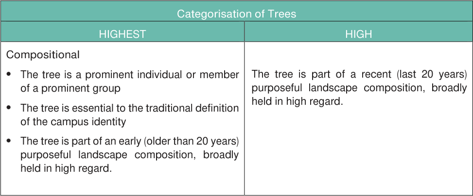
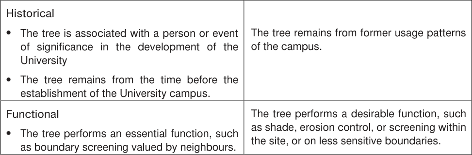
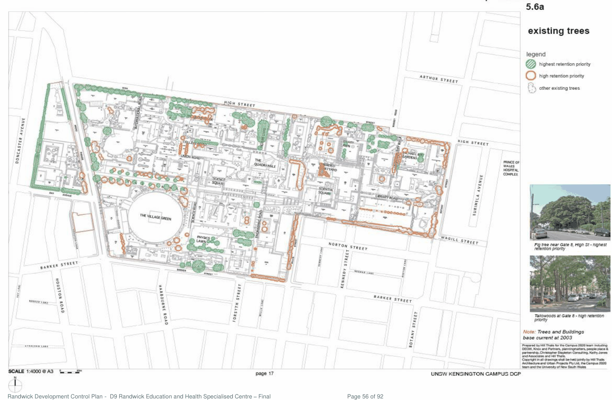
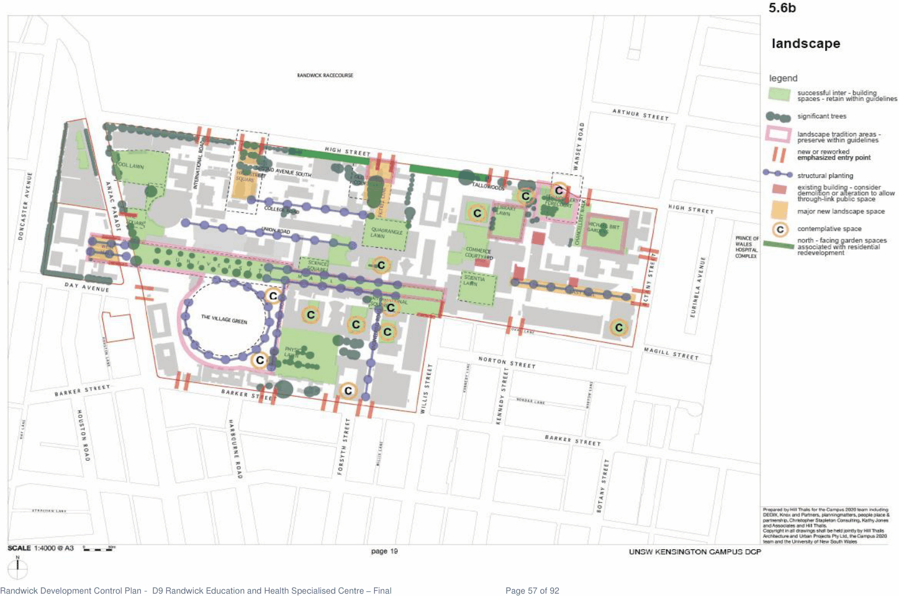

#### 4.2.5. Landscape

The quality of the campus landscape will be enhanced by identifying and protecting significant plantings, redefining and improving existing open spaces, re-evaluating campus boundaries and ensuring the landscape character reflects the aspirations of the campus community. This will be achieved by major new open spaces and incremental refinement of existing landscapes. The landscape design will balance the “greenness” and “urbanity” of the campus with the appropriate provision of hard and soft landscapes. A well distributed range of space types in the public domain is important to the landscape fulfilling its potential:

• busy, urban spaces generally corresponding to gathering and connective spaces

• spaces more associated with active recreation

• quiet, contemplative spaces spaces primarily associated with service functions.

Landscape design also significantly reinforces other principles, particularly the pattern and treatment of spaces which define campus legibility, campus sense of place, quality of recreation spaces, and appropriate landscapes for housing projects and Hubs. Existing Vegetation Vegetation of varying quality is scattered across the campus. The categorisation of trees is based on three groupings of criteria: Compositional

– the role of the tree in the overall composition of the campus

Historical

– the tree as a link to stages before and during the development of the campus

Functional

– whether the tree performs a function which would be difficult to replace.

Within these categories, trees have been rated Highest Retention Priority or High Retention Priority, as explained in the table below. Despite this categorisation, all trees on site are valued and expertly managed, and careful consideration should be required before removal.

Note The most significant elements include various figs (Ficus spp), the poplars in association with the figs on the lower part of University Mall, groups of Tallowoods (Eucalyptus microcorys), and other eucalypts (Eucalyptus saligna, E. grandis, Corymbia citriodora).

> [Picture on page 53: a picture, saved as a picture (images/part-d9-randwick-education-and-health-specialised-page-53-32.gif, 150 dpi).]
> Words printed on the picture (title and legend, copied from the PDF):
> Categorisation of Trees
> HIGHEST
> HIGH
> of a prominent group
> of the campus identity
> purposeful landscape composition, broadly
> held in high regard.

Compositional

• The tree is a prominent individual or member

The tree is part of a recent (last 20 years) purposeful landscape composition, broadly held in high regard.

• The tree is essential to the traditional definition

• The tree is part of an early (older than 20 years)

> [Picture on page 54: a picture, saved as a picture (images/part-d9-randwick-education-and-health-specialised-page-54-1.gif, 150 dpi).]

Historical

The tree remains from former usage patterns of the campus.

• The tree is associated with a person or event of significance in the development of the University

• The tree remains from the time before the establishment of the University campus.

Functional

The tree performs a desirable function, such as shade, erosion control, or screening within the site, or on less sensitive boundaries.

• The tree performs an essential function, such as boundary screening valued by neighbours.

Objectives

1\. Ensure that the landscape of the campus is valued and optimised for its role in the Campus Experience of students, staff and visitors

2\. Conserve and promote the landscape character of the campus by retaining and protecting areas of landscape significance (major trees, vegetation and spaces)

3\. Develop and manage the public domain to optimise:

i. campus circulation and legibility

ii. safety and convenience

iii. creation of focal points

iv. amenity and comfort

v. visual qualities, including pleasure and delight

vi. ecological processes, biodiversity/sustainability

vii. universal access

viii. landscape areas or assemblages as potential research and teaching topics

ix. the collection of special character areas on campus

4\. Reinforce existing strong streetscape amenity and identities along Anzac Parade, High Street, Barker Street and Botany Street, balancing the campus sense of place and its relationship to its neighbourhood setting.

Controls

a) All landscape works and management are to implement the sustainability principles and mechanisms of the EMP

b) New buildings are not to impinge on or harm existing significant trees and areas of vegetation identified in Figures 5.6a and 5.6b, except as set out below. In these locations the existing vegetation is to form the basis of landscape designs

c) Prior to design work for adjoining new developments, the specific root and canopy zone requirements of the vegetation in Figure 5.6a is to be assessed and the needs of the vegetation may be a constraint on development. This vegetation can only be removed based on detailed arborist assessments if there is no other design option, and in conjunction with agreed replacement (including advanced trees) or compensation

strategies only if the trees are non-viable (due to age or disease) and thus require replacement

d) The successful inter-building spaces identified in Figure 5.6b and trees within the Old Tote Courtyard HCA are of such quality that they are to be retained and only improved within clear guidelines and/or related to appropriate changes in surrounding buildings

e) The important landscape tradition areas of University Mall, Village Green, Library Lawn, Old Tote Courtyard and Michael Birt Gardens/ Chancellery Forecourt are to be improved within clear guidelines that retain their design significance in the public domain having regard to contextual changes from surrounding development

f) New campus open spaces (see Figure 5.6b) are to be appropriately landscaped in accordance with their role and position in the public domain pattern and their specific site characteristics

g) Landscape development is to lead toward an optimal distribution of appropriate landscape types. Landscape design is to use successful existing spaces as models for new development

h) Contemplative spaces (see Figure 5.6b) are to have a landscape design appropriate for their role as quiet, relaxation and “retreat” areas, their specific site characteristics and their adjoining uses

i) Landscape design is to be a key aspect of the creation of new entrances (see Figures

5.1 & 5.6b)

j) Garden areas are to be retained or established as a part of all campus residential development, especially along street edges. Along High Street, the garden area could include thinning or selective removal of existing fig trees and paper barks to optimise northern aspect, daylight and direct sun while also maintaining the fig tree character of High Street

k) The campus boundaries are to provide openness and entries, or security or definitional fencing

l) Landscape design and management is to:

i. optimise safety and security by enhancing visibility and sight lines, and eliminating areas of darkness and places for entrapment

ii. provide equal access throughout the public domain implementing the findings of the UNSW Disability Access Audit and service and emergency access to buildings

iii. optimise plant growth, including large trees, by provision of permeable surfaces, deep soil areas and drainage to planted areas, promoting water infiltration and aeration (provision of hard surfaces and their drainage to relate to the UNSW Stormwater Strategy)

iv. incorporate where appropriate infill planting for increasing habitat diversity, and species and assemblages appropriate for academic research and teaching purposes

m) Species selection is to:

i. be ecologically appropriate for the specific site conditions

ii. reinforce the dominant fig tree character of the campus

iii. incorporate other distinctive species, in particular Tallowwoods, Melaleuca quinquenervia and Poplars

iv. develop areas of pre-1788 vegetation of the site (e.g. as Eastern Suburbs Banksia Scrub)

n) New structural plantings are to be provided in key areas as indicated on Figure 5.6b

o) Street tree species on footpaths surrounding the campus are to be as indicated in Council’s Street Tree Master Pla n

p) Expansive areas of pavement are to be permeable in nature wherever possible in order to reduce stormwater runoff, recharge groundwater supplies and to maintain infiltration rates to the root zones of established trees

q) The landscape design of spaces shown in Figures 5.3 and 5.6b is to accommodate informal activities to extend learning areas.

> [Picture on page 57: a picture, saved as a picture (images/part-d9-randwick-education-and-health-specialised-page-57-1.gif, 150 dpi).]

> [Picture on page 58: a picture, saved as a picture (images/part-d9-randwick-education-and-health-specialised-page-58-1.gif, 150 dpi).]
