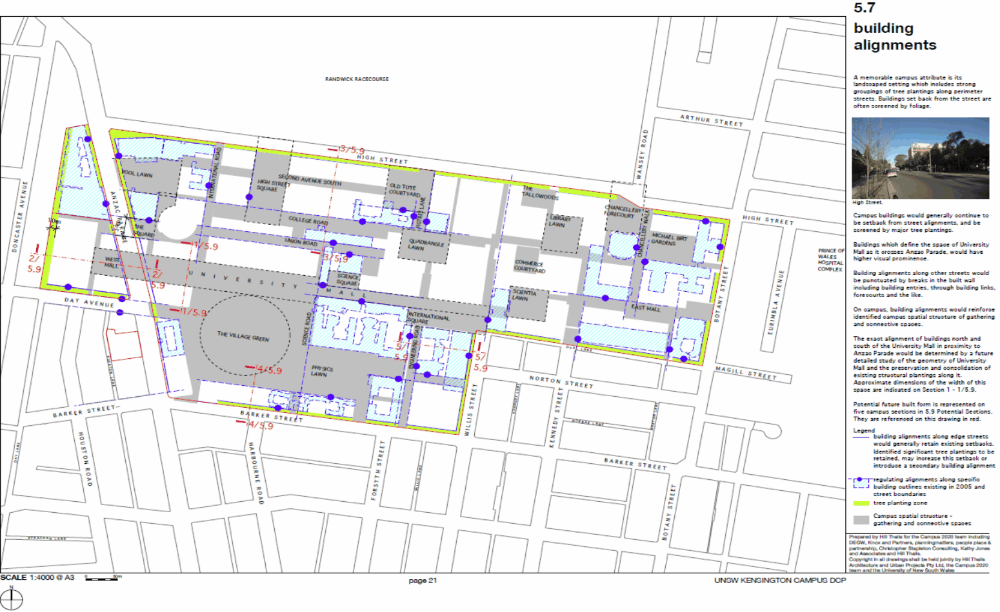
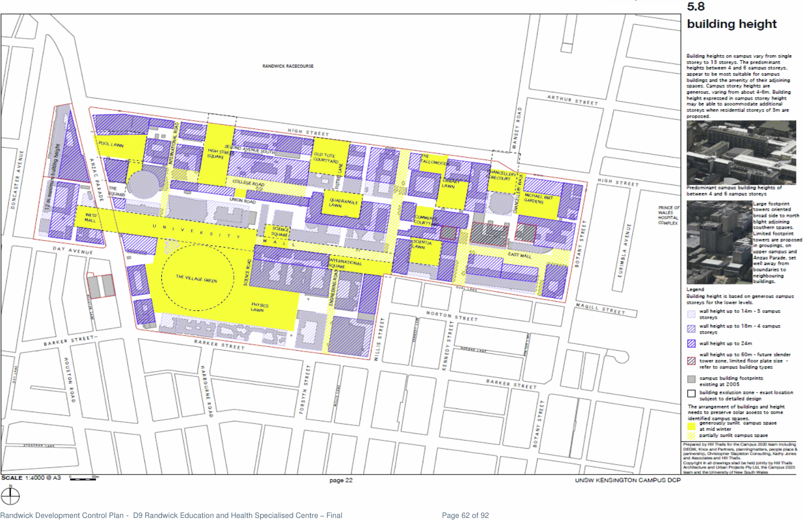
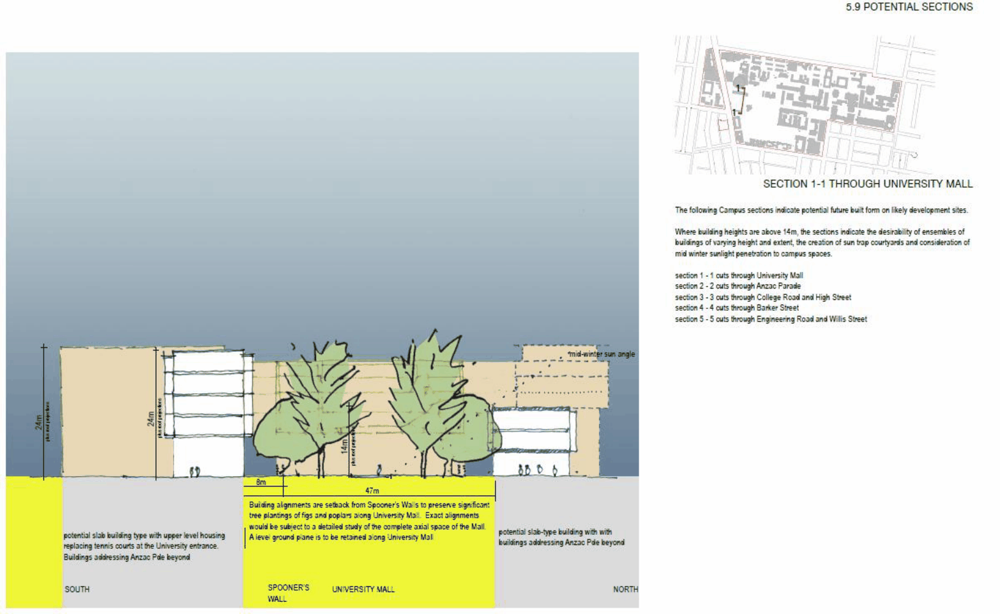
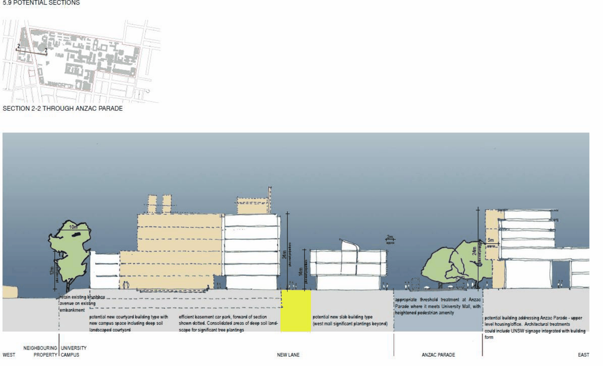
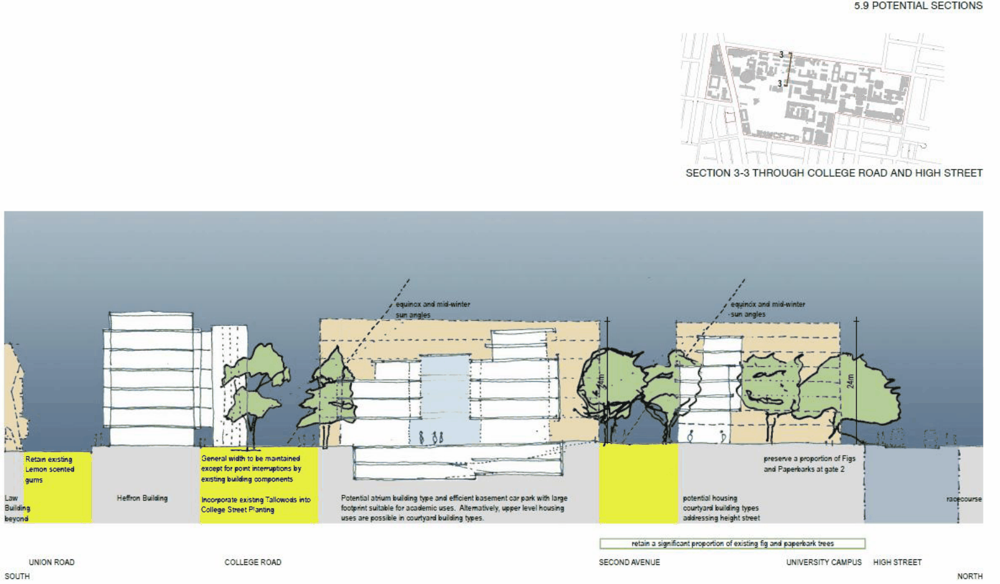
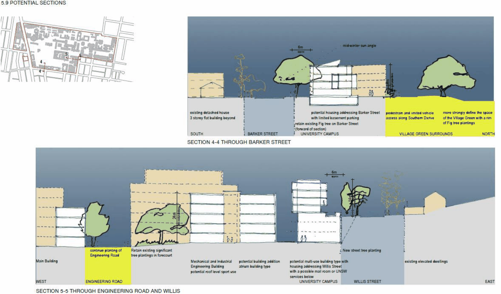

#### 4.2.6. Buildings

Current campus buildings present a range of quality, forms, architectural styles and functions. Some contribute to the existing sense of place and/or are of architectural significance. In places the ensemble of buildings is more important for quality and legibility of the campus than individual buildings. In recent years new buildings and major refurbishments have made significant contributions to the quality of the campus and its image. All buildings on campus should excel in terms of sustainability, their urban design role in the campus structure and form, architectural quality, contribution to campus identity, and creation of optimal learning environments. Objectives

1\. Ensure that buildings are exemplars of excellent design for a university, benefiting all students, staff and visitors, optimising Campus Experience, and teaching by example to the broader community

2\. Adopt whole-of-life cycle approach for buildings, optimising sustainability and allowing for flexibility and adaptation to accommodate new approaches to teaching and research

3\. Optimise design quality of buildings through:

i. alignments, heights and scale which contribute to the overall campus built form and public domain pattern

ii. heights that:

- create campus edge conditions compatible with the desired future adjoining built form

- relate to the scale, use and optimal amenity of campus public domain

- relate to the desired sense of place for the campus

iii. orientation which facilitates passive solar design

iv. footprints/bulk which relate to their function, internal amenity, efficiency and optimal energy performance

v. “safety by design” principles

vi. transparent and activated facades, especially on the ground floor, and

vii. visible through routes

4\. Ensure that buildings define and interface with the public domain in a manner which is appropriate for the specific functions of the building and public space, particularly at Hubs

5\. Ensure that new buildings and refurbishments value the significant architecture and existing character of the campus

6\. Achieve equity of access to all buildings with dignified routes for people with disabilities

7\. Ensure that internal design of buildings fosters interaction and learning, and optimises comfort, pleasure and delight, adding to Campus Experience.

Controls

a) New buildings are to be located within the building location zones identified in Figure

5.8 subject to the additional provisions set out below

b) New buildings or extensions to existing buildings are to be located behind the key building alignments identified in Figure 5.7 and the existing alignments set for University Mall, Science Square, the Quadrangle, Library Lawn, Commerce Courtyard,

Chancellery Forecourt, Union Road, Engineering Road, College Road and Chancellery Walk

c) The precise position of other building alignments are to be subject to detailed design studies of both the proposed buildings and adjoining public domain including consideration of at least:

i. tree root and canopy requirements

ii. heritage conservation requirements around the Old Tote Courtyard Hub

iii. appropriate building footprint sizes to meet the requirements of proposed uses and energy performance of buildings

iv. appropriate dimensions of new gathering and connective spaces

v. the design of new or upgraded entrances

vi. solar access requirements of adjoining open spaces and buildings

vii. residential amenity performance of new campus housing These matters are to be addressed in DAs for new and refurbished buildings

d) Campus boundary conditions are to be achieved as indicated in the building alignments in Figures 5.7 and the sections in Figure 5.9

e) Maximum building heights are to be as specified in Figure 5.8. Heights are defined as wall heights allowing for appropriately articulated upper levels and roof forms. Areas above the wall height may include plant and equipment only, which is not to occupy more than 50% of the building footprint

f) Floor levels of all new habitable and storage areas are to be a minimum of 300 mm above any adjoining 1 in 100 year ARI flow path/ponding depth

g) Design of campus buildings is to respond positively to the architectural relationships and elements set out in 4.3.1

h) Campus building types are to conform to the details set out in 4.3.2

i) Building design is to contribute to the creation of the special places indicated in Sense of Place (4.2.1) and the creation of Hubs (4.2.4)

j) Any new works on the buildings and spaces within the Old Tote Courtyard HCA on High Street are to be guided by the statement of heritage significance. DAs for such works are to include a Heritage Impact Assessment and Plans of Management as required

k) Equal access to buildings is to be achieved through implementation of the findings of the UNSW Disability Access Audit, and compliance with the Building Code of Australia and Disability Discrimination Act

l) Service access to buildings is to be appropriately located in relation to access needs and include required loading docks sited and designed to optimise the aesthetics of ground floor levels and safe and comfortable pedestrian movement

m) Buildings and structures to house infrastructure, plant and campus services are to be in accordance with any Campus Infrastructure and Services Strategy and located adjacent to but not within gathering and connective spaces, be integrated with other buildings and comply with the design quality provisions of the DCP

n) DAs for buildings on western and lower campus greater than 20 metres in height above existing ground level are to be accompanied by an urban design analysis, which

includes a view impact assessment demonstrating the proposal’s relationship with the public domain of the surrounding streets in addition to any impacts on nearby residential development

o) DAs for buildings on upper campus greater than 40 metres in height above existing ground level are to be accompanied by an urban design analysis, which includes a view impact analysis demonstrating the proposal’s relationship with the public domain from significant vantage points around the campus

p) All DAs for buildings greater than 15.24m Above Existing Ground Height (AEGH) are to be referred to Sydney Airports Corporation Ltd for approval, as required by the Civil Aviation (Buildings Control) Regulations

q) Minimum setbacks of 6 metres from the street alignment are to be provided for buildings adjoining a residential precinct, to preserve solar access and privacy to residential properties adjoining the campus

r) All buildings on western campus are to be setback 10 metres from the western boundary of the campus. In addition to the 10 metre setback zone, a maximum height of 12 metres applies to all buildings within 25 metres of the western boundary. This requirement is to preserve an appropriate scale of development when viewed from the adjoining residential precinct of Day and Doncaster Avenues

s) Solar access to living areas and principal landscaped spaces of adjoining residential development is not to be reduced to less than 3 hours per day throughout the year. If 3 hours per day is not currently achieved, new development must not reduce this further

t) In mixed use residential and university use buildings, a secure separate entry is to be provided for residents, to prevent unrestricted public access to private residential areas.

> [Picture on page 62: a picture, saved as a picture (images/part-d9-randwick-education-and-health-specialised-page-62-1.gif, 150 dpi).]

> [Picture on page 63: a picture, saved as a picture (images/part-d9-randwick-education-and-health-specialised-page-63-1.gif, 150 dpi).]

> [Picture on page 64: a picture, saved as a picture (images/part-d9-randwick-education-and-health-specialised-page-64-1.gif, 150 dpi).]

> [Picture on page 65: a picture, saved as a picture (images/part-d9-randwick-education-and-health-specialised-page-65-1.gif, 150 dpi).]

> [Picture on page 66: a picture, saved as a picture (images/part-d9-randwick-education-and-health-specialised-page-66-1.gif, 150 dpi).]

> [Picture on page 67: a picture, saved as a picture (images/part-d9-randwick-education-and-health-specialised-page-67-1.gif, 150 dpi).]
