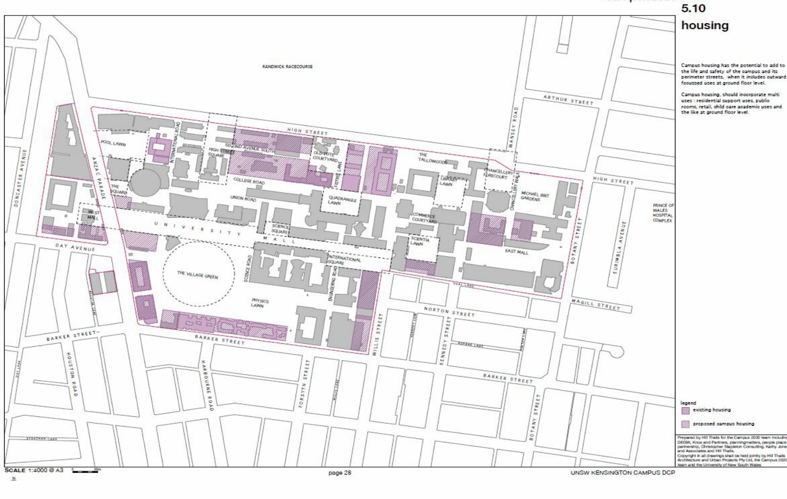
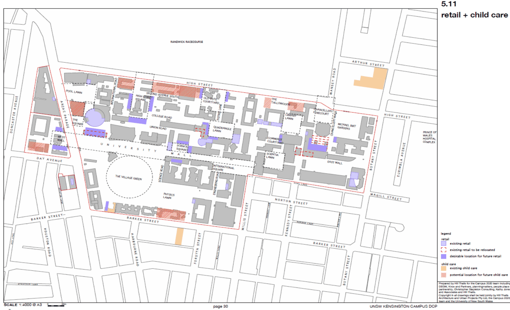

#### 4.2.8. Retail and services

A key component of Hubs is to ensure that retail and other services are appropriately located to establish the pattern and density of activity envisaged. Retail is considered to include the large range of shops and services that provide for daily life on campus, e.g. food and beverages, stationery, books, banking, post office, mini market, travel, student administration and advisory services. The University also has a number of services such as the mailroom and engineering workshops which are essential to the functioning of the campus. Objectives

1\. Ensure that the type and distribution of retail and other services on campus contribute to optimising Campus Experience and the creation and quality of Hubs and related open spaces

2\. Concentrate retail and service outlets in identified Hubs. Limited scattered retail is acceptable to support specific faculty needs or as cafes at contemplative spaces

3\. Ensure that the scale of retail and services focuses on campus users and does not compete with retail located in the nearby town centres of Randwick, Kensington and Kingsford

4\. Expand the range of retail and services on campus, including child care, to maximise their usefulness to staff and students and encourage them to stay on campus longer

5\. Provide a range of facilities targeted to different groups on campus. Controls

a) Existing and new retail and services are to be predominantly located in the identified Hubs as indicated in Figure 5.5 and preferred retail locations in Figure 5.11

b) When opportunities arise over time, existing inappropriately located retail and services are to be relocated into Hubs and the specific frontages identified in Figure 5.11

c) Retail is to activate the public domain at Hubs. Retailing enclosed within buildings, in tunnels and in food courts is not to be provided

d) Major priorities for restructuring retail and services are (refer 4.2.4):

i. Mathews Tower ground floor, Mathews Pavilions and Arcade

ii. Roundhouse, Blockhouse and Squarehouse

iii. the Quadrangle

e) Retain existing successful coffee shops located outside Hubs, such as AGSM Courtyard and Engineering (John Lions Garden), as they provide opportunities for quieter social and academic interaction and contemplation

f) New and upgraded child care facilities are to be provided in key locations (refer Figure 5.11) which meet locational requirements and timeframes of users, especially longer hours to suit part-time and postgraduate students. Examples include redevelopment of Kingsford Gate and the High Street housing area, (see also 4.2.4)

g) Include spaces for staff to meet one another and entertain visitors in a collegiate atmosphere

h) The provision of student services, such as student administration, accommodation, counselling, enrolment, travel advice, are to be located to support the principles and the Campus Experience, especially in Hubs

i) The location of university functions such as security, mailroom, engineering workshops and maintenance facilities are to be carefully sited in accordance with any Campus Infrastructure and Services Strategy and not prejudice the achievement of the principles and the Campus Experience

> [Picture on page 70: a picture, saved as a picture (images/part-d9-randwick-education-and-health-specialised-page-70-1.gif, 150 dpi).]

> [Picture on page 71: a picture, saved as a picture (images/part-d9-randwick-education-and-health-specialised-page-71-1.gif, 150 dpi).]
