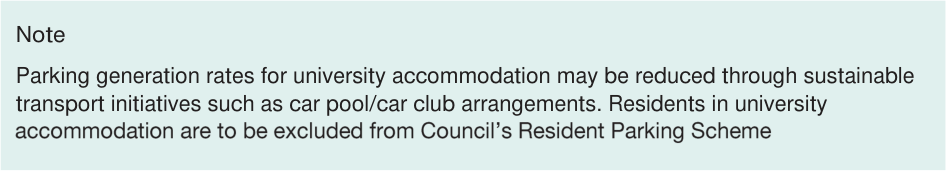
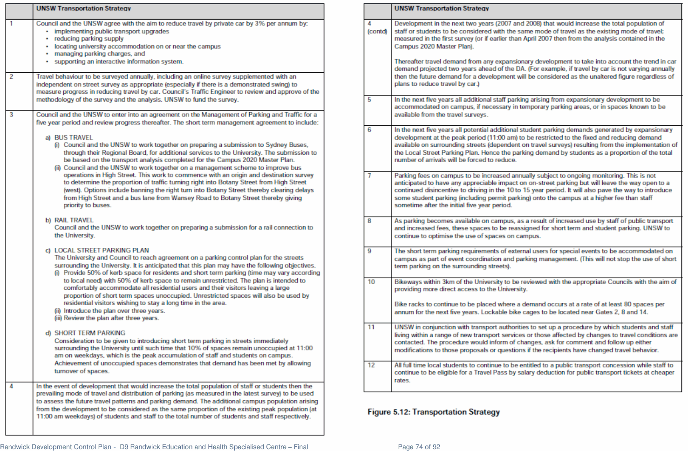
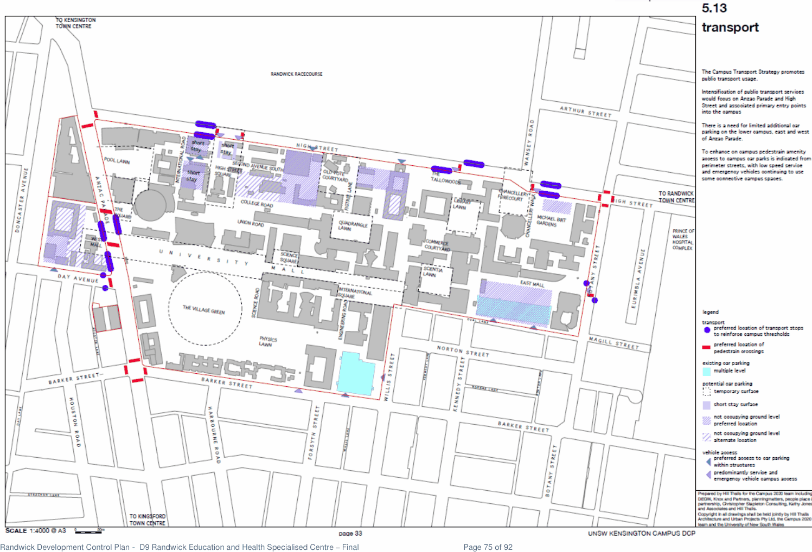

#### 4.2.10. Transport and parking

Making transport more sustainable is one of the key platforms of the Campus 2020 Master Plan. This is to be achieved by improving access to the campus by public transport in preference to private vehicle use. Parking is to be reduced over time, but made more available across the day and night for students, staff and visitors. Other modes of transport such as cycling and walking are also to be made more attractive and safer. UNSW is the largest single employer in the eastern suburbs and the largest generator for bus passengers in Sydney. It can achieve improvements to its transport systems by economies of scale. The improvements to bus services and bike routes would benefit the local community, not just the University. The backbone of the Transportation Strategy is the agreement to measure transport demand every year to avoid subjectivism and focus on policies and cooperation between UNSW, Council and transport agencies.

Objectives

1\. Adopt a sustainable transportation strategy, reducing car dependence

2\. Reduce parking for the University adjusted with any expansion of the University

3\. As the transport, traffic and parking effects of the campus affect the surrounding local area, seek agreement with Council to implement the transport and parking measures outlined in the Transportation Strategy

4\. Improve bus services to the campus, including safe night time services

5\. Improve the connectivity, safety and attractiveness of bike routes to the campus

6\. Maintain a spread of parking throughout the campus

7\. Prepare transport management plans to deal with special events on campus

8\. Improve the public domain adjacent to and in the vicinity of the campus in consultation with Council

9\. Implement traffic improvements to address traffic congestion.

Controls

a) The reduction in car dependence is to be achieved through a combination of:

i. reduction in parking supply

ii. public transport upgrades

iii. location of university accommodation

iv. parking charges, and

v. an interactive information system as set out in the Transportation Strategy in Figure 5.12

b) The total number of parking spaces on campus is to be maintained until such time as it is demonstrated through the annual parking survey that the total number may be reduced without adversely impacting parking on the surrounding streets

c) Surface parking within the campus is to continue to be relocated to be under new buildings or within structured car parks (see Figure 5.13)

i. New car parking areas are to be constructed under new buildings on western campus and on lower campus (possibly also under new buildings) to replace 300 existing permit and reserved parking as lost due to redevelopment

ii. 100 short-term parking spaces are to be located in lower campus with access from High Street over time as new visitor parking for the campus

d) Maintain the provision of Disabled Parking and Loading Zones throughout the campus

e) All new DAs (excluding university accommodation) are to include an assessment of whether the proposal involves an increase in staff, student or other visitations to the campus or only a relocation or up-grade of existing facilities in the context of the total campus population and parking trends, as set out in the Transportation Strategy in Figure 5.12. Where an increase is proposed, the DA is to be supported by a Traffic and Parking Report which addresses:

i. the potential increase in parking demand

ii. the potential impacts on campus parking supply and demand and on-street parking demand

iii. achievements in reducing parking demand across the campus

iv. any specific measures proposed to lower parking demand or avoid potential adverse impacts

v. Specific pedestrian, bicycle, public transport or parking initiatives/improvements may be required prior to occupation of specific proposal

f) The University is to contribute to the cost of external civil works that relate to specific DAs such as improving/upgrading bikeways and pedestrian footpaths in the vicinity of UNSW

g) All new/amended car parking areas, access roadways, internal circulation areas and ramps shall comply with the requirements of AS 2890.1 (2004) and AS 2890.2 (2002)

h) The location of vehicle access/egress points is to be determined subject to an assessment of the impacts on existing traffic flows

i) Parking demand for new university accommodation is to be based on the following minimum rates:

i. 1 space per 10 students/staff for accommodation greater than 800 metres from the Campus

ii. 1 space per 15 students/staff for accommodation at or within 800 metres of the Campus

> [Picture on page 74: a picture, saved as a picture (images/part-d9-randwick-education-and-health-specialised-page-74-22.gif, 150 dpi).]
> Words printed on the picture (title and legend, copied from the PDF):
> accommodation are to be excluded from Council’s Resident Parking Scheme

Note Parking generation rates for university accommodation may be reduced through sustainable transport initiatives such as car pool/car club arrangements. Residents in university

j) At some time in the future, and dependent on the future growth of the University, the top deck of the existing car parks may be reused as sporting or other facilities

k) Opportunities to remove vehicles from the Rupert Myers courtyard are to be investigated

l) Consideration is to be given to a dual pedestrian entry into the campus from Anzac Parade being made legible by two pedestrian crossings, one at each end of bus stops

m) Public domain improvements such as paving and extended pedestrian crossings are to be introduced at the bus stops at Gates 2 and 8 in High Street with the axis from these stops strengthened, signposted, illuminated and inclusive of evening activity.

> [Picture on page 75: a picture, saved as a picture (images/part-d9-randwick-education-and-health-specialised-page-75-1.gif, 150 dpi).]

> [Picture on page 76: a picture, saved as a picture (images/part-d9-randwick-education-and-health-specialised-page-76-1.gif, 150 dpi).]
