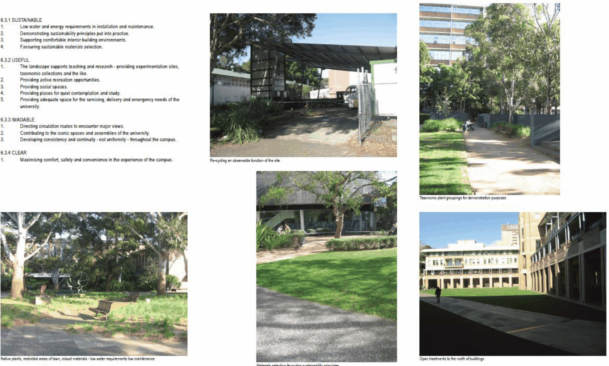
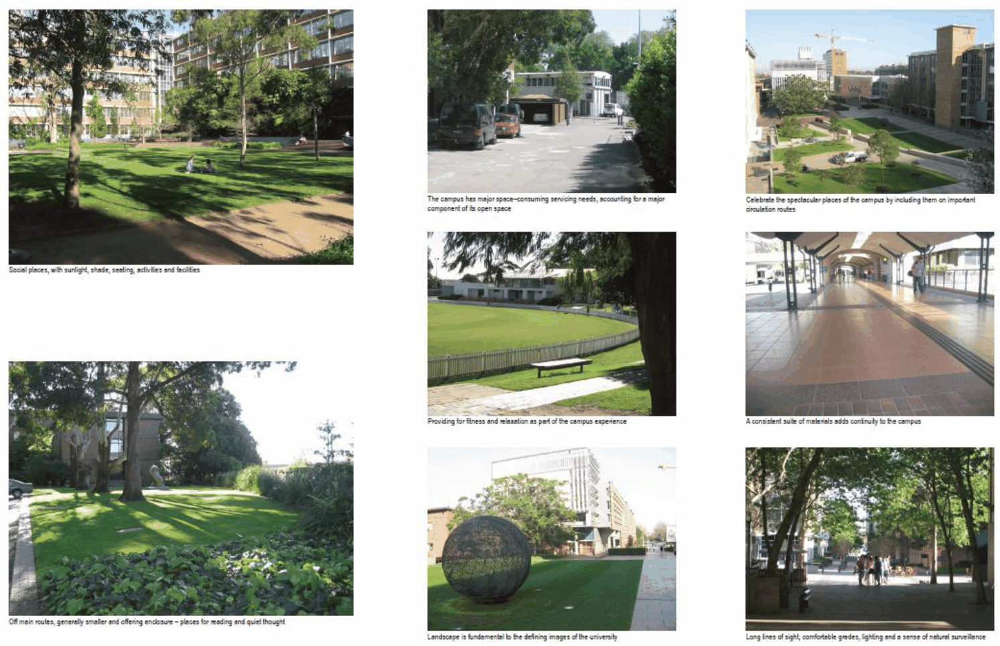

#### 4.3.2. Landscaping

> [Picture on page 89: a picture, saved as a picture (images/part-d9-randwick-education-and-health-specialised-page-89-2.gif, 150 dpi).]

Randwick Development Control Plan -  D9 Randwick Education and Health Specialised Centre - Final

> [Picture on page 90: a picture, saved as a picture (images/part-d9-randwick-education-and-health-specialised-page-90-1.gif, 150 dpi).]

Randwick Development Control Plan -  D9 Randwick Education and Health Specialised Centre - Final

Randwick Development Control Plan -  D9 Randwick Education and Health Specialised Centre - Final

Randwick City Council 30 Frances Street Randwick NSW 2031

1300 722 542 council@randwick.nsw.gov.au www.randwick.nsw.gov.au

Randwick Development Control Plan -  D9 Randwick Education and Health Specialised Centre - Final
