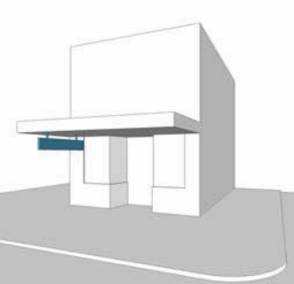
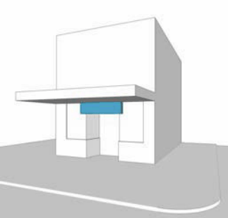
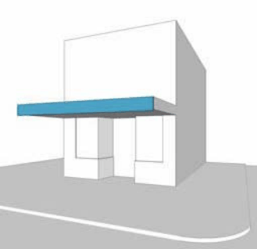
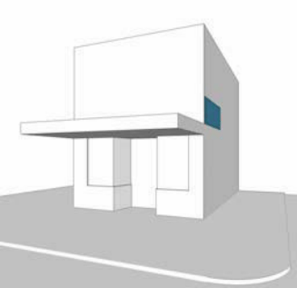

## 1 Introduction

This section provides objectives and controls for the design and

siting of outdoor advertising and signage. These provisions intend

to protect the streetscape quality from visual clutter while

recognising the use of signage in business and retail areas. It

applies to all signage within the City. The controls contained within

this section complement the provisions of State Environmental

Planning Policy No.64 – Advertising and Signage, State

Environmental Planning Policy (Exempt and Complying

Development Codes) 2008 and the RLEP.

This section of the DCP should be read in conjunction with:

• Part A - Introduction and Part B - General Controls of the DCP;

and

• Other sections of the DCP for specific development types,

locations or sites, if relevant to the application.

To the extent of any inconsistency between this section and any

other DCP sections, this section will prevail.

### 1.1 Types of signage and definitions used

Signage is a group term under the standard instrument (local

environmental plans) order which means any sign, notice, device,

representation or advertisement that advertises or promotes any

goods, services or events and any structure or vessel that is

principally designed for, or that is used for, the display of signage,

and includes any of the following:

(a)  an advertising structure,

(b)  a building identification sign,

(c)  a business identification sign,

but does not include a traffic sign or traffic control facilities.

Other land use terms within the ‘Signage’ group term include:

Building identification sign which means a sign that identifies or

names a building and that may include the name of a building, the

street name and number of a building, and a logo or other symbol

but does not include general advertising of products, goods or

services.

Business identification sign which means a sign:

(a)  that indicates:

(i)  the name of the person or business, and

(ii)  the nature of the business carried on by the person at

the premises or place at which the sign is displayed, and

(b)  that may include the address of the premises or place and a

logo or other symbol that identifies the business, but that does not

contain any advertising relating to a person who does not carry on

business at the premises or place.

Advertising structure means a structure used or to be used

principally for the display of an advertisement.

The most common types of signs are: fascia signs, wall signs,

under awning signs and top hamper signs.

### 1.2 Submission Requirements

Design details of all outdoor advertising and signs are to be

submitted with a development application for any building that

requires advertising or signage and must include:

• Details of all advertising proposed for the site, including:

- Number of signs proposed

- Location and size of signs proposed

- Lettering content for each sign

- Colours to be used.

> [Picture on page 3: a picture, saved as a picture (images/part-f2-outdoor-advertising-and-signage-page-3-12.gif, 150 dpi).]

#### Under awning signs

> [Picture on page 3: a picture, saved as a picture (images/part-f2-outdoor-advertising-and-signage-page-3-14.gif, 150 dpi).]

• Plans drawn to an appropriate scale showing the location and

size of all proposed advertising on the building.

• Photographs showing the site and the relationship of the

proposed advertising to that on adjoining buildings and the

streetscape.

#### Top hamper signs

> [Picture on page 3: a picture, saved as a picture (images/part-f2-outdoor-advertising-and-signage-page-3-21.gif, 150 dpi).]

#### Fascia signs

> [Picture on page 3: a picture, saved as a picture (images/part-f2-outdoor-advertising-and-signage-page-3-23.gif, 150 dpi).]

#### Wall signs
