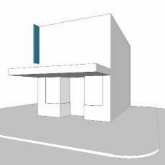
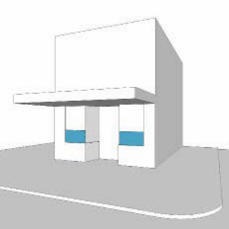
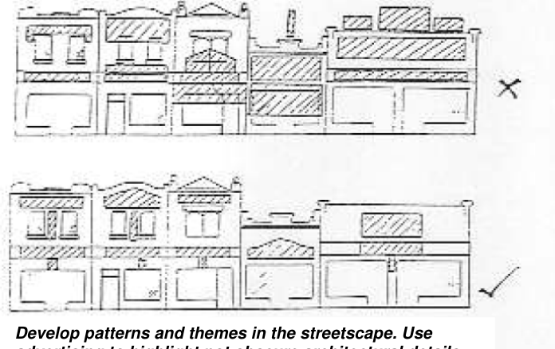

## 2 General Design and Siting

#### Explanation

The design and location of outdoor advertising can have a

significant effect on the environment. The following matters need to

be considered in determining the design and location for outdoor

advertising on a building:

> [Picture on page 4: a picture, saved as a picture (images/part-f2-outdoor-advertising-and-signage-page-4-7.gif, 150 dpi).]

#### Projecting wall signs

> [Picture on page 4: a picture, saved as a picture (images/part-f2-outdoor-advertising-and-signage-page-4-9.gif, 150 dpi).]

#### Note: The objectives and controls in this DCP apply equally

to buildings and places listed as Heritage Items or

within Heritage Conservation Areas.

- architectural detailing

- existing advertising

- the amenity of the streetscape

- heritage significance of the building(where relevant)

#### Objectives

• To facilitate well designed and suitably located signage

that allows for the identification of a business, land use, or

activity to which the signage relates.

• To ensure that outdoor advertising is in keeping with the

scale, character and architectural style or features of the

building.

• To ensure any outdoor advertising and signage does not

adversely impact on the locality or cause any distraction to

road users.

#### Controls

i) Signage should recognise the legitimate needs for

directional advice, business identification and promotion.

ii) Signage must complement and be compatible with the

development on which it is situated and with adjoining

development.

iii) Signage should not obscure architecturally decorative

details or features of buildings or dominate building

facades. It should be placed on the undecorated wall

surfaces or designed sign panels provided.

iv) Entire building facades and /or walls must not be painted

or covered with cladding or other material to act as a large

billboard type.

v) Where a building or site contains multiple tenancies or

uses, a coordinated approach for all signs is required.

vi) Signage shall be displayed in English but may include a

translation in another language.

#### Window signs

vii) Signage erected or displayed on identified heritage

buildings or within heritage conservation areas must not

detract from the architectural character and heritage

significance of such buildings or areas.

viii) Outdoor advertising attached to vehicles or trailers which

are parked for advertising purposes will not be permitted.

ix) Signage must not be flashing or animated.

Note: Flashing or animated signs include mechanical

moving signs, moving LED signs, video/television screens,

projected laser advertising and other flashing,

intermittently illuminated or sequenced lighting signs.

> [Picture on page 5: a picture, saved as a picture (images/part-f2-outdoor-advertising-and-signage-page-5-12.gif, 150 dpi).]

#### Develop patterns and themes in the streetscape. Use

advertising to highlight not obscure architectural details.

.
