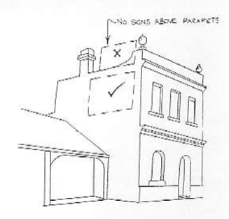
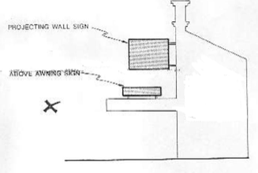
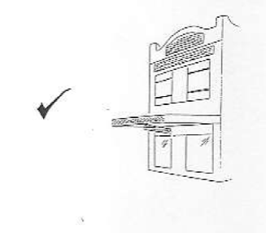

## 3 Signage based on land use zones

### 3.1 Residential Zones Explanation

Interspersed throughout residential areas are a number of

commercial activities such as corner or mid block shops. These

activities and home businesses have a legitimate claim to some

form of signage. However, any outdoor advertising or business

identification signage should not impinge on the amenity of

adjoining or nearby residential housing, particularly in relation to

noise, visual amenity and spillage of light.

#### Objectives

• To ensure that signs in residential areas are appropriate to

the surrounding dwellings.

#### Controls

i) Signage must not be illuminated and signage must relate

to the use of the building or land.

ii) Minimise signage along boundaries common with

residential properties.

iii) Business identification signs (including those for a home

business) must not be more than 1.5sqm in area.

iv) Proposals for signage on buildings operating as existing

#### Protect residential amenity.

#### Avoid signs facing residential

properties

uses or business premises will be assessed against the

controls relating to business zones.

### 3.2 Business Zones Explanation

The greatest demand and pressure for outdoor advertising is

experienced in commercial centres. There is usually a large

number of businesses and activities competing for a limited

amount of advertising space, each trying to ensure that their

message has prominence over other activities, particularly those of

a similar nature.

These demands need to be carefully weighed up against the visual

impact advertising can have, particularly in relation to the

proliferation of advertising that can occur where building facades

are obscured by signs.

#### Objectives

• To reduce the visual complexity of streetscapes by

providing fewer, more effective signs.

• To recognise that outdoor advertising can help to express

the character of a commercial district or business centre.

#### Controls

i) The size and shape of any signage must relate to the size

of the building or space to which it is to be attached to or

placed on. Larger building facades are capable of

accommodating larger signs without detracting from the

appearance of the building.

ii) Signage must not dominate or obscure a building or its

architectural features. Advertising should highlight and

reinforce architectural details.

iii) Roof signs and advertising structures must not project

above the parapet of the building or that part of the

building to which they are attached (including signs and

bunting mounted on plant rooms or other roof structures).

> [Picture on page 7: a picture, saved as a picture (images/part-f2-outdoor-advertising-and-signage-page-7-14.gif, 150 dpi).]

No signs above parapet

> [Picture on page 7: a picture, saved as a picture (images/part-f2-outdoor-advertising-and-signage-page-7-16.gif, 150 dpi).]

iv) Avoid fin signs, projecting wall signs and above awning

signs (sitting on the awning).

v) The visual amenity and value of streetscapes should be

protected through careful consideration of proposals for

flush wall signage.

vi) On any building listed as a Heritage Item or situated in a

Heritage Conservation Area outdoor advertising (projecting

and flush) must not be located above awning level.

vii) Upper level signs are best located at major focal points of

Projecting wall signs, fin signs and

above awning signs are unsuitable

> [Picture on page 7: a picture, saved as a picture (images/part-f2-outdoor-advertising-and-signage-page-7-28.gif, 150 dpi).]

a building only, to advertise arcades, plazas, etc…and to

provide as corporate identity for developments which

contain a range of businesses.

viii) Outdoor advertising on or attached to buildings must align

and relate to the architectural design lines on a building

façade or, in the absence of architectural detail or

decoration, relate to the design lines of adjacent buildings.

ix) Limit under awning to one per shop or for larger premises

one per 6 metres of shop frontage.

x) Under awning signs must be at least 2.6 metres above

footpath level.

xi) Pole or pylon signs must not exceed the height of

adjoining or adjacent buildings, or 6 metres, whichever is

the lower.

One under awning sign per shop

### 3.3 Industrial Zones Explanation

Industrial areas vary greatly in architectural styles and quality,

scale of buildings, siting of buildings, landscaping and the types of

land uses.

Many industrial areas may not be visually attractive; however,

careful design and location of signage can be an effective

mechanism to assist in enhancing the visual quality of the area

while at the same time improving communication via advertising.

#### Objectives

• To ensure a co-ordinated approach to outdoor advertising

is taken where multiple occupancy of sites occurs.

• To minimise visual clutter while contributing to the identity

of the area and the streetscape.

#### Controls

i) The design and location of signage should be placed on

fewer, larger signs.

ii) Signage should be integrated with onsite landscaping.

iii) Signage should not visually dominate the area of building

walls, parapets or landscaped areas.

iv) Larger multiple occupancy industrial developments should

be identified by one or two signs or directory boards at the

entrance identifying the names and activities of the

occupants.

v) Signage for each unit in a multiple occupancy

development should be of a uniform size, shape and

general presentation.

vi) Signage must relate to the use of the building or land.

vii) Avoid lines of bunting draped between poles and /or

buildings.

### 3.4 Special Purpose Zones Explanation

Special Purpose zones are used to accommodate various

specialist activities usually associated with the provisions of

services by Government or public authorities such as schools,

churches, hospitals, state and regional roads, drainage and other

utility works.

These activities may be located in the midst of residential areas

and care needs to be taken that any outdoor advertising does not

impinge on the amenity of these areas.

Generally, advertising unrelated to the use of the land is not

appropriate and should be limited.

#### Objective

• To facilitate quality outdoor advertising and signage for

identification and public information purposes of activities

carried out or services provided on site.

#### Controls

i) Signage must not be flashing or animated.

ii) Signage must be designed and located so that it forms an

integral part of the building or land upon which it is

situated.

iii) The number of signs should be kept to a minimum. Where

possible signs should be grouped together. Avoid a

proliferation of advertising material.

### 3.5 Environmental, Recreation and Rural Zones Explanation

Recreation zoned areas can accommodate a variety of activities

and land uses including public and private recreation facilities.

There is a legitimate need for adequate directional and

identification signage in these areas.

Environmental zoned areas are visually and environmentally

sensitive and as such any outdoor advertising and signage must

be sympathetic to these sensitivities. This is also important in the

Rural zone, while recognising the need for business identification

for any primary/ rural industries.

#### Objectives

• To ensure the environmental and scenic qualities are

protected from inappropriate signage.

• To allow for appropriate promotional and directional

advertising and signage to identify both public and private

recreation facilities.

#### Controls

i) The location, number and size of signs and the use of

shapes, colours and construction materials should ensure

that outdoor advertising is low key in appearance.

ii) Signage must not be illuminated, flashing or animated

except where it can be demonstrated that this would be for

temporary periods only (eg. scoreboards on sports fields)

and measures are proposed to minimise impacts on

surrounding properties.

iii) Signage must relate to the activities carried out or facilities

available on the land on which the sign is erected.
