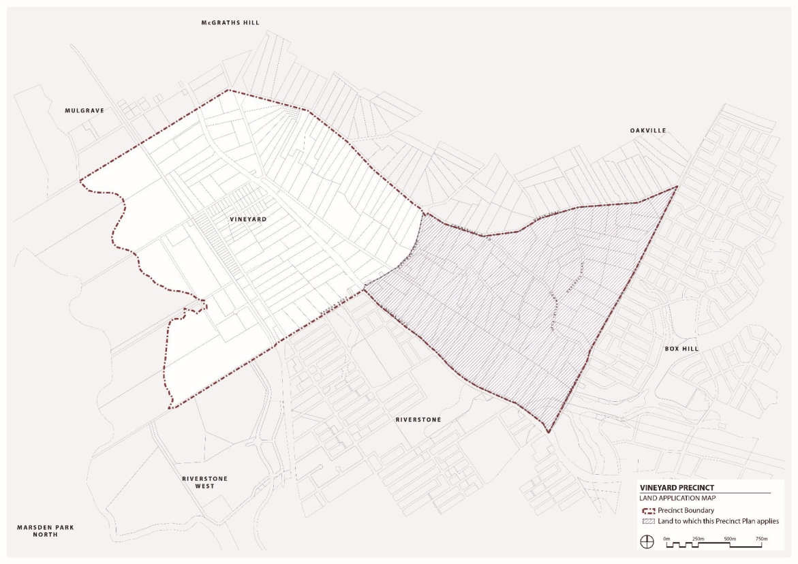
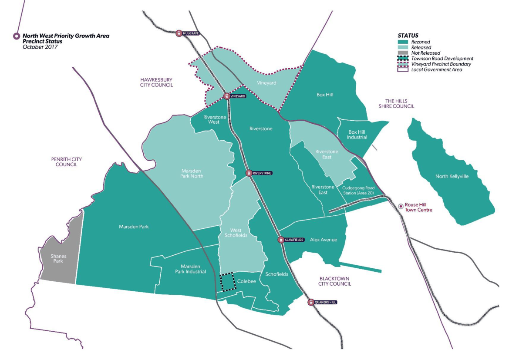
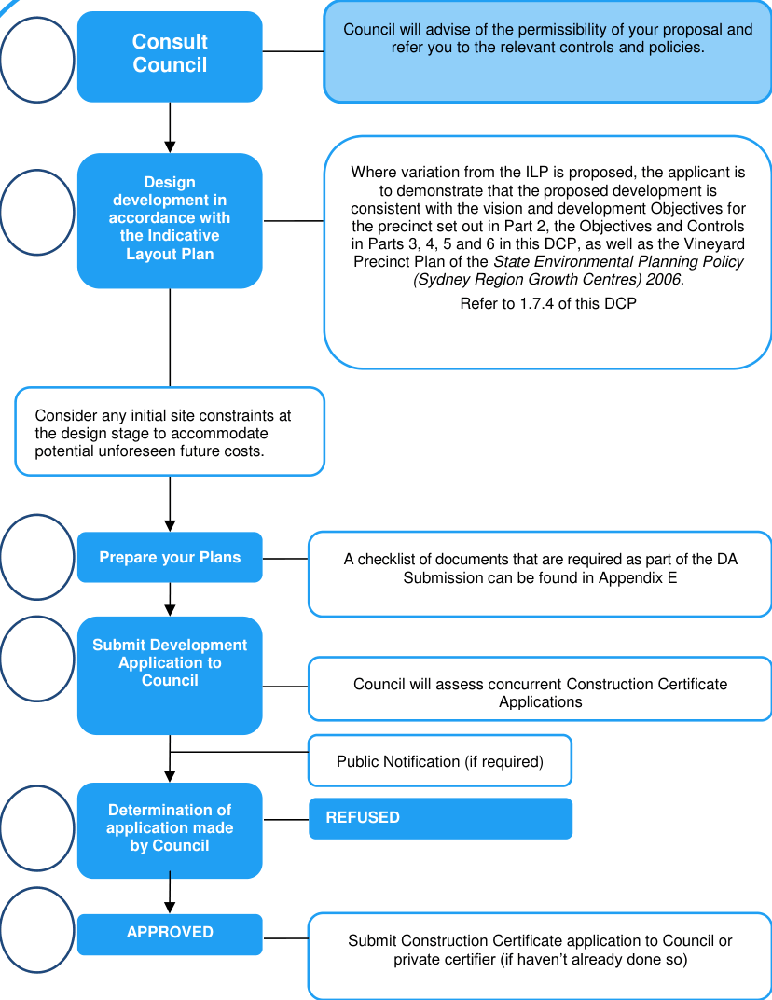

## 1. Introduction

### 1.1 Name and application of this plan

This Development Control Plan (DCP) is the Hawkesbury City Council Growth Centres Precinct Development Control Plan 2017. It has been prepared pursuant to the provisions of Section 72 of the Environmental Planning and Assessment Act 1979 (EP&A Act). This DCP applies to all development within land identified as Stage 1 of the Vineyard Precinct, as illustrated in Figure 1-1. Figure 1-2 illustrates the Vineyard Precinct in the context of the North West Growth Area (NWGA). This DCP was adopted by the Secretary (or delegate) of the Department of Planning and Environment on 8 January 2018 and came into force on 18 January 2018.

### 1.2 Purpose of this plan

The purpose of this DCP is to:

a. Communicate the planning, design and environmental objectives and controls against which Hawkesbury City Council (Council) will assess Development Applications (DAs);

b. Ensure the orderly, efficient and environmentally sensitive development of the Precinct as envisaged by the North West Land Use and Infrastructure Implementation Plan and State Environmental Planning Policy (Sydney Region Growth Centres) 2006 (the Growth Centres SEPP); and

c. Promote high quality urban design outcomes within the context of environmental, social and economic sustainability.

### 1.3 Structure of this plan

Table 1-1 provides a summary of the content of each of the seven parts and the appendices. Table 1-1 Structure of the Hawkesbury City Council Growth Centres DCP 2017

| Part | Summary |
|---|---|
| 1 – Introduction | Sets out the aims and objectives of the DCP, identifies the land to which the DCP applies, explains the structure of the document, the relationship of the DCP to other planning documents, and explains procedures for exempt and complying development and submitting a DA. |
| 2 - Environmental and Design Considerations for Development | Sets out the matters to be addressed when carrying out a site analysis to inform the design of subdivisions and other developments. This part of the DCP provides the considerations and requirements for development in relation to the physical constraints of the land. |
| 3 – Precinct Planning Outcomes | Sets out the vision for the Precinct and the general structural elements of the Indicative Layout Plan which development should comply with. |
| 4 – Neighbourhood and Subdivision Design | Provides objectives and controls related to residential subdivision design including the residential density and character, neighbourhood design, movement network, street and laneway design, the subdivision approval process and construction environmental management. |
| 5 – Development in the Residential and Environment Protection Zones | Establishes the objectives and controls that guide residential development, including dwelling houses, semi-detached, and attached dwellings, multi unit housing, secondary and studio dwellings, dual occupancies, manor homes, residential flat buildings and shop top housing. Also covers residential amenity controls such as streetscape, safety, privacy, sustainable building design and fencing. This part also contains controls applying to non-residential development such as schools, place of worship, neighbourhood shops, seniors housing and farm and outbuildings. |
| 6 – Centres Controls | Provides objectives, controls and design principles for the town centre. |

| Appendix A – Glossary | Explains the terms used in the DCP. |
|---|---|
| Appendix B – Riparian Protection Area Controls | Provides details of the management of the riparian zones along the main creek lines in the Precinct, and the management of stormwater quantity and quality from development, to achieve environmental objectives for waterways. |
| Appendix C – Salinity Management Plan | Provides details to guide subdivision and building DAs and works, to minimise the potential of developments increasing the risk of, and impacts from, soil and groundwater salinity. |
| Appendix D – Preferred Plant Species | Provides a list of plant species that are preferred for use in landscaping within the Precinct. |
| Appendix E – Lodgement Requirements | Provides a checklist of the lodgement requirements for all DAs. |

Notes to readers are provided throughout this document. These notes are intended to provide additional guidance and explanation of the provisions. If further guidance is required on the interpretation of provisions in the DCP, readers should refer to the definitions or contact Council for advice.

> [Picture on page 12: a picture, saved as a picture (images/vineyard-precinct-stage-1-development-control-plan-page-12-1.gif, 150 dpi).]

Figure 1-1 Land Application Map

> [Picture on page 13: a picture, saved as a picture (images/vineyard-precinct-stage-1-development-control-plan-page-13-1.gif, 150 dpi).]

Figure 1-2 Vineyard Precinct in the context of the North West Growth Area

Table 1-2 summarises the controls that are applicable to the main types of development identified in this DCP. Table 1-2 Guide to the controls in this DCP

| Relevant DCP Part | Residential Subdivision | House Dwelling | Occupancy Dwelling Dwelling Dual Secondary Studio | Dwelling Attached | Semi-Detached Dwellings | Dwelling Multi Housing | Flat Residential Home Buildings Manor | Non-residential * Development | Housing top Shop | Commercial Development Retail/ |
|---|---|---|---|---|---|---|---|---|---|---|
| Part 1 | ✓ | ✓ | ✓ | ✓ | ✓ | ✓ | ✓ | ✓ | ✓ | ✓ |
| Part 2 | ✓ | ✓ | ✓ | ✓ | ✓ | ✓ | ✓ | ✓ | ✓ | ✓ |
| Part 3 | ✓ | ✓ | ✓ | ✓ | ✓ | ✓ | ✓ | ✓ | ✓ | ✓ |
| Part 4 | ✓ |  |  |  |  |  |  |  |  |  |
| Part 5.1 |  | ✓ | ✓ | ✓ | ✓ | ✓ | ✓ |  | ✓ |  |
| Part 5.2 |  | ✓ | ✓ | ✓ | ✓ | ✓ | ✓ |  | ✓ |  |
| Part 5.3 |  |  |  |  |  |  |  | ✓ |  | ✓ |
| Part 6 |  |  |  |  |  |  |  |  | ✓ | ✓ |
| Appendices | ✓ | ✓ | ✓ | ✓ | ✓ | ✓ | ✓ | ✓ | ✓ | ✓ |

Note: *Applies to non-residential development on land in the residential and environment protection zones

### 1.4 Relationship to other planning documents

#### 1.4.1. The Act and the Growth Centres SEPP

This DCP has been prepared under the EP&A Act. It has been prepared to provide additional objectives, controls and guidance to applicants proposing to undertake development in the Vineyard Precinct, and for Council’s reference in the assessment of DAs. It should be read in conjunction with the Growth Centres SEPP. The Growth Centres SEPP and the Vineyard Precinct Plan provide the statutory planning controls for development in the Precinct. This DCP is consistent with, and supports those controls, by providing more detail in relation to how development is to occur in the Precinct.

#### 1.4.2. Hawkesbury City Council planning documents

Hawkesbury Local Environmental Plan 2012 and the Hawkesbury Development Control Plan 2002 do not apply to land to which this DCP applies1, except where specifically referred to in the Growth Centres SEPP and this DCP. Some other design standards and guidelines of Council continue to apply, such as Council’s Civil Works Specifications. Where existing policies, procedures and guidelines continue to apply to the Vineyard Precinct, these are specifically referred to in the relevant parts of this DCP. In the event of an inconsistency between this DCP and referenced Council policies, procedures and guidelines, this DCP prevails to the extent of the inconsistency.

1 Hawkesbury Local Environmental Plan 2012 and the Hawkesbury Development Control Plan 2002 continue to apply to land outside of Stage 1 of the Vineyard Precinct.

#### 1.4.3. Growth Centres Biodiversity Certification

The Biodiversity Conservation Act 2016 (BC Act) provides for the protection of threatened species and threatened ecological communities in NSW. Typically, threatened species and ecological community issues are addressed during both the rezoning of land and when DAs are submitted to, and assessed by Council. However, the BC Act also provides for planning instruments to be “certified”, meaning that the assessment of threatened species and ecological communities is done at the rezoning stage and does not need to be further considered at the DA stage. This approach provides for more strategic assessment and management of threatened species and ecological community issues, and streamlines the DA process. Biodiversity Certification was conferred upon the Growth Centres SEPP on 14 December 2007 via the gazettal of a Biodiversity Certification Order signed by the then Minister for Climate Change and the Environment. The Order requires 2,000 hectares (ha) of “existing native vegetation” (ENV) to be retained across the North West and South West Growth Centres. A BC Act assessment will be required to be undertaken for any clearing of ENV within Non-Certified Areas and vegetation removal may need to be offset in accordance with the Biodiversity Certification Ministerial Order. The Vineyard Indicative Layout Plan, Precinct Plan and this DCP have been prepared in accordance with the Biodiversity Certification Order. The majority of land within the Growth Centre Precincts is certified, meaning that development can occur without the need for further assessment under the BC Act. The Precinct Plan contains controls to restrict the clearing of ENV and this is the principal mechanism for ensuring consistency with the Biodiversity Certification Order. This DCP contains other objectives and controls in relation to the protection and enhancement of native vegetation, consistent with the Biodiversity Certification Order.

#### 1.4.4. Summary of applicable planning documents

Applicants proposing to undertake development in the Precinct, and Council when assessing DAs, should refer to:

• the Growth Centres SEPP, as amended, including the Vineyard Precinct Plan at the relevant Appendix;

• this DCP;

• the relevant Section 94 Contributions Plan; and

• the Growth Centres Biodiversity Certification Order, December 2007 and related amendments to the BC Act.

### 1.5 Consent authority

Council is the consent authority for all development on land to which this DCP applies unless otherwise authorised by the EP&A Act. Council will use this DCP in its assessment of DAs.

### 1.6 Exempt and Complying Development

The EP&A Act enables certain forms of development to be classified as either exempt development or complying development through environmental planning instruments.

• Exempt development is development of a minor nature that can be undertaken without the need for development consent.

• Complying development is development that, providing that certain criteria are met, can be assessed through the issuance of a complying development certificate.

The State Environmental Planning Policy (Exempt and Complying Development Codes) 2008 and the associated Housing Code provides controls for the siting and design of detached housing on lots 300m² and larger, as well as alterations and additions to existing residential dwellings up to two storeys.

Development that meets the criteria in the Housing Code is complying development and this DCP does not apply. The NSW Commercial and Industrial Code outlines how internal modifications to commercial and industrial premises in certain zones can meet the complying development criteria. Where a development does not meet the requirements of these Codes, consent is required and this DCP applies.

### 1.7 Development Application Process Development Application Process

The DA process is summarised in Figure 1-3.

> [Picture on page 17: a picture, saved as a picture (images/vineyard-precinct-stage-1-development-control-plan-page-17-4.gif, 150 dpi).]
> Words printed on the picture (title and legend, copied from the PDF):
> Council will advise of the permissibility of your proposal and
> refer you to the relevant controls and policies.
> Where variation from the ILP is proposed, the applicant is
> Design
> development in
> accordance with
> the Indicative
> to demonstrate that the proposed development is
> consistent with the vision and development Objectives for
> the precinct set out in Part 2, the Objectives and Controls
> in Parts 3, 4, 5 and 6 in this DCP, as well as the Vineyard
> Layout Plan
> Precinct Plan of the State Environmental Planning Policy
> (Sydney Region Growth Centres) 2006.
> Refer to 1.7.4 of this DCP
> Consider any initial site constraints at
> the design stage to accommodate
> potential unforeseen future costs.
> Prepare your Plans
> A checklist of documents that are required as part of the DA
> Submission can be found in Appendix E
> Submit Development
> Application to
> Council
> Council will assess concurrent Construction Certificate
> Applications
> Public Notification (if required)
> REFUSED
> Determination of
> application made
> by Council
> APPROVED
> Submit Construction Certificate application to Council or
> private certifier (if haven’t already done so)

#### Consult Council

Figure 1-3 Development Approval process

#### Lodging a Development Application

The documents that are to accompany a DA are listed in Appendix E to this DCP.

#### Notification of Development Applications

DAs shall be notified in accordance with the relevant chapter of the Hawkesbury Development Control Plan 2002 or such other Development Control Plan (or equivalent) that might replace it.

#### Variations to Development Controls

Council may grant consent to a proposal that does not comply with the controls in this DCP, providing the intent of the controls is achieved. Similarly, Council may grant consent to a proposal that varies from the Indicative Layout Plan (ILP) where the variation is considered to be minor and the proposal remains generally consistent with the ILP. As such, each DA will be considered on its merits. Where variation from the ILP is proposed, the applicant is to demonstrate that the proposed development is generally consistent with the Objectives and Controls in Parts 2, 3, 4, 5 and 6 (as relevant), as well as the Vineyard Precinct Plan under the Growth Centres SEPP. Where a variation is sought it must be justified in writing indicating how the development is meeting the intent of the objectives of the relevant control and/or is generally consistent with the ILP. A proposed departure from the development controls contained in this DCP will only be considered where written justification is provided for such departure which demonstrates:

• connectivity of the road network;

• why the controls are unreasonable or unnecessary in the circumstances;

• how the development will achieve the aims and objectives of the DCP, ILP and Precinct Plan under the Growth Centres SEPP despite the proposed departure; and

• what innovative and improved outcomes will be achieved by the development to justify the departure.
