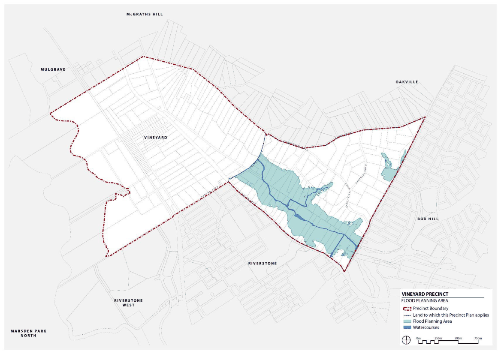
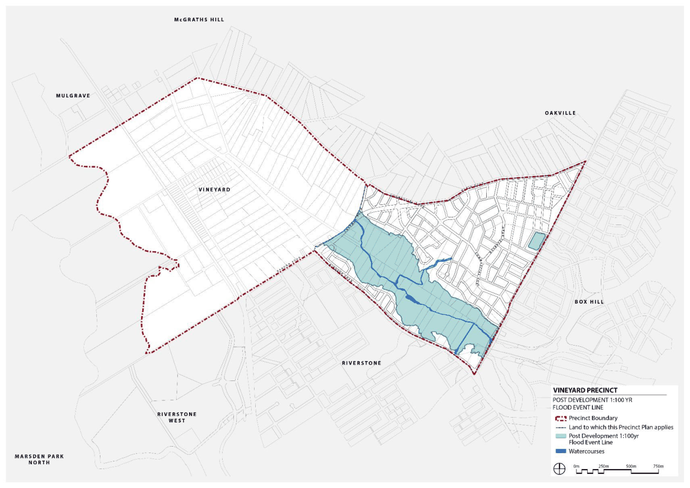
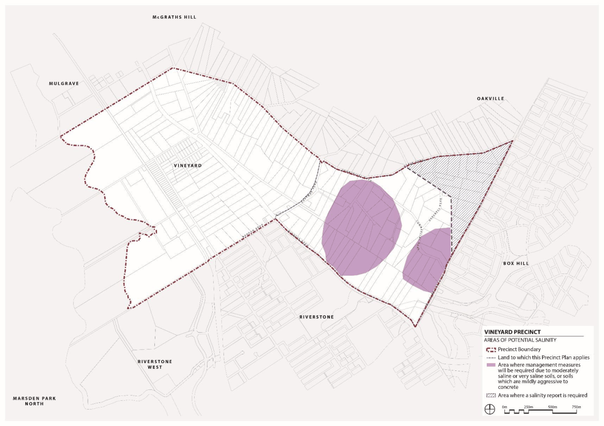
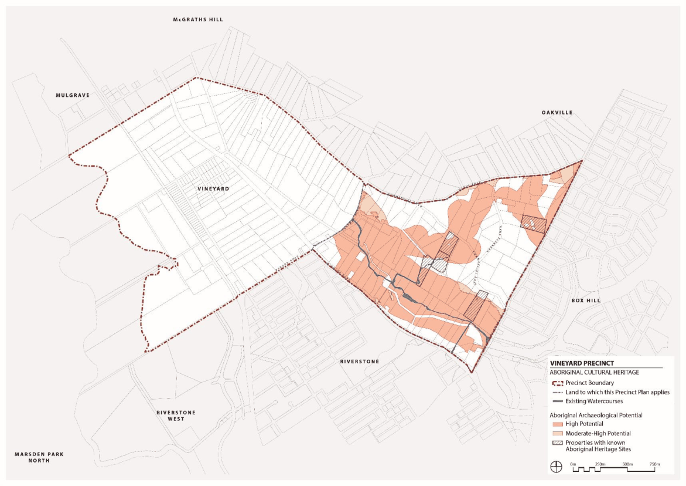
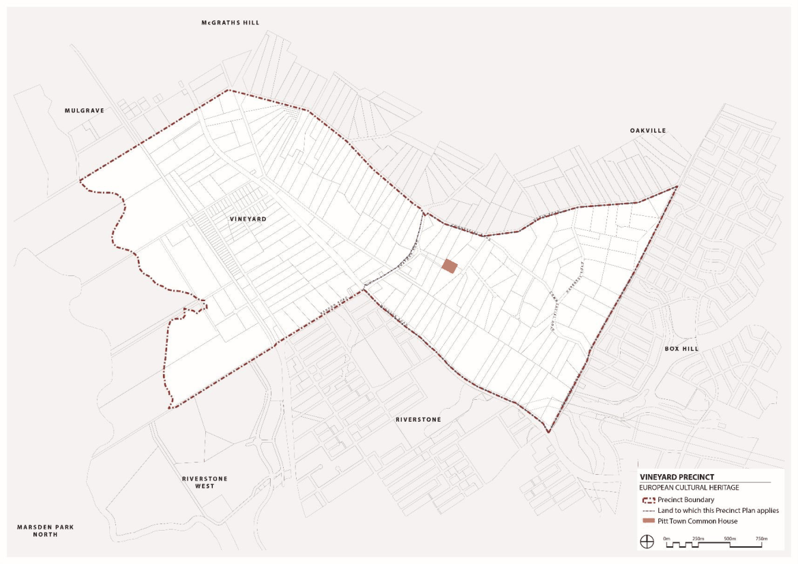
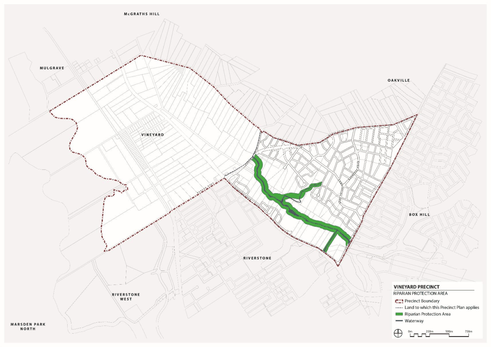
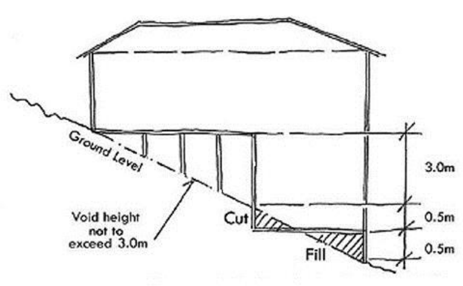
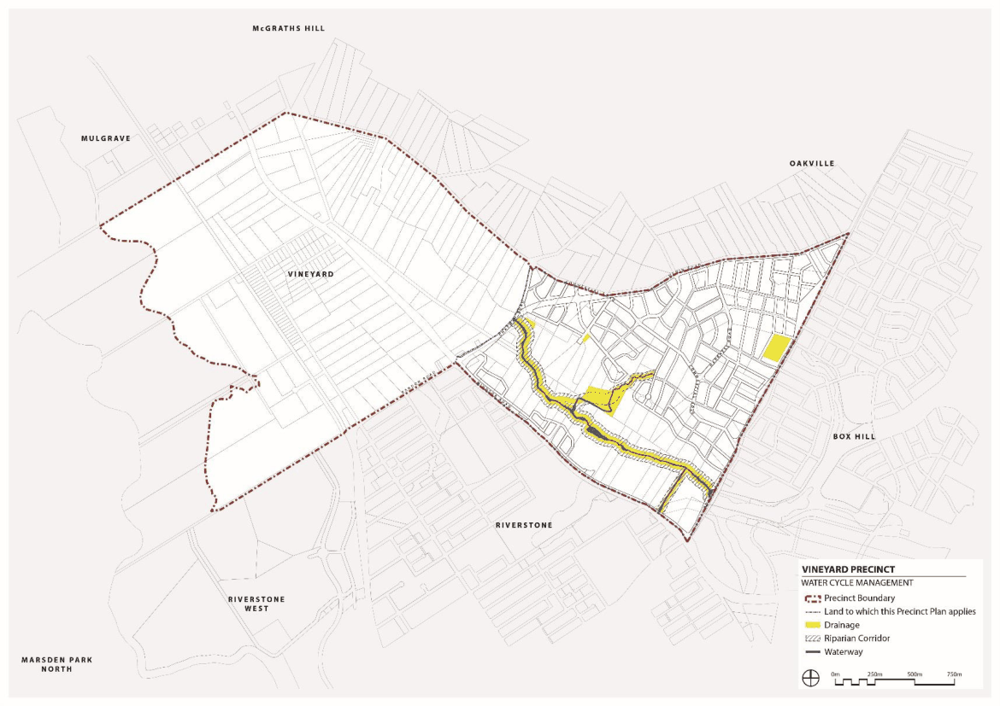

## 2. Environmental and Design Considerations for Development

### 2.1 Site analysis

Site analysis for each individual lot is an important part of the design process. Development proposals need to illustrate design decisions which are based on careful analysis of the site conditions and their relationship to the surrounding context. By describing the physical elements of the locality and the conditions impacting on the site, opportunities and constraints for development can be understood and addressed in the design. A Site Analysis Plan must be submitted with any DA and should show the existing features of the site and its surrounding area, together with supporting written material. At a minimum, the Site Analysis Plan must show the following features (for further guidance refer to Appendix E):

• the position of any proposed building(s) in relation to site boundaries and any other structures and existing vegetation and trees on the site;

• any easements over the land;

• location of services (electricity, sewer, stormwater, gas, telecommunications);

• the location, boundary dimensions, site area and north point of the land;

• location of existing street features adjacent to the property, such as trees, planting, street lights, street/road intersections;

• contours and existing levels of the land in relation to buildings and roads and, whether the proposed development will involve any changes to these levels;

• location and uses of any buildings on sites adjoining the land, as well as trees located adjacent to shared boundaries; and

• a concept stormwater plan.

### 2.2 Environmental Considerations

The following parts contain matters to be addressed in relation to existing site characteristics when planning new development.

#### 2.2.1 Flooding

#### Definitions

Annual Exceedance Probability (AEP) means the chance of a flood of a given or larger size occurring in any one year, usually expressed as a percentage. Commercial development means any of the following development types child care centres, community facilities, food and drink premises, health consulting rooms, home based child care, home businesses, home industries, home occupations, information and education facilities, neighbourhood shops, places of public worship, public administration buildings, recreational facilities (indoor), respite day care, veterinary hospitals, Flood planning area means the area so described in Figure 2-1 or any other area of land adopted by Council for the purposes of this DCP. Floodway means those areas of the floodplain where a significant discharge of water occurs during floods.  They are often aligned with natural defined channels.  Floodways are areas that even if only partially blocked, would case a significant redistribution of flood flow, or a significant increase in flood levels.

Habitable floor means:

• in a residential situation: a room used for normal domestic activities and includes a bedroom, living room, lounge room, music room, television room, kitchen, dining room, sewing room, study, playroom and sunroom.  It excludes a bathroom, laundry, water closet, food-storage pantry, walk in wardrobe, corridor, hallway, lobby, photographic darkroom, clothes drying room, and other spaces of a specialised nature that are occupied only infrequently; and

• in all other situations: an area used for offices, the display or sale of goods and services and/or to store valuable possessions susceptible to flood damage in the event of a flood and/or an area that is likely to be occupied frequently or for extended periods.

Recreation or Non-Urban Uses means any of the following development types environmental facilities, kiosks, markets, recreational facilities outdoor. Residential development means any of the following development types: attached dwellings, bed and breakfast accommodation, dual occupancy, dwelling houses, exhibition homes, manor homes, multi dwelling housing, residential flat buildings, secondary dwellings, semi-detached dwellings, shop top housing, studio dwellings. 1% AEP existing regional flood level means the flood level as shown in map titled Vineyard ILP 1% AEP Existing Regional Flood Depth (Tail Water 17.3m AHD), drawing number VY_EXR_100yr_360m_D, dated 31/10/2017 contained in Appendix D to Water Cycle Management Report Vineyard Precinct, October 2017 prepared by Mott MacDonald. 1% AEP proposed regional flood level means the flood level as shown in map titled Vineyard ILP 1% AEP Proposed Regional Flood Depth (Tail Water 17.3m AHD), drawing number VY_PRR_100yr_360m_D, dated 31/10/2017 contained in Appendix D to Water Cycle Management Report Vineyard Precinct, October 2017 prepared by Mott MacDonald. Flood planning level means the following:

• the 1% AEP proposed regional flood level plus any applicable freeboard, or

• any other 1% AEP related flood level plus any applicable freeboard adopted by Council for the purposes of this DCP.

Note: The Water Cycle Management Report Vineyard Precinct, October 2017 prepared by Mott MacDonald proposes a range of waterway realignments and stormwater management devices to achieve the 1% AEP proposed regional flood level.  Such realignments and management devices will be built over time as funding and delivery arrangements permit.  Where the 1% AEP existing regional flood level is greater than the 1% AEP proposed regional flood level developers will need to manage existing flooding onsite with temporary solutions until such time as the relevant realignments and management devices are realised.  This may involve the installation of temporary works such as temporary on-site detention and temporary flood storage works and the delayed development of part of the subject site.  The horizontal extent of the 1% AEP proposed regional flood level is indicatively shown in Figure 2-2.

#### Objectives

a. To minimise the flood risk to life and property with the use of land.

b. To allow development on land that is compatible with the land’s flood hazard.

c. To allow development that will not have a significant adverse effect on flood behaviour.

#### Controls – Riverine flooding - General

1\) In general, Council will not support development, including the filling of land, within a floodway due to its function as the main flow path for flood waters once the main channel has overflowed and the possibility that a significant threat to life and property exists in a major flood.

#### Controls – Riverine flooding - Subdivision

2\) Each lot created by the subdivision of land within a residential zone is to be located wholly at a level at or above the flood planning level unless it is also a subdivision to which control 3) applies.

3\) Each lot created by the subdivision of land within the E4 Environmental Living zone must have an area of land with a level at or above the flood planning level sufficient in area for the erection of a dwelling house. The dwelling house area may be on land zoned E4 Environmental Living or on land that is zoned for residential purposes if the lot contains such zoned land.

4\) All lots created by the subdivision of land must provide vehicular access with a level at or above the flood planning level from the proposed dwelling area to a public road.

Note: Controls 2) – 4) do not apply to:

• a lot created for a public purpose, a lot created as neighbourhood property in a community title subdivision or common property in a strata title subdivision

• a lot created in the E4 Environmental Living zone as a result of part or parts of the property being subdivided for public purposes and no additional lots for the purposes of erecting a dwelling are created within the E4 Environmental Living zone

5\) Roads serving residential and environmental living areas are to be located at or above the flood planning level.

#### Controls – Riverine flooding - Building

6\) DAs are to demonstrate:

• whether the land is within a floodway or flood storage area;

• whether the proposed building materials are flood compatible;

• whether the building is structurally adequate to withstand the likely impacts of flood water, including buoyancy forces;

• whether the buildings are to be sited in the optimum position to avoid flood waters and allow evacuation;

• whether the orderly and safe evacuation of people from the development can be achieved;

• whether proposed structures or the filling of land are likely to affect flood flows;

• whether earthworks required to maintain the capacity of the floodplain and flood flow velocities will impact on soil salinity and soil stability; and

• the potential impact of the development, including earthworks, on native vegetation.

7\) For development on land designated as being within a floodway (other than agriculture, cultivation and minor alterations to existing buildings), DAs are to demonstrate that:

• the development will not increase flood hazard or damage to other properties or adversely affect them in any way, by the provision of a report from a professional civil engineer

experienced in hydraulics; and

• the building can withstand the force of flooding, by the provision of a detailed report from a professional structural engineer.

8\) For residential development and commercial development, habitable floor levels are to be at or above the flood planning level.

9\) For recreation or non-urban uses:

• all permanent structures are to have flood compatible building components and flood compatible building methods up to and including the flood planning level;

• an Engineer’s report is to be provided certifying that the permanent structures can withstand the forces of floodwater, debris and buoyancy up to and including the flood planning level. In the case of alterations or additions to an existing development, the structure to be certified is that which is proposed to be newly constructed; and

• the minimum surface level of open car parking spaces, carports or garages, shall be as high as practical. The driveway providing access between the road and parking space shall be as high as practical and generally rising in the egress direction.

10\) For additions or alterations to an existing dwelling that existed at the date of commencement of this DCP:

▪ any additional floor area shall not exceed 40% of the habitable floor area that existed at the date of commencement of this DCP;

• additional habitable floor levels are to be at or above the flood planning level. Where this is not practical due to compatibility with the floor level of the existing building, compatibility with the height of adjacent buildings, or the need for access for persons with disabilities, a lower floor level may be considered.  In these circumstances, the floor level is to be as high as practical and no lower than the existing habitable floor level;

▪ a restriction is to be placed on the title of the land, pursuant to S.88B of the Conveyancing Act, where the lowest habitable floor area is elevated above finished ground level, confirming that the undercroft area is not to be enclosed, where Council considers this may potentially occur;

▪ building additions and alterations are to have flood compatible building components and flood compatible building methods up to and including the flood planning level; and

• an Engineer's report is to be provided certifying that the building additions can withstand the forces of floodwater, debris and buoyancy up to and including the flood planning level.

Note: Where development is proposed within or adjacent to land that is shown on Figure 2-1, Council may require a more detailed flood assessment to be undertaken by the applicant to confirm the extent of the flood affectation on the subject land.

> [Picture on page 24: a picture, saved as a picture (images/vineyard-precinct-stage-1-development-control-plan-page-24-1.gif, 150 dpi).]

Figure 2-1 Flood Planning Area

> [Picture on page 25: a picture, saved as a picture (images/vineyard-precinct-stage-1-development-control-plan-page-25-1.gif, 150 dpi).]

Figure 2-2 Indicative horizontal extent of the 1% AEP proposed regional flood level

#### 2.2.2 Salinity and soil management

#### Objectives

a. To manage and mitigate the impacts of, and on, salinity and sodicity.

b. To minimise the damage caused to property and vegetation by existing saline soils, or processes that may create saline soils.

c. To ensure development will not significantly increase the salt load in existing watercourses.

d. To prevent degradation of the existing soil and groundwater environment, and in particular, to minimise erosion and sediment loss and water pollution due to siltation and sedimentation.

#### Controls - Subdivision

1\) DAs are to demonstrate how salinity shall be considered during the planning, design and carrying out of earthworks, rehabilitation works and during the siting, design and construction of all development, including infrastructure:

• to protect development and other works from salinity damage; and

• to minimise the potential impacts that development and other works may have on salinity.

2\) Every DA on land identified in Figure 2-3 as being in an ‘Area where management measures will be required due to moderately saline or very saline soils, or soils which are mildly aggressive to concrete’ or an ‘Area where a salinity report is required’ are to be accompanied by a salinity report prepared by a suitably qualified person. The report is to cover the conditions of the site, the impact of the proposed subdivision or development on any saline land, the land’s suitability for future development and the mitigation measures that will be required during the course of construction. The qualified person is to certify the project upon completion of the works.

3\) Investigations and sampling for salinity are to be conducted in accordance with the requirements of Site Investigations for Urban Salinity (Department of Land and Water Conservation, 2002). Where applicable, the salinity report shall also report on the issues of soil aggressivity and sodicity and any mitigation measures required. All works are to comply with the Western Sydney Salinity Code of Practice, WSROC, 2004.

4\) A comprehensive Salinity Management Plan must be submitted based on the findings of the site specific investigation and prepared in accordance with the Western Sydney Salinity Code of Practice, WSROC, 2004 and Appendix C. All DAs are to demonstrate that the recommendations of the Salinity Management Plan have been incorporated into the development.

5\) Salinity and sodicity management actions are to complement Water Sensitive Urban Design (WSUD) strategies, improving or at least maintaining the current condition, without detriment to the waterway environment.

6\) All developments must incorporate soil conservation measures to minimise soil erosion and siltation during construction and following completion of development. Soil and Water Management Plans, prepared in accordance with Managing Urban Stormwater: Soils and Construction, Landcom (‘The Blue Book’), are to be submitted with each DA.

#### Controls - Building

7\) All development must comply with the Salinity Management Plan developed at the subdivision phase. The actions/works from the Salinity Management Plan must be certified upon completion of the development. DAs must demonstrate compliance with the Salinity Management Plan.

8\) Salinity shall be considered in the siting, design and construction of buildings (including: drainage,

vegetation type and location, foundation selection and cut and fill activities), to ensure the protection of the building from salinity damage and to minimise the impacts development may have on the salinity process, and must have regard to the recommendations of the Salinity Management Plan.

9\) In salinity prone areas materials for pipe infrastructure, foundations and brickwork must have sulfate resistant properties to cope with the saline conditions.

10\) Applications for new buildings must be consistent with any conditions of consent for the subdivision of the land in relation to the management of soil salinity, sodicity and aggressivity, and with the Salinity Management Plan.

11\) Salt tolerant plant species are to be chosen for landscaping purposes.

> [Picture on page 28: a picture, saved as a picture (images/vineyard-precinct-stage-1-development-control-plan-page-28-1.gif, 150 dpi).]

Figure 2-3 Areas of potential salinity

#### 2.2.3 Aboriginal and European heritage

#### Objectives

a. To manage Aboriginal heritage values to ensure enduring conservation outcomes.

b. To ensure areas identified as archaeologically or culturally significant are managed appropriately.

#### Controls – Aboriginal Heritage

1\) Figure 2-4 identifies sites of known Aboriginal Heritage and areas of high and moderate–high Aboriginal archaeological potential.

2\) In order to ensure that a person undertaking any development or activities on land does not harm Aboriginal objects, DAs must identify any areas of Aboriginal heritage value that are within or adjoining the area of the proposed development, including any areas within the development site that are to be retained and protected (and identify the management protocols for these).

3\) Developments or other activities that will impact on Aboriginal heritage may require consent from the Office of Environment and Heritage under the National Parks and Wildlife Act 1974 and consultation with the relevant Aboriginal communities.

4\) Any DA that is within or adjacent to land that contains a known Aboriginal cultural heritage site, as indicated on Figure 2-4, must consider and comply with the requirements of the National Parks and Wildlife Act 1974. An Aboriginal Heritage Impact Permit (AHIP) issued under Part 6 of the National Parks and Wildlife Act 1974 (NPW Act) is required for any works which directly affect these sites.

5\) Where the necessary consents have already been obtained from the Office of Environment and Heritage, the DA must demonstrate that the development will be undertaken in accordance with any requirements of that consent.

Notes: Applicants should consult with the Office of Environment and Heritage to determine requirements for assessment and approval where developments or other works are to be carried out on or near Aboriginal heritage sites identified on the Aboriginal cultural heritage sites figure. Council or Office of Environment and Heritage may require additional investigations to be undertaken as part of a DA to confirm the presence of Aboriginal cultural heritage on the land. Where works uncover items that may be of Aboriginal cultural heritage, the developer is to consult with Office of Environment and Heritage to determine an appropriate course of action.

#### Controls – European Heritage

6\) Applications for subdivision and building on land identified as a heritage item on Figure 2-5 are to be accompanied by a report from a suitably qualified heritage consultant detailing the results of archaeological investigations undertaken to confirm the presence of archaeological material relating to the heritage site. Where archaeological material is identified, the proposal is to address the requirements of the Heritage Act 1977.

7\) Any DA on, adjacent to or in the vicinity of, land identified as a heritage item on Figure 2-5 is to be consistent with the relevant Heritage Conservation chapter of the Hawkesbury Development Control Plan 2002 or such other Development Control Plan (or equivalent) that might replace it.

8\) A Heritage Impact Statement is to be submitted with any DA on, adjacent to or in the vicinity of, land identified as a heritage item on Figure 2-5.

> [Picture on page 30: a picture, saved as a picture (images/vineyard-precinct-stage-1-development-control-plan-page-30-1.gif, 150 dpi).]

Figure 2-4 Aboriginal cultural heritage

> [Picture on page 31: a picture, saved as a picture (images/vineyard-precinct-stage-1-development-control-plan-page-31-1.gif, 150 dpi).]

Figure 2-5 European cultural heritage

#### 2.2.4 Native vegetation and ecology

#### Objectives

a. To conserve and rehabilitate the remaining native vegetation within the Precinct.

b. To ensure that native vegetation contributes to the character and amenity of the Precinct.

c. To preserve and enhance the ecological values of the Precinct and ecological links to surrounding areas.

#### Controls

1\) Where relevant, DAs are to contain a map showing the location, extent and area of any Existing Native Vegetation (ENV) within non-certified land located on the development site.

2\) DAs for land that contains a Riparian Protection Area, a threatened species, or a threatened ecological community is to be accompanied by a Vegetation Management Plan (VMP) for the rehabilitation and conservation of native vegetation and habitat. The VMP is to be prepared in accordance with Appendix E of this DCP.

3\) A landscape plan is to be submitted with all DAs, including subdivision, identifying:

• all existing trees on the development site and those that are proposed to be removed or retained;

• the proposed means of protecting trees to be retained during both construction of subdivision works and construction of buildings;

• proposed landscaping including the locations and species of trees, shrubs and ground cover to be planted; and

• the relationship of the proposed landscaping to native vegetation that is to be retained including factors such as the potential for weed or exotic species invasion and the contribution of the proposed landscaping to the creation of habitat values and ecological linkages throughout the Precinct.

4\) The selection of proposed trees and other landscaping plants is to consider:

• the preferred trees in Appendix D to this DCP;

• the use of locally indigenous species where available;

• the re-use of native plants or top soil removed during subdivisions works or earthworks; and

• the contribution to the management of soil salinity, groundwater levels and soil erosion.

5\) Native trees and other vegetation are to be retained where possible by careful planning of subdivisions to incorporate native vegetation and wildlife corridors into areas such as road reserves and private or communal open space.

6\) Where practical, prior to development commencing, applicants are to:

• provide for the appropriate re-use of native plants (including but not limited to seed collection) and re-use of topsoil that contains known or potential native seed bank; and

• relocate native animals from development sites. Applicants should refer to OEH’s Policy on the Translocation of Threatened Fauna in NSW.

7\) All subdivision design and bulk earthworks are to consider the need to minimise weed dispersion and promote weed eradication. A Weed Eradication and Management Plan, outlining weed control measures during and after construction, is to be submitted with any subdivision DA.

8\) Within land that is in a Riparian Protection Area as shown on Figure 2-6:

• all existing native vegetation is to be retained and rehabilitated, except where clearing is required for essential infrastructure;

• native vegetation is to be conserved and managed in accordance with the Riparian Protection Area controls of Appendix B to this DCP; and

• development is to be carried out in accordance with the Riparian Protection Area controls of Appendix B to this DCP.

9\) Land subject to Condition 12 of the Growth Centres Biodiversity Certification Order must not be cleared unless it is in accordance with a plan of management or unless such clearance has been agreed to by the OEH.

10\) Vegetation to which Part 3 of State Environmental Planning Policy (Vegetation in Non-Rural Areas) 2017 applies is the same vegetation that must not be ringbarked, cut down, lopped, topped, removed, injured, wilfully destroyed or cleared without a development consent or permit granted by Council as described in the relevant chapter of the Hawkesbury Development Control Plan 2002 or such other Development Control Plan (or equivalent) that might replace it.

> [Picture on page 34: a picture, saved as a picture (images/vineyard-precinct-stage-1-development-control-plan-page-34-1.gif, 150 dpi).]

Figure 2-6 Riparian Protection Area

#### 2.2.5 Bushfire hazard management

#### Objectives

a. To prevent loss of life and property due to bushfires by providing for development that is compatible with bushfire hazard.

b. To encourage sound management of bushfire prone areas.

#### Controls

1\) DAs must demonstrate compliance with Planning for Bushfire Protection 2006 for development located on ‘bushfire prone land’.

2\) In addition to complying with the requirements of Planning for Bushfire Protection 2006 Asset Protection Zones (APZs):

• are to be located wholly within the Precinct;

• may incorporate roads;

• are to be located wholly outside of the Riparian Protection Area; and

• are not to burden Council owned or managed land (other than roads).

#### 2.2.6 Site contamination

#### Objectives

a. To minimise the risks to human health and the environment from the development of potentially contaminated land.

b. To ensure that potential site contamination issues are adequately addressed at the subdivision stages.

#### Controls

1\) Prior to granting development consent, Council must be satisfied that the site is suitable, or can be made suitable, for the proposed use having regard to land contamination.

2\) All DAs where the site has not been investigated for contamination shall be accompanied by a Stage 1 Preliminary Site Investigation prepared in accordance with State Environmental Planning Policy No 55 – Remediation of Land and the Contaminated Land Management Act, 1995.

3\) Where the site has known contamination or a Stage 1 Preliminary Site Investigation identifies potential or actual site contamination a Stage 2 Detailed Site Investigation must be prepared in accordance with State Environmental Planning Policy No 55 – Remediation of Land and the Contaminated Land Management Act, 1995. A Remediation Action Plan (RAP) will be required for areas identified as contaminated land in the Stage 2 Detailed Site Investigation.

4\) All investigation, reporting and identified remediation works must be in accordance with the protocols of the NSW EPA’s Guidelines for Consultants Reporting on Contaminated Sites.

5\) Council will require a Site Audit Statement (SAS) (issued by an Accredited Site Auditor) where remediation works have been undertaken to confirm that a site is suitable for the proposed use.

Note: All applicants should consider and assess contamination hazards on their land in accordance with the Contaminated Land Management Act, 1995 and State Environmental Planning Policy No 55 – Remediation of Land, both of which override any controls in this DCP.

#### 2.2.7 Odour assessment and control

Prior to the commencement of this DCP the Vineyard Precinct was used mostly for rural purposes. The Precinct, and nearby rural areas, contain a number of existing rural uses that have the potential to generate odour and other associated impacts that may affect the amenity of nearby urban areas. While these activities may cease operation at some point in the future (such as when the land is developed for urban

purposes) the timing of cessation of odour generating land uses is not known. Developers and buyers of property within the Precinct should be aware that their property may be subject to odour impacts from these uses for an indeterminate period of time.

#### Objectives

a. To minimise nuisance caused by odour generating activities.

#### Controls

1\) Where a proposed development has the potential to create an odour nuisance or is likely to be affected by an odour nuisance Council will consider whether the development is appropriate and will also consider the need for the applicant to provide additional supporting information with the DA.

2\) Commercial or apartment buildings are to be orientated and designed to provide adequate air flow around the building and, if required, encourage air flow in a particular direction (e.g. away from outdoor café areas). Dead end courtyards or long narrow spaces perpendicular to the prevailing winds where air can lay dormant and stagnate should be avoided.

3\) Where necessary, a barrier such as continuous dense landscaping (bunds and vegetation) is to be provided to assist in odour dispersion from nearby odour sources.

4\) Buildings should be designed so that living and work spaces such as bedrooms and offices do not face odorous sources. Apartment buildings should have non-opening windows on the odorous side of the building and duct cleaner air into the building from the non-odorous side and out to the odorous side.

5\) Separation buffers or development restrictions may be removed if an odour source ceases operation.

### 2.3 Site responsive design

#### 2.3.1 Cut and fill

#### Objectives

a. To minimise the extent of cut and fill within the Precinct.

b. To protect and enhance the aesthetic quality of the area by controlling the form, bulk and scale of land forming operations.

c. To ensure that fill material is not contaminated and does not adversely affect the fertility or salinity of soil, or the quality of surface water or groundwater.

d. To ensure that the amenity of adjoining residents is not adversely affected by any land forming operation.

#### Controls

1\) DAs are to illustrate where it is necessary to cut and/or fill land and provide justification for the proposed changes to the land levels.

2\) Earthworks shall be undertaken to a maximum of 500mm excavation or fill from the present surface level of the property.

3\) Council will assess proposals for excavation or fill greater than 500mm having regard to the visual impact of the proposed earthworks.

4\) On sloping sites, site disturbance is to be minimised by use of split level or pier foundation building designs. Council will consider greater cut for basement garages.

5\) A Site Validation Report is required to be submitted to Council prior to the placement of imported fill on site.

6\) DAs are to demonstrate that the importation of fill shall comply with the Site Investigation for Urban

Hawkesbury City Council Growth Centre Precinct Development Control Plan 2015 Page 34

Salinity, Department of Water and Energy and the Guidelines for the NSW Site Auditor Scheme (2nd edition) – Soil Investigation Levels for Urban Development Sites in NSW, DECC Contaminated Sites Guidelines.

7\) Where cut is proposed on the boundary of a lot, retaining walls are to be constructed with side fence posts integrated with its construction (relevant construction details are required with retaining wall approval). Otherwise retaining walls must be located a minimum of 450mm from the side or rear boundary of the lot containing the cut.

8\) Where cut is proposed, retaining walls within residential allotments are to be no greater than 600mm high at any point on the edge of any residential allotment. A combined 1200mm maximum retaining wall height is permissible between residential lots (2 x 600mm). Where terraced walls are proposed the minimum distance between each step is 0.5m. A variation to the retaining wall heights can be considered with supporting justification.

9\) The maximum height of voids within individual allotments is 3m, as illustrated in Figure 2-7.

10\) All retaining walls proposed for the site are to be identified in the DA.

11\) Filling on lots must be either contained within the ‘building footprint’ or no closer than 2 metres from a property boundary and up to 500mm in depth.

> [Picture on page 37: a picture, saved as a picture (images/vineyard-precinct-stage-1-development-control-plan-page-37-17.gif, 150 dpi).]

Figure 2-7 Maximum cut and fill within residential lots

#### 2.3.2 Sustainable building design

#### Objectives

a. To maximise microclimate benefits to residential lots.

b. To enhance streetscape amenity.

c. To minimise energy usage and greenhouse emissions and encourage the adoption of renewable energy initiatives.

d. To minimise the use of non-renewable resources and minimise the generation of waste during construction.

#### Controls

1\) New residential dwellings, including a residential component within a mixed use building and serviced apartments intended, or capable of being, strata titled, are to be accompanied by a BASIX Certificate and are to incorporate all commitments stipulated in the BASIX Certificate on the

Hawkesbury City Council Growth Centre Precinct Development Control Plan 2015 Page 35

submitted plans in accordance with State Environmental Planning Policy (Building Sustainability Index: BASIX) 2004.

2\) At least 50% of plants used in landscaping must consist of native species of local provenance.

3\) Plant species are to be selected from the preferred species listed at Appendix D to this DCP.

4\) Outdoor clothes lines and drying areas are required for all dwellings and can be incorporated into communal areas for multi-dwelling development and residential flat building developments and mixed use development.

5\) Dwelling and private open space location and orientation must be consistent with the siting principles of Figure 5-6.

### 2.4 Water Cycle Management

#### 2.4.1 Stormwater management

#### Objectives

a. To manage the flow of stormwater from urban parts of the Precinct to replicate pre-development flows.

#### Controls

1\) Stormwater management is to be designed and implemented with all subdivisions.

2\) Stormwater is to be managed and associated infrastructure provided in accordance with the provisions of Water Cycle Management Report, October 2017 prepared by Mott MacDonald or other water cycle management plan (or equivalent) approved by Council and the Hawkesbury City Council’s Civil Works Specifications.

3\) In order to achieve the stormwater quality and quantity objectives for the precinct all dwellings are to be provided with a 3000L minimum rainwater tank which must be plumbed for internal use.

4\) Management of ‘minor’ flows using piped systems for the 20% AEP (residential land use) and 5% AEP (commercial land use) shall be in accordance with Hawkesbury City Council’s Civil Works Specifications. Management measures shall be designed to:

• prevent damage by stormwater to the built and natural environment;

• control stormwater to minimise localised flooding and reduce nuisance flows to a level that is acceptable to the community;

• provide a stormwater system that can be economically maintained and that uses open space in a compatible manner;

• minimise urban water run-off pollutants to watercourses; and

• meet the standards for a 20% AEP flood level for residential development.

5\) Management of ‘major’ flows using dedicated overland flow paths such as open space areas, roads and riparian protection areas for all flows in excess of the pipe drainage system capacity and above the 20% AEP shall be in accordance with Hawkesbury City Council’s Civil Works Specifications. Management measures shall be designed to:

• prevent both short term and long term inundation of habitable dwellings;

• control localised flooding from storm events to maintain access to lots, maintain the stability of the land form and to control erosion;

• provide for the orderly and safe evacuation of people away from rising floodwaters;

• meet the standards for the flood planning level;

• where practical, development shall attenuate up to the 50% AEP peak flow for discharges into the local tributaries. This will be achieved using detention storage within water quality

Hawkesbury City Council Growth Centre Precinct Development Control Plan 2015 Page 36

features and detention basins;

• the developed 1% AEP peak flow is to be reduced to pre-development flows through the incorporation of stormwater detention and management devices; and

• the trunk stormwater system is to be designed in accordance with the Water Cycle Management strategy shown in

• , satisfy the requirements of Appendix B – Riparian Protection Area Controls and achieve the water quality targets in Table 2-1.

6\) Where appropriate detention basins are to be planted with wetland species of local provenance for the purposes of establishing suitable wetland / aquatic habitat.

Table 2-1 Water quality and environmental flow targets

|  | WATER QUALITY % reduction in pollutant loads |  |  |  | ENVIRONMENTAL FLOWS Stream erosion control ratio¹ |
|---|---|---|---|---|---|
|  | Gross Pollutants (>5mm) | Total suspended solids | Total phosphorous | Total nitrogen |  |
| Stormwater management Objective | 90 | 85 | 65 | 45 | 3.5-5.0: 1 |
| ‘Ideal’ stormwater outcome | 100 | 95 | 95 | 85 | 1:1 |

1 This ratio should be minimised to limit stream erosion to the minimum practicable. Development proposals should be designed to achieve a value as close to one as practicable, and values within the nominated range should not be exceeded. A specific target cannot be defined at this time.

Hawkesbury City Council Growth Centre Precinct Development Control Plan 2015 Page 37

> [Picture on page 40: a picture, saved as a picture (images/vineyard-precinct-stage-1-development-control-plan-page-40-1.gif, 150 dpi).]

Figure 2-8 Water Cycle Management
