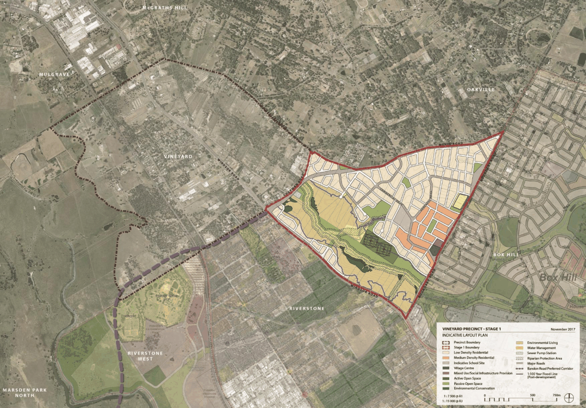

## 3. Precinct Planning Outcomes

### 3.1 Introduction

This Part of the DCP defines Precinct wide planning outcomes. It also outlines the matters to be considered when undertaking site analysis for subdivision planning. These controls should be considered during the initial stages of subdivision planning to determine the suitability and the development potential of land.

### 3.2 Vision

Planning for the Vineyard Precinct responds to the need for new and diverse housing in Sydney that is well connected to major centres and employment, protects natural assets and encourages sustainable living. Consideration of the surrounding context, history and natural environment has informed the precinct planning process. The Precinct will consist of a mix of housing types that will allow for greater choice for different household types. It predominantly provides for low density housing, with some medium density around the village centre and open spaces. Places of significant heritage value, particularly the Pitt Town Common House, have been integrated into the planning of the Precinct to ensure protection through a sensitive design approach. The village centre will support retail, commercial and community services to promote community interaction. Regional public transport accessibility has been provided through road connections to the nearby Vineyard railway station and a regional bus network along the major roads. A safe and permeable street network will promote accessibility, connectivity and social interaction. The provision of cycle ways and pedestrian connections, as well as public transport connections to surrounding centres, will promote a community that is less dependent on private vehicle use.

### 3.3 The Indicative Layout Plan

The Indicative Layout Plan (Figure 3-1) forms the basis for urban development in the Precinct by setting out:

• the road network;

• the open space and drainage networks;

• the locations of land uses including residential development, a school, open space, drainage land and a retail centre;

• areas requiring protection because of environmental or heritage values; and

• the density and types of housing that are preferred in various parts of the Precinct.

#### Objectives

a. To ensure that development occurs in a coordinated manner consistent with the North West Land Use and Infrastructure Implementation Plan and the Vineyard Precinct ILP.

#### Controls

1\) All DAs are to be generally in accordance with the ILP.

2\) If any variations to the general arrangement of the ILP are proposed, the applicant must demonstrate, to Council’s satisfaction, that the variation is consistent with the precinct planning vision (Part 3.2).

> [Picture on page 43: a picture, saved as a picture (images/vineyard-precinct-stage-1-development-control-plan-page-43-1.gif, 150 dpi).]

Figure 3-1 Vineyard Precinct Indicative Layout Plan
