## 4. Neighbourhood and Subdivision Design

### 4.1 Residential Density and Subdivision

The Growth Centres are subject to residential density controls as detailed in the Residential Density Maps in the SEPP. This part of the DCP provides guidance on the typical characteristics of the residential density bands. Net Residential Density means the number of dwellings proposed to be located on land to be developed divided by the net developable area in hectares of the land to be developed.  Net Developable Area means the land occupied by the development, including internal streets plus half the width of any adjoining access roads that provide vehicular access, but excluding land that is not zoned for residential purposes. An example of how to calculate Net Residential Density is shown below in Figure 4-1.

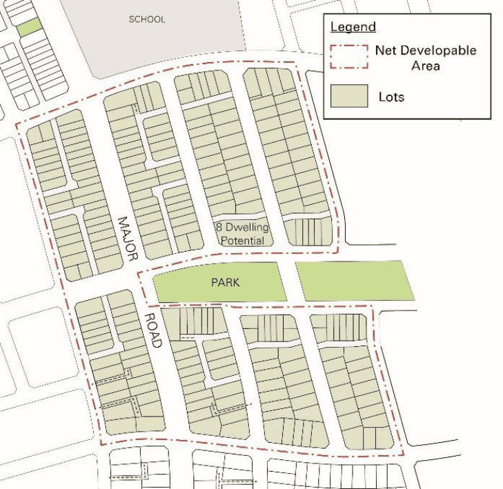

> [Picture on page 45: a picture, saved as a picture (images/vineyard-precinct-stage-1-development-control-plan-page-45-11.gif, 150 dpi).]

Figure 4-1 Example of how to calculate Net Residential Density Net Residential Density is an averaging statistic.  The average dwelling density target in the SEPP should be achieved across the identified area with a diversity of lot and housing types.  However, this does not mean that all streets offer the same housing and lot mix.  Built form intensity should vary across a neighbourhood in response to the place: more intense around centres or fronting parks, less intense in quieter back streets.  In lower density areas, there will be a higher proportion of larger lots and suburban streetscapes but there may also be some streets with an urban character.  In higher density areas, urban streets with more attached housing forms will be more common but there will also be some suburban streetscapes.

In recognition of different objectives and street characters at varying densities, certain built form controls vary by density bands. Refer to Part 5 Development in the Residential and Environment Protection Zones of this DCP.

#### 4.1.1 Residential Density

#### Objectives

a. To ensure density targets are met.

b. To provide guidance to applicants on the appropriate mix of housing types and appropriate locations for certain housing types.

c. To establish the desired character of the residential areas.

d. To promote housing diversity and affordability.

#### Controls

1\) All applications for residential subdivision and the construction of residential buildings are to demonstrate that the proposal meets the residential density requirements and contributes to meeting the overall dwelling target of the Vineyard Precinct.

2\) Residential development is to be generally consistent with the residential structure as set out in Figure 4-3 Residential Structure and the typical characteristics of the corresponding Density Band in Table 4-1.

Table 4-1 Typical characteristics of residential net densities

| Net Residential Density dw/Ha | Typical Characteristics |
|---|---|
| 15-18dw/Ha | • Generally located away from centres and transport. • Predominantly detached dwelling houses. • Typically single and double storey dwellings. • Mainly garden suburban streetscapes. (See Figure 4-2). |
| 20-30dw/Ha | • Focused areas of a mix of smaller lot dwelling types close to centres. • Typically single, double and three storey dwellings. • Mainly suburban streetscapes and urban streetscapes. (See Figure 4-2). |

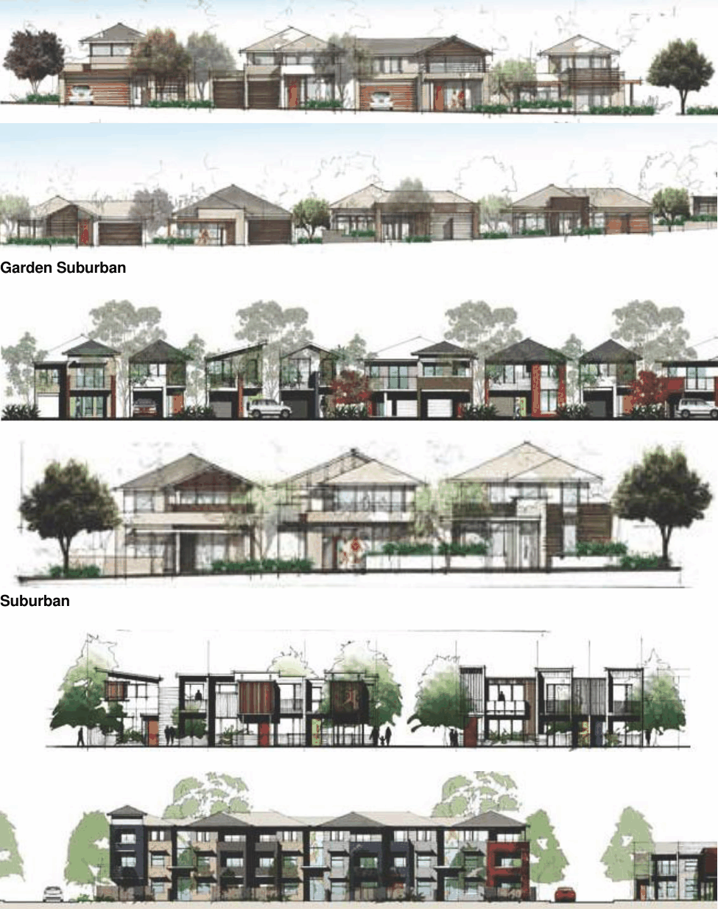

> [Picture on page 47: a picture, saved as a picture (images/vineyard-precinct-stage-1-development-control-plan-page-47-1.gif, 150 dpi).]

#### Garden Suburban

#### Suburban

#### Urban

Figure 4-2 Distinct and coherent streetscapes occur in varying proportions in density bands

3\) Residential development in the Environmental Living area, on Figure 4-3 is to:

• consist primarily of single dwellings on larger lots, reflecting the environmental sensitivity and visual character of these parts of the Precinct;

• emphasise high quality housing design to make the most of the environmental characteristics of the surrounding area;

• be designed and located to minimise impacts on flood prone land and risks to property from flooding;

• avoid impacts on Existing Native Vegetation and other remnant native vegetation;

• consider relationships to adjoining land uses including public open space and drainage infrastructure;

• be designed to respond to constraints from infrastructure; and

• consider views to and from the land and surrounding parts of the Precinct.

4\) Non-residential development in the residential areas is encouraged where it:

• contributes to the amenity and character of the residential area within which it is located;

• provides services, facilities or other opportunities that meet the needs of the surrounding residential population, and contributes to reduced motor vehicle use;

• will not result in detrimental impacts on the amenity and safety of surrounding residential areas, including factors such as noise and air quality; and

• is of a design that is visually and functionally integrated with the surrounding residential area.

Note: The Vineyard Precinct Plan permits certain non-residential development within the residential and environment protection zones. Other parts of this DCP provide more detailed objectives and controls for these types of development.

#### 4.1.2 Block and Lot Layout

#### Objectives

a. To establish a clear urban structure that promotes a ‘sense of neighbourhood’ and encourages walking and cycling.

b. To efficiently utilise land and achieve the target dwelling yields for the Precinct.

c. To emphasise the natural attributes of the site and reinforce neighbourhood identity through the placement of visible key landmark features, such as parks, squares and landmark buildings.

d. To optimise outlook and proximity to public and community facilities, parks and public transport with increased residential density.

e. To encourage variety in dwelling size, type and design to promote housing choice and create attractive streetscapes with distinctive characters.

f. To accommodate a mix of lot sizes and dwelling types across the Precinct.

g. To establish minimum lot sizes for different residential dwelling types.

#### Controls Blocks

1\) Subdivision layout is to create a legible and permeable street hierarchy that responds to the natural site topography, the location of existing significant trees and site features, place making opportunities and solar design principles.

2\) Pedestrian connectivity is to be maximised within and between each residential neighbourhood with a particular focus on pedestrian routes connecting to public open space, bus stops and railway stations, educational establishments and community/recreation facilities.

3\) Street blocks are to be generally a maximum of 250m long and 70m deep.  Block lengths in excess of 250m may be considered by Council where pedestrian connectivity, stormwater management and traffic safety objectives are achieved.  In areas around town centres, the block perimeters should generally be a maximum of 520m (typically 190m x 70m) to increase permeability and promote walking.

#### Lots

4\) Minimum lot sizes for each dwelling type are to comply with the minimum lot size provisions permitted by the Growth Centres SEPP, summarised in Table 4-2.  In certain density bands, variations to some lot sizes may be possible subject to Part 4 of the Vineyard Precinct Plan in the Growth Centres SEPP.

5\) Minimum lot frontages applying to each density band will comply with Table 4-3.  Lot frontage is measured at the street facing building line as indicated in Figure 4-4.

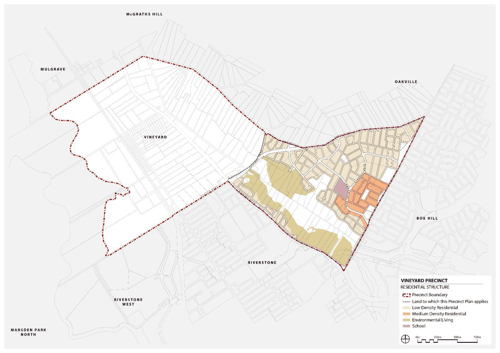

> [Picture on page 50: a picture, saved as a picture (images/vineyard-precinct-stage-1-development-control-plan-page-50-1.gif, 150 dpi).]

Figure 4-3 Residential Structure

Table 4-2 Minimum lot size by density bands

|  | R2 Low Density Residential | R3 Medium Density Residential |
|---|---|---|
| Residential density range (dwellings/ha) | 15-18 | 20-30 |
| Dwelling House (base control) | 300 | 300 |
| With Building Envelope Plan (BEP) | 250 | 225 |
| As Integrated DA | 250 | 125 |
| Locational criteria* (BEP or Integrated DA) | 225 | N/A |
| Studio Dwelling | No minimum lot size as strata development not subject to minimum lot size controls |  |
| Secondary Dwelling | 450 | In principal lot |
| Dual Occupancy | 500 | 400 |
| Semi Detached Dwelling | 200 | 125 |
| Attached Dwelling | 375* | 375 |
| Multi Dwelling Housing | 375* | 375 |
| Manor Homes | N/A | 600 |
| Residential Flat Buildings | N/A | 2000 |

#### Notes:

\* On land zoned R2 Low Density Residential with a minimum residential density of 15dw/ha, the minimum development lot size for the purposes of a dwelling house can be varied to 225m2 in places that satisfy one of the following locational criteria. Attached and multi dwelling housing is also permissible on land zoned

R2 Low Density Residential with a minimum residential density of 15dw/ha that also satisfies one of these criteria:

a. adjoining land within the RE1 Public Recreation zone or land that is separated from land within the

RE1 Public Recreation zone only by a public road;

b. adjoining land within the B2 Local Centre zone or the B4 Mixed Use zone or land that is separated from land the B2 Local Centre zone or the B4 Mixed Use zone only by a public road;

c. adjoining land that is set aside for drainage or educational purposes, or is separated from that land only by a public road; and is within 400m of land in the B2 Local Centre zone or the B4 Mixed Use zone.

Table 4-3 Minimum lot frontages by density bands

|  |  | Net Residential Density Range (dw/ha) |  |
|---|---|---|---|
|  |  | 15-18 | 20-30 |
| Minimum Lot Frontages | Front Loaded Rear Loaded | 9m 4.5m | 7m 4.5m |

Note: The combination of the lot frontage width and the size of the lot determine the type of dwelling that can be erected on the lot, and the development controls that apply to that dwelling.

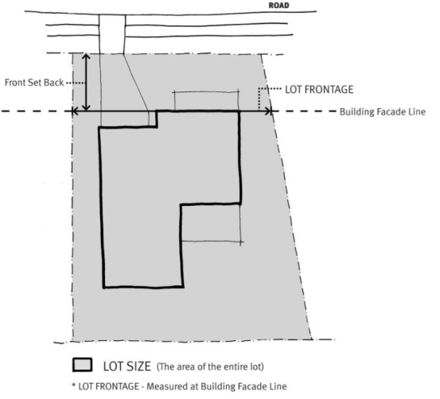

> [Picture on page 52: a picture, saved as a picture (images/vineyard-precinct-stage-1-development-control-plan-page-52-1.gif, 150 dpi).]

Figure 4-4 Measurement of minimum lot widths and lot area

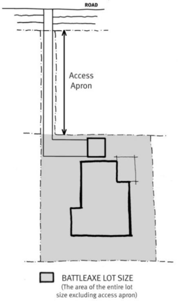

> [Picture on page 52: a picture, saved as a picture (images/vineyard-precinct-stage-1-development-control-plan-page-52-3.gif, 150 dpi).]

6\) A range of residential lot types (area, frontage, depth, zero lot and access) must be provided to ensure a mix of housing types and dwelling sizes and to create coherent streetscapes with distinctive garden suburban, suburban and urban characters across a neighbourhood.

7\) In areas with a density range of 15-18 dw/ha no more than 40% of the total residential lots proposed in any one street block may have a frontage of less than 10m wide. Lots subdivided using Subdivision Approval Pathway B1 or B2 (Integrated Housing) for attached dwellings are exempt from this control.

8\) A street block is defined as a portion of a city, town etc., enclosed by (usually four) neighbouring and intersecting streets. In the density range 20-30 dw/ha, total lot frontage for front accessed lots greater than or equal to 7m and less than 9m should not exceed 20% of any block length due to garage dominance and on-street parking impacts.

9\) Lots should be rectangular. Where lots are an irregular shape, they are to be large enough and oriented appropriately to enable dwellings to meet the controls in this DCP.

10\) Where residential development adjoins land zoned RE1 Public Recreation or SP2 Drainage, subdivision is to create lots for the dwelling and main residential entry to front the open space or drainage land.

11\) The orientation and configuration of lots is to be generally consistent with the following subdivision principles:

• smallest lots achievable for the given orientations fronting parks and open space with the larger lots in the back streets;

• larger lots on corners;

• north to the front lots are either the widest or deepest lots, or lots suitable for residential development forms with private open space at the front.  Narrowest lots with north to the rear.

12\) The preferred block orientation is established by the road layout on the ILP.  Optimal lot orientation is east-west, or north-south where the road pattern requires.  Exceptions to the preferred lot orientation may be considered where factors such as the layout of existing roads and cadastral boundaries, or topography and drainage lines, prevent achievement of the preferred orientation.

13\) An alternative lot orientation may be considered where other amenities such as views and outlook over open space are available, and providing appropriate solar access and overshadowing

outcomes can be achieved.

#### Zero Lot Lines

14\) The location of a zero lot line is to be determined primarily by topography and should be on the low side of the lot to minimise water penetration and termite issues.  Other factors to consider include dwelling design, adjoining dwellings, landscape features, street trees, vehicle crossovers and the lot orientation.

15\) On all lots where a zero lot line is permitted, the side of the allotment that may have a zero lot alignment must be shown on the approved subdivision plan.

16\) Where a zero lot line is nominated on an allotment on the subdivision plan, the adjoining (burdened) allotment is to include a 900mm easement for single storey zero lot walls and 1200mm for two storey zero lot walls to enable servicing, construction and maintenance of the adjoining dwelling. No overhanging eaves, gutters or services (including rainwater tanks, hot water units, air-conditioning units or the like) of the dwelling on the benefited lot will be permitted within the easement.  Any services and projections permitted within the easement to the burdened lot dwelling should not impede the ability for maintenance to be undertaken to the benefitted lot.

17\) The S88B instrument for the subject (benefited) lot and the adjoining (burdened) lot shall include a note identifying the potential for a building to have a zero lot line.  The S88B instrument supporting the easement is to be worded so that Council is removed from any dispute resolution process between adjoining allotments.

#### Subdivision of Shallow Lots

18\) Shallow lots (typical depth 14-18m, typical area <200m2) intended for double storey dwellings should be located only in locations where it can be demonstrated that impacts on adjoining lots, such as overshadowing and overlooking of private open space, satisfy the requirements of the DCP.  For lots over 225m2 where development is not Integrated Assessment, the Building Envelope Plan should demonstrate in principle how DCP requirements such as solar access and privacy to neighbouring private open spaces will be satisfied.

#### Subdivision for Attached Dwellings

19\) Subdivision of lots for Torrens title attached dwellings must take into account that construction will be in 'sets'.  A 'set' is a group of attached dwellings built together at the same time that are designed and constructed independently from other dwellings.

20\) The maximum number of attached or abutted dwellings permissible in a set is six.

21\) The composition of sets needs to be determined in the subdivision design to take into account the lot width required for a side setback to the end dwellings in each set.  Examples of lot subdivisions for sets of attached terraces are illustrated in Figure 4-5.

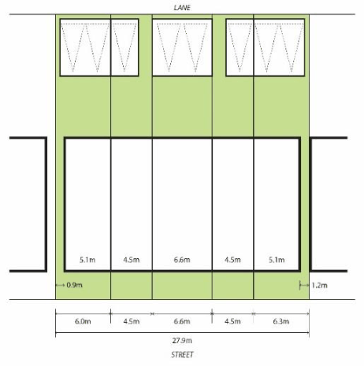

> [Picture on page 54: a picture, saved as a picture (images/vineyard-precinct-stage-1-development-control-plan-page-54-1.gif, 150 dpi).]

Figure 4-5 Two examples of lot subdivision for ‘sets’ of attached terraces

#### 4.1.3 Battle-axe lots

#### Objectives

a. To limit battle-axe lots to certain circumstances.

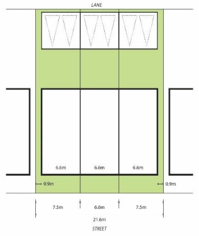

> [Picture on page 54: a picture, saved as a picture (images/vineyard-precinct-stage-1-development-control-plan-page-54-6.gif, 150 dpi).]

b. To ensure that where a battle-axe lot without public road or open space frontage is provided, their amenity and the amenity of neighbouring lots is not compromised by their location.

c. To enable battle-axe shaped lots or shared driveway access to lots fronting access denied roads.

#### Controls

1\) Principles for the location of battle-axe lots are illustrated at Figure 4-6.

2\) Subdivision layout should minimise the use of battle-axe lots without public frontage to resolve residual land issues.

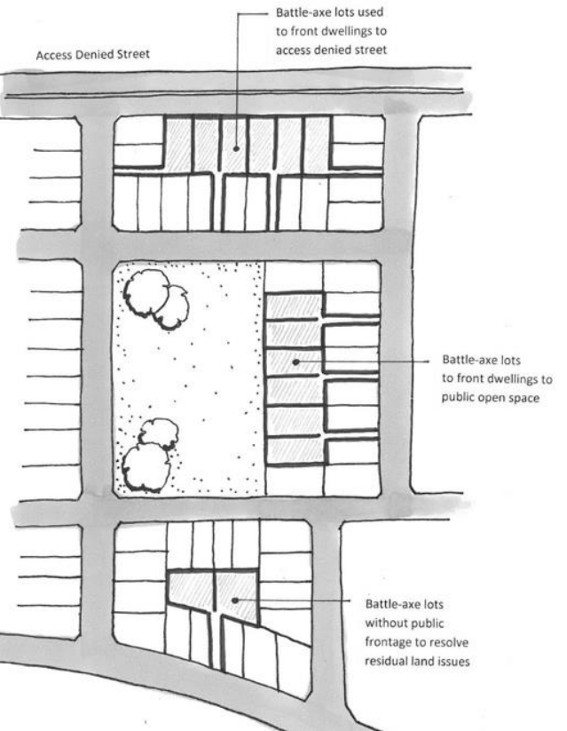

> [Picture on page 55: a picture, saved as a picture (images/vineyard-precinct-stage-1-development-control-plan-page-55-1.gif, 150 dpi).]

Figure 4-6 Examples of locations of battle-axe lots

3\) Driveway design, including dimensions and corner splays, are to be in accordance with Figure 4- 7 and the following: Driveway to a single battle axe lot:

• The driveway access shall be a minimum of 3.5 metres wide with paved driveway of 2.5m wide and 0.5m wide strip along either side of the driveway for services and landscaping.

• Lots along the driveway bends should allow for a splay to accommodate a 3m radius driveway curve for safe vehicle turning. Access to multiple battle axe lots (shared driveway):

• The driveway access shall be a minimum of 5 metres wide with paved driveway of 3m wide and 1m wide strip along either side of the driveway for services and landscaping.

• Lots along the driveway bends should allow for a splay to accommodate 3m radius curve for safe vehicle turning.

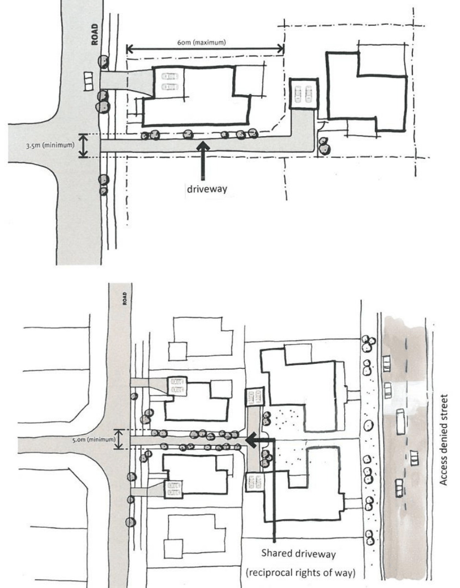

> [Picture on page 56: a picture, saved as a picture (images/vineyard-precinct-stage-1-development-control-plan-page-56-1.gif, 150 dpi).]

Figure 4-7 Examples of driveways and shared driveways for battle-axe lots

#### 4.1.4 Corner Lots

#### Objectives

a. To ensure corner lots are of sufficient dimensions and size to enable residential controls to be met.

#### Controls

1\) Corner lots, including splays and driveway locations, are to be designed in accordance with Australian Standard AS 2890 Parking Facilities, Hawkesbury City Council’s Civil Works Specifications and the following requirements:

• Corner lots shall allow for a splay of minimum 3m x 3m for pedestrian sight distance, vehicle turning, footpaving and landscaping.

• The driveway location is not permitted within 6m of the kerb as it turns the corner to form a road, see Figure 4-8.

• Where a corner lot fronts a roundabout, the driveway shall be set back 10m from the splay.

2\) Corner lots are to be designed to allow dwellings to positively address both street frontages as indicated in Figure 4-8Figure 4-8 Corner lots

3\) Garages on corner lots should be accessed from the secondary street or a rear lane.

4\) Plans of subdivision are to show the location of proposed or existing substations, kiosks, sewer access points and/or vents affecting corner lots.

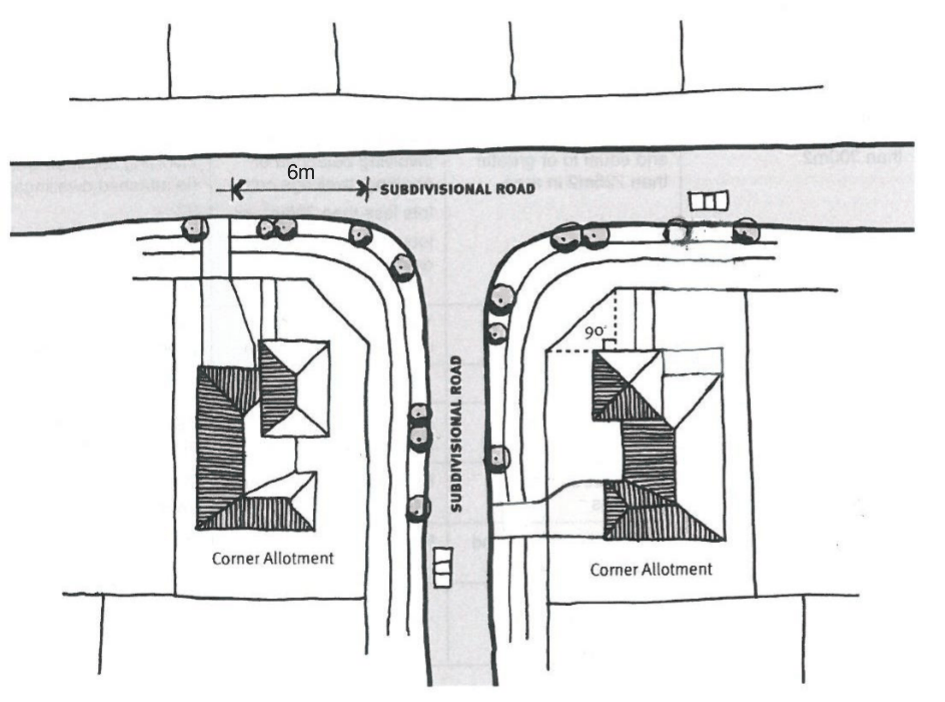

> [Picture on page 58: a picture, saved as a picture (images/vineyard-precinct-stage-1-development-control-plan-page-58-4.gif, 150 dpi).]
> Words printed on the picture (title and legend, copied from the PDF):
> 6m

Figure 4-8 Corner lots

#### 4.1.5 Environmental Living Lots

#### Objectives

To ensure lots created on land zoned E4 Environmental Living are of sufficient dimensions and size to enable residential controls to be met.

#### Controls

1\) Minimum subdivision lot sizes for E4 Environmental Living zoned land are set out in the Growth Centres SEPP map ‘Lot Size Map’ and include 600m2 1,500m2, 2,500m2, 10,000m2 and 20,000m2.

2\) For lots with a minimum subdivision size of 1,500m2, a minimum lot width of 20m is required.

3\) For lots with a minimum subdivision size of 2,500m2 or greater, a minimum lot width of 30m is required.

### 4.2 Subdivision Approval Process

#### Objectives

a. To facilitate a diversity of housing sizes and products.

b. To ensure that subdivision and development on smaller lots is undertaken in a coordinated manner.

c. To ensure that all residential lots achieve an appropriate level of amenity.

#### Controls

1\) The land subdivision approval process is to be consistent with the requirements of Table 4-4.

2\) Subdivision of land creating residential lots less than 225m2 or lots less than 9m wide shall include a dwelling design as part of the subdivision DA.  The dwelling design is to be included on the S88B instrument attached to the lot.

Table 4-4 Subdivision Approval Process

| Approval pathway | DA for Subdivision Pathway A1 | DA for Subdivision with Building Envelope Plan Pathway A2 | DA for Integrated Housing (Integrated Assessment with subdivision prior to construction of dwellings) Pathway B1 | DA for Integrated Housing Pathway B2 |
|---|---|---|---|---|
| Application | Lots equal to greater than 300m2 | Lots less than 300m2 and equal to or greater than 225m2 in area, and with a width equal to or greater than 9m*. | Dwelling construction involving detached dwellings on: lots less than 225m2, or lots with a width less than 9m*. | Dwelling construction involving common walls (i.e. attached dwellings) on: lots less than 225m2, or lots with a width less than 9m*. |
| Dwelling plans required | As part of future DA or CDC | As part of future DA or CDC | Yes as part of subdivision application | Yes as part of subdivision application |
| Dwelling Design 88B restriction required | No | Yes | Yes, only approved dwelling can be built | Yes, only approved dwelling can be built |
| Timing of subdivision (release of linen plan) | Pre-construction of dwellings | Pre-construction of dwellings | Pre-construction of dwellings | Post-construction of dwellings |

\*For minimum lot width refer to Figure 4-4

3\) Subdivision applications that create lots smaller than 300m2 and larger than or equal to 225m2 must be accompanied by a Building Envelope Plan (BEP).  An example of a BEP is included at Figure 4-9. The BEP should be at a legible scale (suggested 1:500) and include the following elements:

• lot numbers, north point, scale, drawing title and site labels such as street names;

• maximum permissible building envelope (setbacks, storeys, articulation zones);

• preferred principal private open space;

• garage size (single or double) and location; and

• zero lot line boundaries. A BEP should be fit for purpose and include only those elements that are necessary for that particular lot.  Other elements that may be relevant to show include:

• special fencing requirements;

• easements and sewer lines;

• retaining walls;

• preferred entry/frontage (e.g. corner lots);

• access denied frontages;

• electricity kiosks or substations; and

• indicative yield on residue or super lots.

4\) Applications for subdivision using approval pathways A2, B1 and B2 require a Public Domain Plan (PDP) to be submitted as part of the application.  The purpose of the PDP is to demonstrate how the public domain will be developed as a result of future development on the proposed lots.  An example of a PDP is included at Figure 4-10.

5\) The PDP should be a legible scale (suggested 1:500) and include the following elements:

• lot numbers, north point, scale, drawing title and site labels such as street names;

• indicative building footprints on the residential lots;

• location of driveways and driveway crossovers;

• verge design (footpath, landscape);

• surrounding streets and lanes (kerb line, material surface where special treatments proposed);

• in laneways, indicative provision for bin collection;

• street tree locations (sizes and species list can be provided on a separate plan);

• demonstrated provision and arrangements for on-street car parking particularly in relation to street tree planting, driveways and intersections*; and

• extent of kerb line where parking is not permitted*. * In principle, not as public domain works Other elements that may be relevant to show include:

• location and type of any proposed street furniture;

• location of retaining walls in the public domain;

• electricity substations; and

• indicative hydrant locations at lane thresholds. Information on landscape treatment within the private lot is not required.

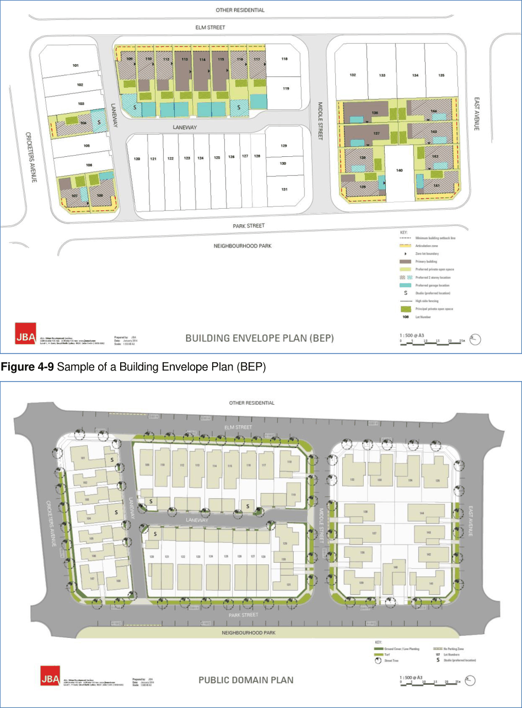

> [Picture on page 61: a picture, saved as a picture (images/vineyard-precinct-stage-1-development-control-plan-page-61-1.gif, 150 dpi).]

Figure 4-9 Sample of a Building Envelope Plan (BEP)

Figure 4-10 Sample of a Public Domain Plan (PDP)

### 4.3 Construction Environmental Management

#### Objectives

a. To ensure that the construction of subdivisions, new buildings, other structures and works is done in an environmentally responsible manner.

#### Controls

1\) A Construction Environmental Management Plan is to be submitted to Council or the accredited certifier and approved prior to the issue of a construction certification for subdivision works.

2\) The Construction Environmental Management Plan is to detail the methods of ensuring the protection of the environment during construction, monitoring and reporting on construction activities, and procedures to be followed in the event of an incident that is likely to cause harm to the environment.

3\) Construction activities are to be undertaken to ensure that water quality, soil stability, trees and vegetation cover, and heritage sites are protected in accordance with the development consent and to maintain the quality of the natural environment.

4\) Preservation of trees and native vegetation during construction is to be in accordance with the development consent issued for the development, and with the native vegetation and tree preservation provisions of the Vineyard Precinct Plan.

### 4.4 Movement Network

#### 4.4.1 Street layout and design

#### Objectives

a. To establish a hierarchy of interconnected streets that give safe, convenient and clear access within and beyond the Precinct.

b. To contribute to the creation of an interesting and attractive streetscape.

#### Controls

1\) Roads are to be provided in accordance with the hierarchy shown on Figure 4-11.

2\) The design of streets, roundabouts and intersections is to be consistent with the relevant typical designs in Figure 4-12 to Figure 4-18, Table 4-5 and Hawkesbury City Council’s Civil Works Specifications. Alternative street designs for local streets and access ways may be permitted on a case by case basis if they preserve the functional objectives and requirements of the design standards.

3\) The locations and alignments of all roads are to be generally in accordance with the locations shown on Figure 4-11. Where any variation to the residential street network indicated at Figure 4- 11 is proposed the alternative street network is to be designed to:

• create a permeable network that is based on a modified grid system;

• encourage walking and cycling and minimise travel distances;

• maximise connectivity between residential areas and community facilities, open space and centres;

• take account of topography and site drainage, and accommodate significant vegetation;

• optimise solar access opportunities for dwellings;

• provide frontage to and maximise surveillance of open space and drainage lands;

• provide views and vistas to landscape features and visual connections to nodal points and centres;

• maximise the effectiveness of water sensitive urban design measures; and

• minimise the use of cul-de-sacs. Applicants wishing to amend the proposed road pattern are advised to liaise with affected adjoining owners prior to the submission of the DA. Variation to the residential street network will only be approved by Council where the applicant can demonstrate to Council’s satisfaction that the proposal:

• will not detrimentally impact on access to adjoining properties;

• provides for the management of stormwater to drain to Council’s trunk drainage network, without negative impacts on other properties;

• will not impede the orderly development of adjoining properties in accordance with the Vineyard Precinct Plan and this DCP; and

• does not restrict the ability to provide water, sewer, electricity and other essential services to adjoining properties.

4\) Where necessary to ensure that access to residential properties is provided in the early stages of development, Council may consent to the construction and operation of temporary access roads. Temporary access roads are to remain in operation only until such time as the road network has been developed to provide permanent access to all properties.

5\) Residential roads, i.e. minor collector roads, local streets, access road/places shall be designed for and sign posted at a maximum of 50kph (i.e. traffic management must be considered at the DA for subdivision, with road layout, intersection controls and speed reducing devices used to produce a traffic environment which reduces traffic speed).

6\) The minimum distance from an access place to a collector road is to be 50m if the junction is on the same side of the road or 40m if staggered on the opposite side of the road. The minimum distance between collector roads is to be 100m if the junction is on the same side or 100m if it is staggered on the opposite side of the road.

7\) Where four way intersections are proposed, traffic is to be controlled, where appropriate, by traffic lights, roundabouts, median strips or signage.

8\) Any private road is to be designed and built in accordance with Council’s Civil Works Specifications. Details must be shown on the engineering design plans and must be submitted prior to the issue of the occupation or subdivision certificate (whichever occurs first).

9\) Street trees are required for all streets. Street planting is to:

• use the preferred species listed in Appendix D;

• be consistently used to distinguish between public and private spaces and between different classes of street within the street hierarchy;

• minimise risk to utilities and services;

• be durable and suited to the street environment and, wherever appropriate, include endemic species;

• maintain adequate lines of sight for vehicles and pedestrians, especially around driveways and street corners;

• provide appropriate shade in summer and solar access in winter; and

• provide an attractive and interesting landscape character and clearly define public and private areas, without blocking the potential for street surveillance.

10\) Signage, street furniture and lighting is to be:

• designed to reinforce the distinct identity of the development;

• coordinated in design and style;

• located so as to minimise visual clutter and obstruction of the public domain; and

• of a colour and construction agreed by Council.

11\) Locating entry signage and the like within a public road reserve is subject to Council agreement.

12\) The location and design of signage and street furniture is to be indicated on the Landscape Plan and on engineering construction drawings.

13\) Street lighting is to be designed to meet the current Australian Standards AS/NZS 1158 series. Shared pedestrian and bicycle pathways are to be provided generally in accordance with Figure 4-18.

Table 4-5 Street Types

| Road/ Street Type | Description |
|---|---|
| Collector | Collector roads collect traffic from local streets and carry a higher volume of traffic, linking neighbourhoods and centres and accommodating public transport routes. Amenity and safety is to be maintained by restricting vehicle speeds through traffic-calming measures and intersection design. Intermittent parking with landscaping is permitted on both sides of the street. Refer to Figure 4-12 for a typical collector road cross section. |
| Local | Local streets provide local residential access. These streets are designed to slow residential traffic in order to give priority to pedestrians and cyclists. Amenity and safety is to be maintained by introducing various traffic calming measures. On-street parking is permitted on both sides of the street. Refer to Figure 4-13 typical access street for a typical local street cross section. |
| Access | Access places may be used where: • the access place separates residential land from open space or drainage land; • the road is not a through traffic route (ie it provides access only to residences on it); • the maximum number of dwellings serviced by the access place is 10; and • on-street parking is permitted on one side of the street only. Refer to Figure 4-14 for a typical access street cross section. Note: Where an access street has frontage to open space or drainage land, the footpath must be constructed as part of the access street. Where the access street is adjacent to a sub-arterial or arterial road, the footpath is not required. |

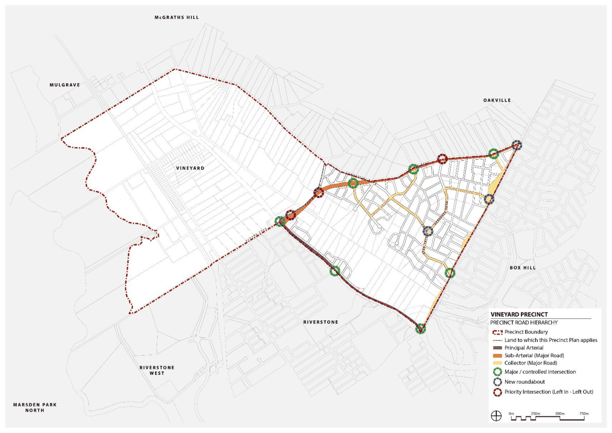

> [Picture on page 65: a picture, saved as a picture (images/vineyard-precinct-stage-1-development-control-plan-page-65-1.gif, 150 dpi).]

Figure 4-11 Precinct Road Hierarchy

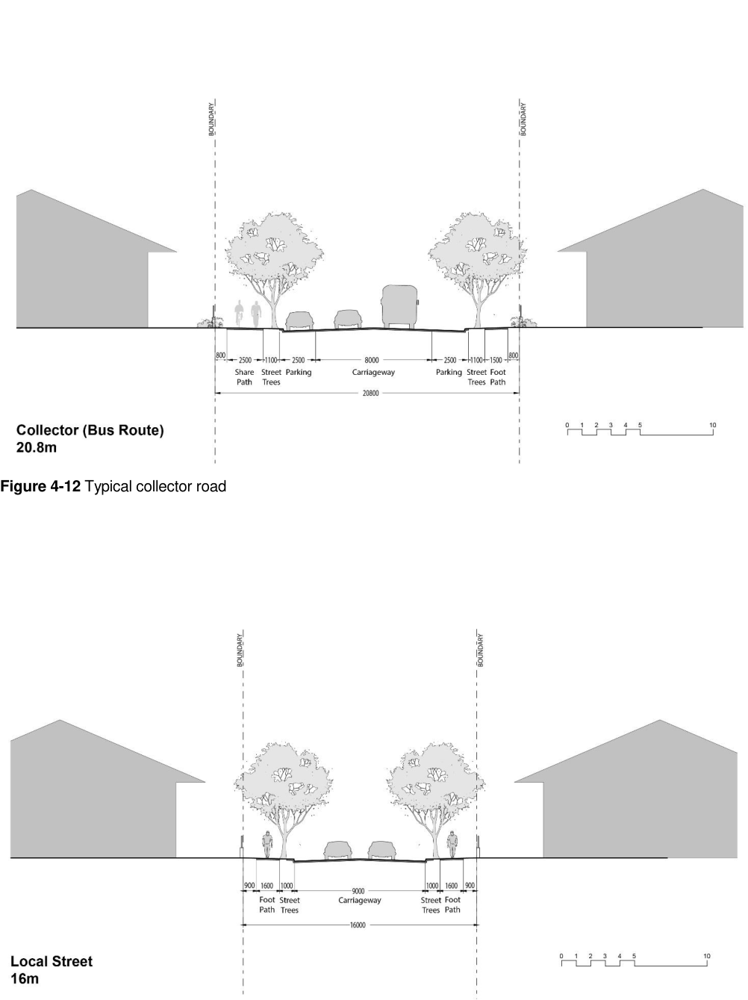

> [Picture on page 66: a picture, saved as a picture (images/vineyard-precinct-stage-1-development-control-plan-page-66-1.gif, 150 dpi).]

Figure 4-12 Typical collector road

Figure 4-13 Typical local street

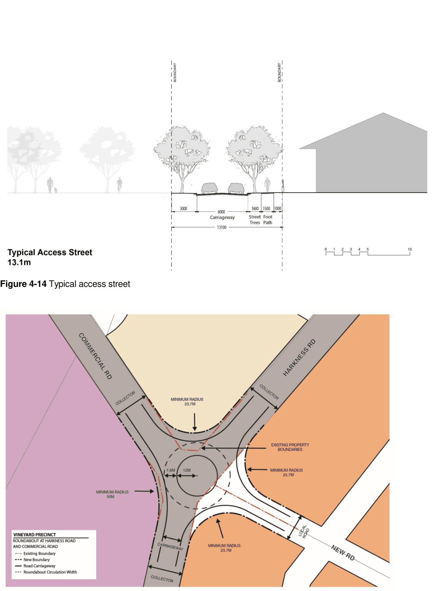

> [Picture on page 67: a picture, saved as a picture (images/vineyard-precinct-stage-1-development-control-plan-page-67-1.gif, 150 dpi).]

Figure 4-14 Typical access street

Figure 4-15 Indicative location and design of roundabout at Harkness Road and Commercial Road

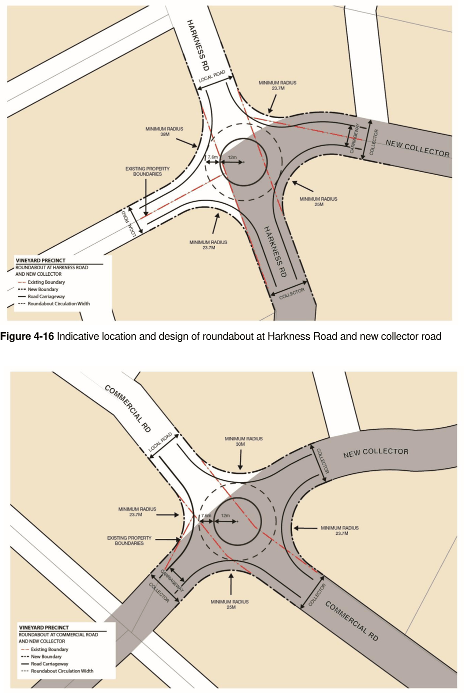

> [Picture on page 68: a picture, saved as a picture (images/vineyard-precinct-stage-1-development-control-plan-page-68-1.gif, 150 dpi).]

Figure 4-16 Indicative location and design of roundabout at Harkness Road and new collector road

Figure 4-17 Indicative location and design of roundabout at Commercial Road and new collector road

Note: Figures 4-15 to 4-17 are indicative only and are subject to further detailed design at DA stage. The detailed design is to consider matters such as vehicle type and speed, roundabout location and geometry, deflection, sight distances and adequacy of road reserve widths.

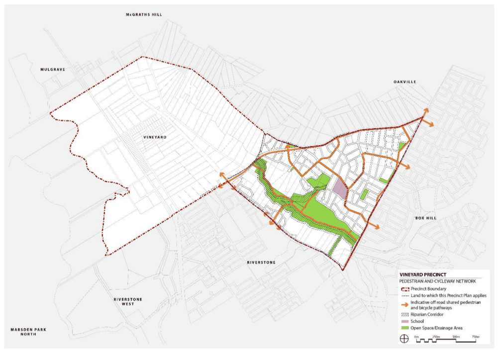

> [Picture on page 69: a picture, saved as a picture (images/vineyard-precinct-stage-1-development-control-plan-page-69-4.gif, 150 dpi).]

Figure 4-18 Indicative location of off road shared pedestrian and bicycle pathways

#### 4.4.2 Laneways

Laneways are public roads that are shareways, utilitarian throughways of the street network that provide rear vehicular access to compact or restricted access lots.  The primary purpose of rear laneways is to create attractive front residential streets by removing garages and driveway cuts from the street frontages, improving the presentation of houses and maximising on street parking spaces and street trees.  Laneways are a ‘sacrificial’ network device: while they should be neat and tidy, they should not be confused with streets in width, character or function. A laneway is a shareway, designed to be shared by all users whether they are pedestrians, cyclists or drivers.  Equal priority between all users reinforces the distinctive, slow speed environment for drivers. In the design and subdivision of lots, laneways should be provided with casual surveillance from available second floor rooms and balconies over garages.  Various building forms can provide this casual surveillance along the lane such as studio dwellings, secondary dwellings and rooms of the principal dwelling or lofts over garages.  Separate titling of studio dwellings may affect servicing requirements. Generally there will be no underground services in the laneway (except for streetlights) as the studios will be strata titled so power, water, gas, sewer and communications will be located in the front street and reticulated from the front of the allotment through the lot to the rear studio.

#### Objectives

a. To provide vehicular access to the rear or side of lots where front access is restricted or not possible, particularly narrow lots where front garaging is not permitted.

b. To reduce garage dominance in residential streets.

c. To maximise on-street parking spaces and landscaping in residential streets.

d. To provide opportunities for affordable housing options.

e. To reduce vehicular conflict through reduced driveway cross overs and focusing of traffic to known points.

f. To enable garbage collection.

g. To facilitate the use of attached and narrow lot housing to achieve overall higher neighbourhood densities.

h. To create a slow speed shared zone requiring co-operative driving practices for the very low volume and frequency of vehicle movements that is distinctly different in character and materials to residential streets.

#### Controls

1\) The design and construction of laneways is to be consistent with Figure 4-19. Laneways are to be designed in accordance with RMS technical direction TTD2016/001 Design and Implementation of Shared Zones Including Provision for Parking.

2\) The laneway is a public "shareway" as the paved surface is for cyclists, pedestrians, garbage collection, mail deliveries, cars etc., with a 10 km speed limit and driveway-style crossovers to the street rather than a road junction.

3\) The minimum garage doorway widths for manoeuvrability in this laneway section are 2.4m (single) and 4.8m (double).

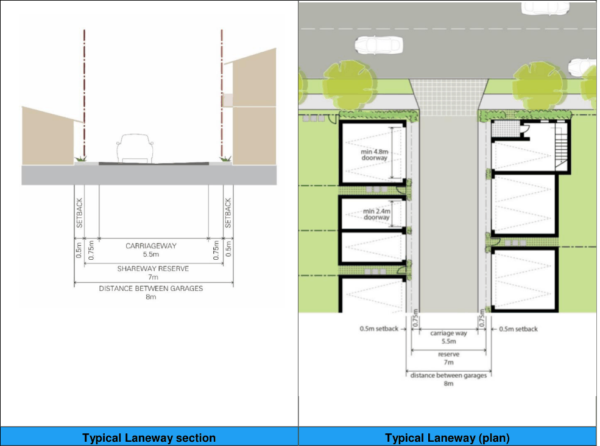

> [Picture on page 71: a picture, saved as a picture (images/vineyard-precinct-stage-1-development-control-plan-page-71-1.gif, 150 dpi).]
> Words printed on the picture (title and legend, copied from the PDF):
> Typical Laneway section
> Typical Laneway (plan)

Figure 4-19 Laneway principles

4\) The configuration of the laneway, associated subdivision and likely arrangement of garages arising from that subdivision should create ordered, safe and tidy laneways by designing out ambiguous spaces and unintended uses such as casual parking, the storage of trailers, bin stacking etc.

5\) The layout of laneways should take into account subdivision efficiency, maximising favourable lot orientations, intersection locations with streets, topography, opportunities for affordable housing, legibility and passive surveillance.

• Generally, straight layouts across the block are preferred for safety and legibility, but the detailed alignment can employ subtle bends or secondary or studio dwellings over garages to add visual interest and avoid long distance monotonous views.  "C" shaped layouts with the laneway length parallel to the front street can limit the views of laneways from residential streets to short sections.  However, if the laneway is used for garbage collection, any bends or intersections are to be sized for garbage truck movements.  Suggested layouts are shown on Figure 4-20.

• Lanes on sloping land with significant longitudinal and/or cross falls require detailed design consideration to demonstrate functionality.

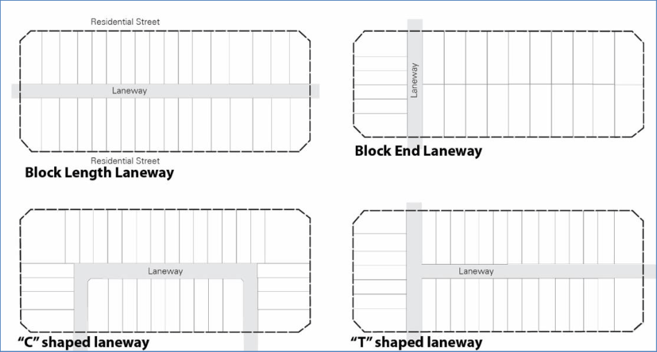

> [Picture on page 72: a picture, saved as a picture (images/vineyard-precinct-stage-1-development-control-plan-page-72-1.gif, 150 dpi).]

Figure 4-20 Sample lane layouts

6\) Laneways that create a 'fronts to backs' layout (front addressed principal dwellings on one side and rear accessed garages on the other side) are to be avoided.

7\) All lots adjoining a laneway should utilise the laneway for vehicular/garage access.

8\) Passive surveillance along the laneway from the upper storey rooms or balconies of secondary dwellings, studio dwellings, principal dwelling or lofts over rear garages is encouraged.  Ground floor habitable rooms on laneways are to be avoided unless they are located on external corners (laneway with a street) and face the street to take advantage of the residential street for an address, shown in Figure 4-21 as lane entry/street corner lots.

9\) Figure 4-21 indicates mid-lane lots and internal corner locations (lane with another lane) where ground floor habitable rooms in secondary dwellings or strata studios (marked 'S') are to be avoided.

10\) A continuous run of secondary dwellings or strata studios along the lane is to be avoided, as it changes the character, purpose and function of the lane.  No more than 25% of the lots adjoining lanes (excluding street corner lots with studio at the lane entry) are to have secondary dwellings or strata studios.  See Figure 4-21.

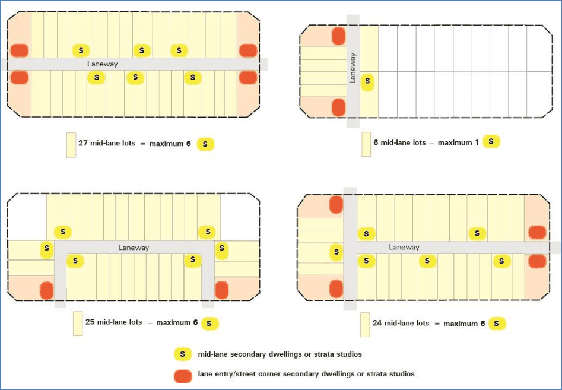

> [Picture on page 73: a picture, saved as a picture (images/vineyard-precinct-stage-1-development-control-plan-page-73-1.gif, 150 dpi).]

Figure 4-21 Sample laneways showing maximum number of secondary dwellings or strata studios

11\) All lot boundaries adjoining the lane are to be defined by fencing or built form.  The garage setback to the lane is minimal (0.5m) to allow overhanging eaves or balconies to remain in the lot without creating spaces where people park illegally in front of garages and/or on the laneway.  Deeper balconies requiring larger garage setbacks (up to 2m) may be permitted occasionally along the laneway provided the application demonstrates how the setback space will not create an opportunity for illegal parking, such as the presence of a supporting post or bollard.

#### 4.4.3 Shared Driveways

Shared driveways are privately owned and maintained driveways that serve two or more dwellings through a titling arrangement such as a reciprocal right of way or community title.  Shared driveways are usually of minimal dimensions for vehicle access to lots with only a single access to the street network.  Garbage collection is not a function.  Shared driveways are a useful subdivision device for a small number of dwellings with otherwise difficult access or unavoidable block configurations, but are not a substitute in blocks designed with significant numbers of dwellings requiring rear access by laneways.

#### Objectives

a. To minimise the impact of vehicle access points on the quality of the public domain and pedestrian safety.

b. To provide safe and convenient access to garages, carports and parking areas.

c. To clearly define public and private spaces, such that driveways are for the sole use of residents.

d. To permit casual surveillance of private driveways from dwellings and from the street.

#### Controls

1\) Shared driveways are to be constructed as one of four general types, depending on block geometry

and garages to be accessed. Refer to examples in Figure 4-22.

2\) Shared driveways are to have the smallest configuration possible to serve the required parking facilities and vehicle turning movements.

3\) The driveway crossing the verge between the property boundary and the kerb is to have a maximum width of 5.4 metres.

4\) The location of driveways is to be determined with regard to dwelling design and orientation, street gully pits and tree bays and is to maximise the available on-street parking.

5\) The design of subdivisions incorporating shared driveways must ensure that suitable and convenient garbage collection areas on the street are available for each new lot.

6\) Access to allotments in the vicinity of roundabouts and associated splitter islands shall not be provided within 10m of the roundabout.

7\) Driveways are not to be within 1m of any drainage facilities on the kerb and gutter.

8\) Shared driveways are to have soft landscaped areas on either side, suitable for infiltration.

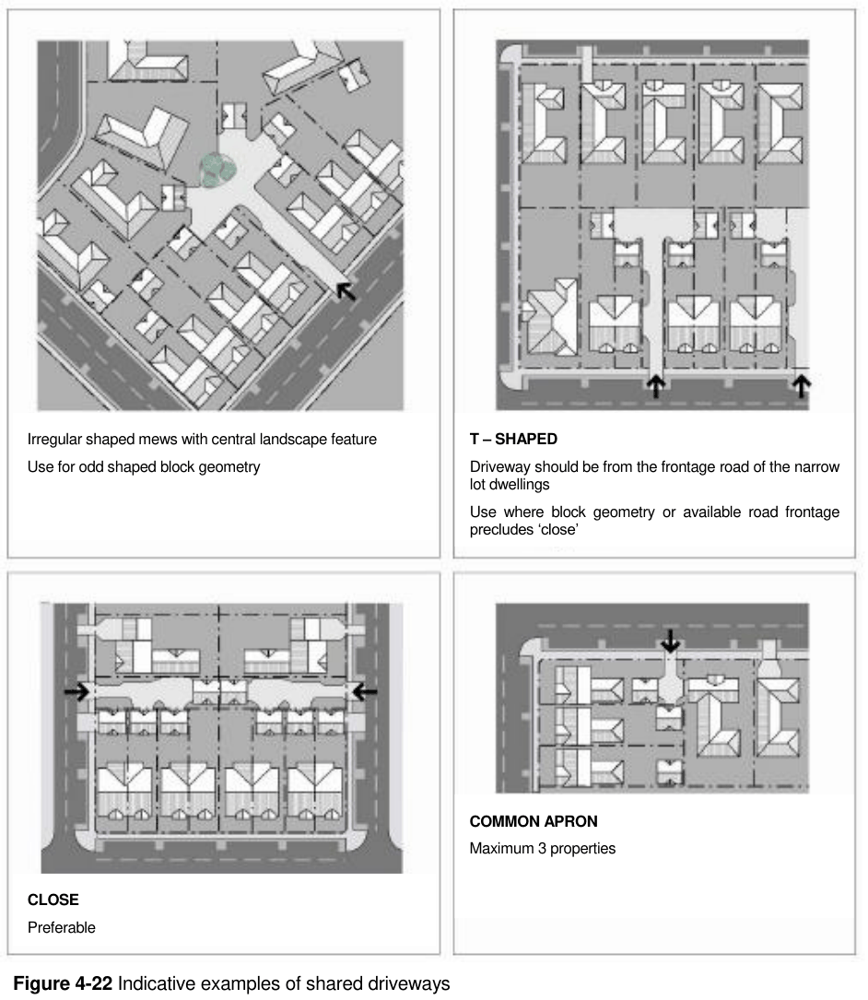

> [Picture on page 75: a picture, saved as a picture (images/vineyard-precinct-stage-1-development-control-plan-page-75-1.gif, 150 dpi).]
> Words printed on the picture (title and legend, copied from the PDF):
> Irregular shaped mews with central landscape feature
> T – SHAPED
> Use for odd shaped block geometry
> Driveway should be from the frontage road of the narrow
> lot dwellings
> Use where block geometry or available road frontage
> precludes ‘close’
> COMMON APRON
> Maximum 3 properties
> CLOSE
> Preferable

Figure 4-22 Indicative examples of shared driveways

#### 4.4.4 Access to arterial and sub-arterial roads

#### Objectives

a. To restrict direct property access to higher order roads to provide for the safe and efficient movement of vehicles on these roads.

#### Controls

1\) Vehicular access to arterial roads and sub-arterial roads shown on Figure 4-11 may only be made by way of another road.

2\) Persons creating allotments adjoining arterial or sub-arterial roads are required to create restrictions on the use of land under Section 88B of the Conveyancing Act 1919 to legally deny direct vehicular access to allotments from the arterial or sub-arterial road.

3\) To enable the development of land, such as in situations where access across adjoining properties

is required but not yet able to be provided, Council may allow temporary access to arterial or sub-arterial roads where:

• the development complies with all other development standards;

• subdivisional roads generally conform with the road pattern shown on the ILP; and

• Council is satisfied that the carrying out of the development will not compromise traffic safety.

4\) Where Council grants such consent, the temporary access must be constructed to Council's standards and conditions will be imposed that access to the designated road by way of the temporary access shall cease when alternative access becomes available.

5\) Access to the residential land fronting Windsor Road may only occur via the local road network. No new direct access off Windsor Road will be permitted.

Note: Approval from the RMS may also be required for any temporary access to a classified road.
