## 5. Development in the Residential and Environment Protection Zones

### 5.1. Dwelling design controls

Under the provisions of the Vineyard Precinct Plan, development consent is generally required for all dwellings in all residential and environment protection zones, except where applications meet the criteria for complying development.  This part of the DCP establishes objectives and controls for the following types of residential accommodation as defined in the Growth Centres SEPP:

• dwelling houses;

• semi-detached dwellings;

• attached dwellings;

• multi-dwelling housing;

• dual occupancy dwellings;

• manor homes;

• residential flat buildings;

• secondary dwellings; and

• studio dwellings. Additional controls for attached dwellings, secondary dwellings, studio dwellings, dual occupancies, multi-dwelling housing, manor homes, residential flat buildings and shop top housing are contained in Parts 5.2.2, 5.2.3, 5.2.4 and 5.2.5. It is acknowledged that innovative dwelling designs are evolving particularly on lots <300m2, and design solutions may be developed that meet the objectives but do not comply with the relevant controls. In density bands ≥20dw/Ha, there is the opportunity to vary the dwelling design controls where agreed to as part of an integrated housing DA at subdivision approval. Note: Reference should be made to the Glossary (Appendix A) for descriptions of the various dwelling types, and to the Vineyard Precinct Plan for statutory definitions of land uses.

#### 5.1.1 Summary of Key Controls

The following Table 5-1 summarises the types of lots and housing. Table 5-1 is diagrammatic only and directs readers to the relevant Table 5-2 to Table 5-6 containing the main development controls. The key controls should be read in conjunction with the controls in the parts that follow.

Table 5-1 Summary of lot and dwelling types

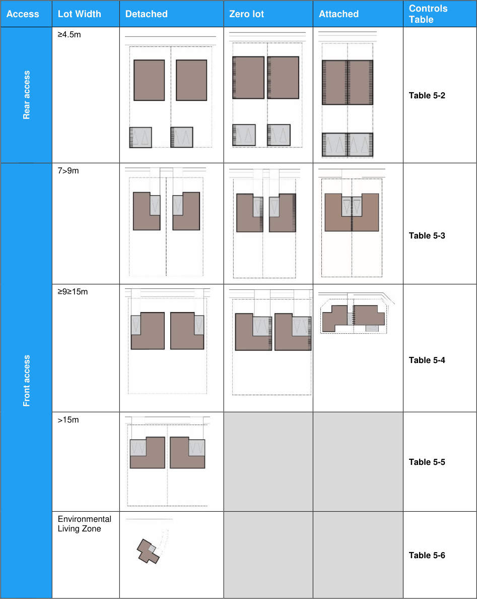

> [Picture on page 79: a map, saved as a picture (images/vineyard-precinct-stage-1-development-control-plan-page-79-2.gif, 150 dpi); the street names and other small labels are on the picture.]
> Words printed on the picture (title and legend, copied from the PDF):
> Access Lot Width Detached

Table 5-2

Table 5-3

Table 5-4

Table 5-5

Table 5-6

Table 5-2 Summary of key controls for lots with frontage width ≥4.5m for rear accessed dwellings

| Element | Control |  |
|---|---|---|
| Front setback (minimum) | In density range 15-18dw/ha: 4.5m to building facade line 3.5m to building façade fronting open space 3m to articulation zone 2m to articulation zone fronting open space | In density range 20-30dw/ha: 3m to building façade line 1.5m to articulation zone |
| Side setback (minimum) | Zero Lot or Attached Boundary (benefited lot) Ground floor: 0m Upper floor: 0m Where a boundary adjoins Public Recreation or Drainage land: 3m | Detached Boundary: 0.9m. If lot burdened by zero lot boundary, side setback must be within easement: 0.9m (single storey zero lot wall) 1.2m (double storey zero lot wall) |
| Maximum length of zero lot line on boundary | Attached house: 15m upper levels only (excludes rear loaded garages) No limit to ground floor | Zero lot house: 15m (excludes rear loaded garages) |
| Rear setback (minimum) | 0.5m (rear loaded garages to lane) |  |
| Corner lots secondary street setback (minimum) | 1m |  |
| Building height, massing and Siting | In density range 15-18dw/ha: 2 storeys maximum (3rd storey subject to Part 5.1.5) | In density range 20-30dw/ha: 3 storeys maximum |
| Site Coverage | Upper level no more than 40% of lot area |  |
| Soft landscaped area | Minimum 15% of lot area The first 1m of the lot measured from the street boundary (excluding paths) is to be soft landscaped |  |
| Principal Private Open Space (PPOS) | In density range 15-18dw/ha: Minimum 16m² with a minimum dimension of 3m | In density range 20-30dw/ha: Minimum 16m² with a minimum dimension of 3m 10m² per dwelling if provided as balcony or rooftop with a minimum dimension of 2.5m |
| Solar access | In density range 15-18dw/ha: At least 3 hours of sunlight between 9am and 3pm at the winter solstice (21 June) to at least 50% of the required PPOS of both the proposed development and the neighbouring properties For alterations and additions to existing dwellings in all density areas, no reduction in the existing solar access to PPOS of the existing neighbouring properties | In density range 20-30dw/ha: At least 3 hours of sunlight between 9am and 3pm at the winter solstice (21 June) to at least 50% of the required PPOS of: • all affected neighbouring properties and • at least 70% of the proposed dwellings |
| Garages and car parking | Rear loaded garage or car space only for lots of this type Minimum garage width 2.4m (single) and 4.8m (double) All parking spaces are to have a minimum depth of 5.5m Maximum garage door width 2.4m (single) and 4.8m (double) 1-2 bedroom dwellings will provide at least 1 car space 3 bedroom or more dwellings will provide at least 2 car spaces |  |

Table 5-3 Summary of key controls for lots with frontage width ≥ 7m and < 9m for front accessed dwellings

| Element | Control |  |
|---|---|---|
| Front setback (minimum) | 4.5m to building facade line 3.5m to building façade fronting open space 3m to articulation zone 2m to articulation zone fronting open space 5.5m to garage line and minimum 1m behind the building line |  |
| Side setback (minimum) | Zero Lot or Attached Boundary (benefited lot) Ground floor: 0m Upper floor: 0m Where a boundary adjoins Public Recreation or Drainage land: 3m | Detached Boundary: 0.9m. If lot burdened by zero lot boundary, side setback must be within easement: 0.9m (single storey zero lot wall) 1.2m (double storey zero lot wall) |
| Maximum length of zero lot line on boundary | 15m |  |
| Rear setback (minimum) | 4m (ground level) and 6m (upper levels) |  |
| Corner lots secondary street setback (minimum) | 1m |  |
| Building height, massing and siting | In density range 15-18dw/ha: 2 storeys maximum (3rd storey subject to Part 5.1.5) | In density range 20-30dw/ha: 3 storeys maximum |
| Site Coverage | Upper level no more than 50% of lot area |  |
| Soft landscaped area | Minimum 15% of lot area The first 1m of the lot measured from the street boundary (excluding paths) is to be soft landscaped |  |
| Principal Private Open Space (PPOS) | In density range 15-18dw/ha: Minimum 16m² with a minimum dimension of 3m | In density range 20-30dw/ha: Minimum 16m² with a minimum dimension of 3m 10m² per dwelling if provided as balcony or rooftop with a minimum dimension of 2.5m |
| Solar access | In density range 15-18dw/ha: At least 3 hours of sunlight between 9am and 3pm at the winter solstice (21 June) to 50% of the required PPOS of both the proposed development and the neighbouring properties For alterations and additions to existing dwellings in all density areas, no reduction in the existing solar access to PPOS of the existing neighbouring properties | In density range 20-30dw/ha: At least 3 hours of sunlight between 9am and 3pm at the winter solstice (21 June) to at least 50% of the required PPOS of: • all affected neighbouring properties and • at least 70% of the proposed dwellings |
| Garages and car parking | Single width garage or car space only Minimum garage internal width 3m Minimum garage internal depth 5.5m Maximum garage door width not to exceed 3m The garage must be less than 40% of the total area of the front façade 1-2 bedroom dwellings will provide at least 1 car space 3 bedroom or more dwellings will provide at least 2 car spaces |  |
| Layout | Driveway locations must be paired to preserve on-street parking spaces in front of lots In density range 15-18dw/ha, total lot frontage of this lot type is not to exceed 20% of the block length due to garage dominance and on-street parking impacts |  |

Table 5-4 Summary of key controls for lots with frontage width ≥ 9m and ≤15m for front accessed dwellings

| Element | Control |  |
|---|---|---|
| Front setback (minimum) | 4.5m to building facade line 3.5m to building façade fronting open space or drainage land 3m to articulation zone 2m to articulation zone fronting open space or drainage land 5.5m to garage line and 1m behind the building line |  |
| Side setback (minimum) | Detached boundary: Ground Floor: 0.9m Upper Floor: 0.9m Where a boundary adjoins Public Recreation or Drainage land: 3m | Lots with a zero lot boundary: Ground Floor: 0m (Side A), 0.9m (Side B) Upper Floor: 1.5m (Side A), 0.9m (Side B) |
| Length of zero lot line on boundary | 11m |  |
| Rear setback (minimum) | 4m (ground level) and 6m (upper levels) |  |
| Corner lots secondary street setback (minimum) | 2m |  |
| Building height, massing and Siting | 2 storeys maximum (3rd storey subject to Part 5.1.5) |  |
| Site coverage | Single storey dwellings: 60% Lot ≤375sqm, upper level no more than 40% of lot area Lot >375sqm, upper level no more than 35% of lot area |  |
| Landscaped area | Minimum 25% of allotment area |  |
| Principal Private Open space (PPOS) | Minimum 20m² with a minimum dimension of 4m 50% of the area of the required PPOS (of both the proposed development and adjoining properties) should receive at least 3 hours of sunlight between 9am and 3pm at the winter solstice (21 June) |  |
| Garages and car parking | Lots ≥9m and <12.5m: • where front accessed, single width garages only • rear lane or side street accessed single or double garage width permitted Minimum garage internal width 3m (single) and 6m (double) Minimum garage internal depth 5.5m per car space Maximum carport and garage door width not to exceed 3m (single) and 4.8m (double). 1-2 bedroom dwellings will provide at least 1 car space 3 bedroom or more dwellings will provide at least 2 car spaces | Lots ≥12.5m and ≤15m: • front or rear accessed single, tandem or double garages permitted • triple garages are not permitted |

Table 5-5 Summary of key controls for lots with frontage width > 15m for front accessed dwellings

| Element | Control |
|---|---|
| Front setback (minimum) | 4.5m to building facade line 3.5m to building façade fronting open space or drainage land 3m to articulation zone 2m to articulation zone fronting open space or drainage 5.5m to garage line and 1m behind the building line |
| Side setback (minimum) | Ground Floor: 0.9m (Side A), 0.9m (Side B) Upper Floor: 0.9m (Side A), 1.5m (Side B) Where a boundary adjoins Public Recreation or Drainage land: 3m |
| Rear setback (minimum) | 4m (ground level) and 6m (upper levels) |
| Corner lots secondary street setback (minimum) | 2m |
| Building height, massing and Siting | 2 storeys (3rd storey subject to Part 5.1.5) |
| Site coverage | Single storey dwellings: 50% Two storey dwellings: 50% at ground floor and 30% at upper floor |
| Landscaped area | Minimum 30% of the allotment area |
| Principal Private Open Space (PPOS) | Minimum 24m² with a minimum dimension of 4m 50% of the area of the required principal private open space (of both the proposed development and adjoining properties) should receive at least 3 hours of sunlight between 9am and 3pm at the winter solstice (21 June) |
| Garages and car parking | Front or rear loaded double and tandem garages permitted Minimum garage internal width 3m (single) and 6m (double) Minimum garage internal depth 5.5m per car space Maximum garage door width not to exceed 3m (single) and 6m (double) Triple garages are not permitted 1-2 bedroom dwellings will provide at least 1 car space 3 bedroom or more dwellings will provide at least 2 car spaces |

Table 5-6 Summary of key controls for lots in the Environmental Living Zone

| Element | Control |
|---|---|
| Front setback (minimum) | 4.5m to building facade line Façade articulation is to be behind the front setback Garage setback 1m behind the building façade line |
| Side setback (minimum) | Ground Floor: 1.5m Upper Floor: 1.5m (Side A), 3m (Side B) Where a boundary adjoins Public Recreation or Drainage land: 4.5m |
| Rear setback (minimum) | 10m |
| Corner lots secondary street setback (minimum) | 4.5m |
| Building height, massing and Siting | 2 storeys (3rd storey subject to Part 5.1.5) |
| Site coverage | Single storey dwellings: 35% Two (or more) storey dwellings: 25% ground floor and 15% upper floors |
| Landscaped area | Single storey dwellings: Minimum 55% of the allotment area Two or more storey dwellings: Minimum 60% of the allotment area |
| Principal Private Open Space (PPOS) | Minimum 24m² with a minimum dimension of 4m 50% of the area of the required principal private open space (of both the proposed development and adjoining properties) should receive at least 3 hours of sunlight between 9am and 3pm at the winter solstice (21 June) |
| Garages and car parking | Front or rear loaded double and tandem garages permitted Minimum garage internal width 3m (single) and 6m (double) Minimum garage internal depth 5.5m per car space Maximum garage door width not to exceed 3m (single) and 6m (double) where garages front a public road Triple garages permitted where at least one garage door is not visible from the street or where the total width of the garages is less than 50% of the total width of the building façade 1-2 bedroom dwellings will provide at least 1 car space 3 bedroom or more dwellings will provide at least 2 car spaces. |

#### 5.1.2 Streetscape and architectural design

Growth Centres neighbourhoods will be composed of a variety of streets with different but equally appealing characters and built form intensity. In low density areas, suburban streetscapes will be most common but there will also be some streets with a more urban village character. In higher density areas, urban village streets will be more common but there will also be some suburban streetscapes. The objective is to avoid a monoculture of the one type of street which is neither a successful suburban or urban street. Figure 5-1 illustrates how the designed combination of built form, lot size, setbacks, garaging and landscaping can create distinctive streetscape characters ranging from the low intensity ‘garden suburban’ character based on landscaped private space around buildings to the built form intensity and public landscapes of urban streets.

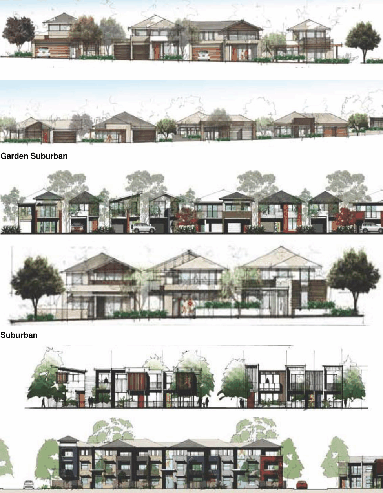

> [Picture on page 85: a picture, saved as a picture (images/vineyard-precinct-stage-1-development-control-plan-page-85-1.gif, 150 dpi).]

#### Garden Suburban

#### Suburban

#### Urban

Figure 5-1 The combination of built form, lot size, garaging and landscaping creates different streetscapes

#### Objectives

a. To ensure that buildings are designed to enhance the built form and character of the neighbourhood by encouraging innovative and quality designs that contribute to unified streetscapes.

b. To encourage a diversity of housing types.

c. To provide a clear distinction between private and public space and to encourage casual surveillance of the street.

d. To reinforce significant street intersections particularly on open space and other key strategic areas through articulation of corner buildings.

#### Controls

1\) The primary street facade of a dwelling should address the street and must incorporate at least two of the following design features:

• entry feature or porch

• awnings or other features over windows

• balcony treatment to any first floor element

• recessing or projecting architectural elements

• open verandah

• bay windows or similar features

• verandahs, pergolas or similar features above garage doors.

2\) Corner lot development should emphasise the corner. The secondary street facade for a dwelling on a corner lot should address the street and must incorporate at least two of the above design features. Landscaping in the front setback on the main street frontage should also continue around into the secondary setback.

3\) Modulation of the façade should be integral to the design of the building, rather than an unrelated attached element.

4\) Eaves are to provide sun shading and protect windows and doors and provide aesthetic interest. Except for walls built to the boundary, eaves should have a minimum of 450mm overhang (measured to the fascia board). Council will consider alternative solutions to eaves so long as appropriate sun shading is provided to windows and display a high level of architectural merit.

5\) The pitch of hipped and gable roof forms on the main dwelling house should be between 22.5 degrees and 35 degrees. Skillion roofs, roofs hidden from view by parapet walls, roofs on detached garages, studios and ancillary buildings on the allotment are excluded from this control.

6\) Light coloured roofs are encouraged to reduce heat build-up within dwellings and urban heat island effects.

7\) Front facades are to feature at least one habitable room with a window onto the street.

8\) Carports and garages are to be constructed of materials that complement the colour and finishes of the main dwelling.

9\) Streets should be fronted with similar housing types to create a consistent street character. For example, a ‘garden suburban’ street character will be created where most dwellings are detached on lot widths ≥15m, perhaps with deeper lots allowing for larger front setbacks and generous landscaping around dwellings. A suburban street character will be created where most dwellings are front loaded, detached or zero lotted on lot widths between 9-15m. An urban street character will be created where most dwellings are zero lotted, attached on lot widths less than 9m with rear garages. Streetscape design principles are illustrated at Figure 5-2.

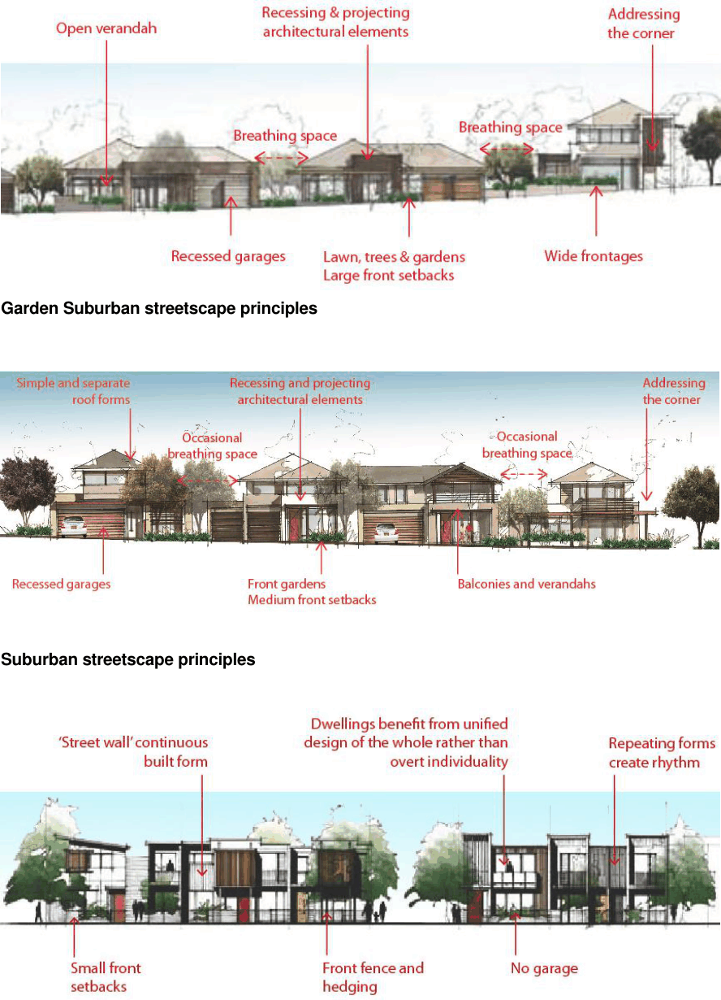

> [Picture on page 87: a picture, saved as a picture (images/vineyard-precinct-stage-1-development-control-plan-page-87-1.gif, 150 dpi).]

#### Garden Suburban streetscape principles

#### Suburban streetscape principles

#### Urban streetscape principles

Figure 5-2 Streetscape design principles

#### 5.1.3 Front setbacks

#### Objectives

a. To enable the integration of built and landscape elements to create an attractive, visually consistent streetscape.

b. To encourage simple and articulated building forms.

c. To ensure garages do not dominate the streetscape.

#### Controls

1\) Dwellings are to be consistent with the front setback controls and principles in Table 5-2 to Table 5-6 and Figure 5-3 and Figure 5-4.

2\) On corner lots, front setback controls are to be consistent with Figure 5-5.

3\) To achieve a desired streetscape character, the building façade front setback for a series of lots can be more or less than the setbacks shown in Table 5-2 to Table 5-6 where agreed to as part of the preparation of a Building Envelopes Plan or integrated housing DA at subdivision approval and the front setbacks are attached to the lot titles. However, the front setback to garages must be a minimum of 5.5m.

4\) Elements permitted in the articulation zone (shown on Figure 5-3 to Figure 5-6) include those items listed in control 5.1.2 (1).

5\) Except for rear loaded garages, the garage line is to have a front set back that is at least 1m behind the building front facade line.

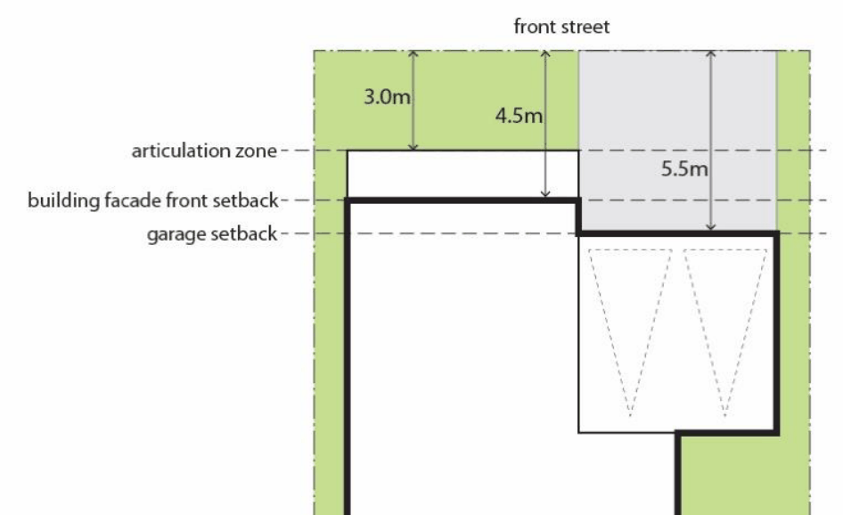

> [Picture on page 88: a picture, saved as a picture (images/vineyard-precinct-stage-1-development-control-plan-page-88-20.gif, 150 dpi).]

Figure 5-3 Minimum front setback distances

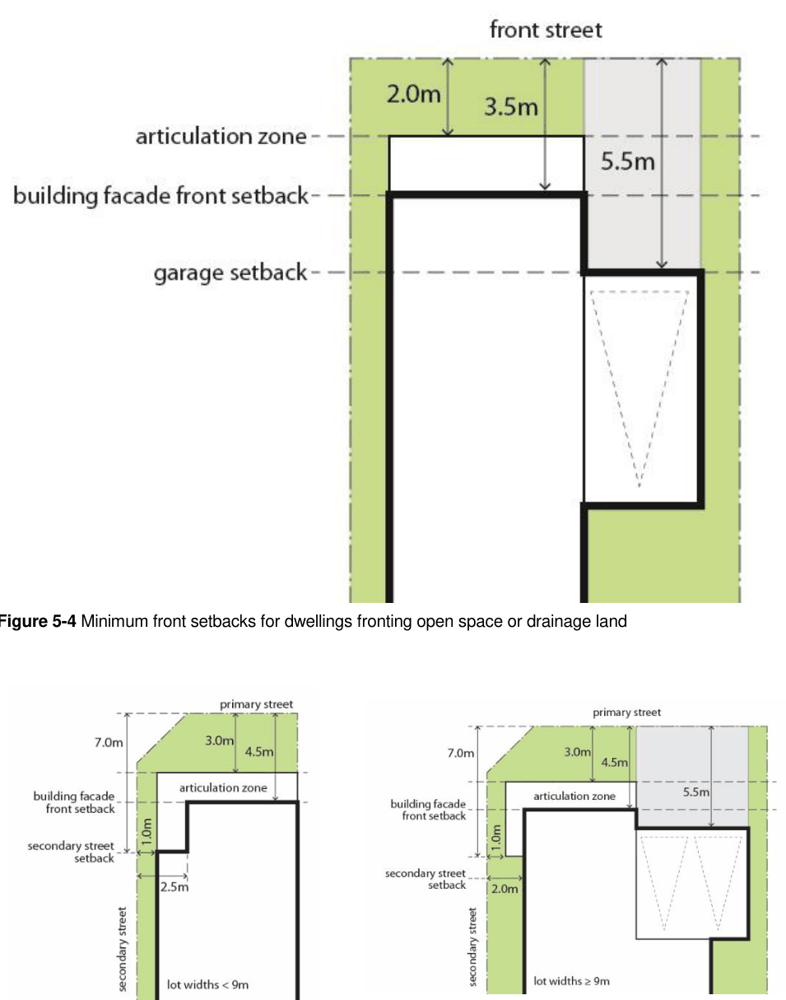

> [Picture on page 89: a picture, saved as a picture (images/vineyard-precinct-stage-1-development-control-plan-page-89-1.gif, 150 dpi).]

Figure 5-4 Minimum front setbacks for dwellings fronting open space or drainage land

Figure 5-5 Minimum setbacks for corner lot dwellings

#### 5.1.4 Side and rear setbacks

#### Objectives

a. To create an attractive and cohesive streetscape that responds to the character areas.

b. To minimise the impacts of development on neighbouring properties.

c. To provide appropriate separation between buildings.

d. To create opportunities for articulation on the side walls.

#### Controls

1\) All development is to be consistent with the side and rear setback controls in the relevant Table 5-2 to Table 5-6.

2\) The location of a zero lot line (Side A) is to be determined primarily by topography and should be on the low side of the lot to minimise water penetration and termite issues. Other factors to consider include dwelling design, adjoining dwellings, landscape features, street trees, vehicle crossovers and the lot orientation as illustrated at Figure 5-6.

3\) For attached or semi-detached dwellings the side setback only applies to the end of a row of attached housing, or the detached side of a semi-detached house.

4\) Pergolas, swimming pools and other landscape features/structures are permitted to encroach into the rear setback.

5\) For dwellings with a minimum 900mm side setback, projections permitted into the side setback areas include eaves (up to 450 mm wide), fascias, sun hoods, gutters, down pipes, flues, light fittings, electricity or gas meters, rainwater tanks and hot water units.

6\) No overhanging eaves, gutters or services (including rainwater tanks, hot water units, air-conditioning units or the like) of the dwelling on the benefited lot will be permitted within any easement. Any services and projections permitted under by control 5.1.4 (5) (above) within the easement to the burdened lot dwelling should not impede the ability for maintenance to be undertaken to the benefitted lot.

7\) For battle-axe lots without a street facing elevation setbacks are to be determined in the context of surrounding lots, built form and the location of private open space. An example is shown in Figure 5-7.

8\) The upper floor of dwellings on battle-axe lots must be setback so as not to impact adversely on the existing or future amenity of any adjoining land on which residential development is permitted, having regard to overshadowing, visual impact and privacy.

9\) For a battle-axe lot with direct frontage to land zoned for a public purpose or a street facing elevation (such as access denied lots), the front setback controls in Part 5.1.3 are to apply to the lot boundary adjoining the public purpose zone, and side and rear setbacks are to apply to lot boundaries determined relative to the front setback boundary as shown in Figure 5-8.

10\) For corner lots >15m lot width with shallow depths (i.e. approximately square corner lots) the rear setback can be varied to be consistent with the side setbacks in Table 5-5 and Table 5-6 provided the minimum private open space and solar access requirements to the proposed and adjoining properties are met.

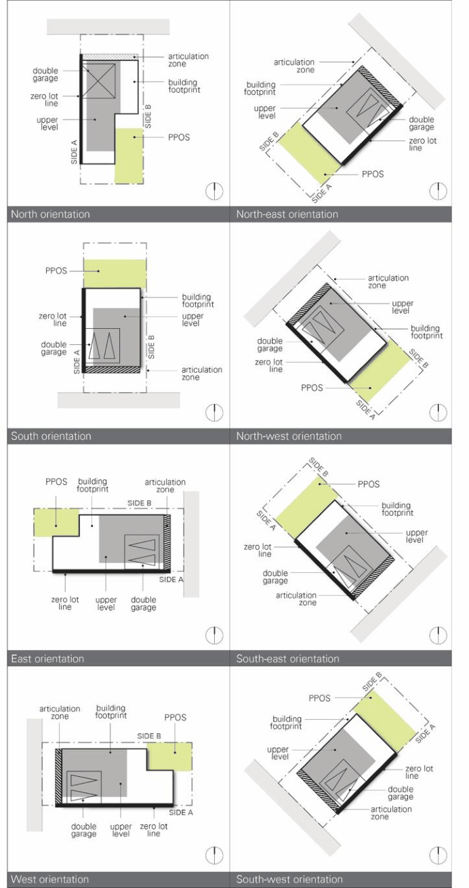

> [Picture on page 91: a picture, saved as a picture (images/vineyard-precinct-stage-1-development-control-plan-page-91-1.gif, 150 dpi).]

Figure 5-6 Dwelling and open space siting principles for different lot orientations

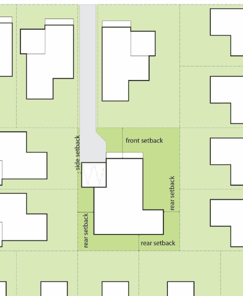

> [Picture on page 92: a picture, saved as a picture (images/vineyard-precinct-stage-1-development-control-plan-page-92-1.gif, 150 dpi).]

Figure 5-7 Battle axe lot without any street frontage setbacks

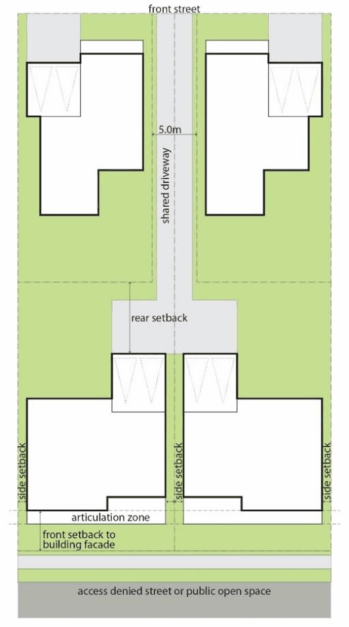

> [Picture on page 92: a picture, saved as a picture (images/vineyard-precinct-stage-1-development-control-plan-page-92-3.gif, 150 dpi).]

Figure 5-8 Battle axe lot fronting access denied road setbacks

#### 5.1.5 Dwelling Height, Massing and Siting

#### Objectives

a. To ensure development is of a scale appropriate to protect residential amenity.

b. To ensure building heights achieve built form outcomes that reinforce quality urban and building design.

#### Controls

1\) Dwellings are to be generally a maximum of 2 storeys in height. Council may permit a 3rd storey if it is satisfied that:

• the dwelling is located on a prominent street corner; or

• the dwelling is located adjacent to a neighbourhood or local centre, public recreation or drainage land, a golf course, or a riparian protection area; or

• the dwelling is located on land with a finished ground level slope equal to or more than 15%, and is not likely to impact adversely on the existing or future amenity of any adjoining land on which residential development is permitted, having regard to overshadowing, visual impact and any impact on privacy; or

• the third storey is within the roof line of the building (i.e. an attic).

Note: Reference should be made to clause 4.3 of the Vineyard Precinct Plan under the Growth Centres SEPP for statutory height limits.

2\) All development is to comply with the maximum site coverage as indicated in the relevant Table 5-2 to Table 5-6.

3\) The ground floor level shall be no more than 1m above finished ground level.

4\) Dwellings on a battle-axe-lot without public open space or street frontage are to be a maximum of 2 storeys in height.

#### 5.1.6 Landscaped Area

#### Objectives

a. To encourage the use of native flora species and low maintenance landscaping.

b. To contribute to effective stormwater management, management of micro-climate impacts and energy efficiency.

c. To ensure a balance between built and landscaped elements in residential areas.

d. To create the desired street character.

#### Controls

1\) The minimum soft landscaped area within any residential lot is to comply with the controls and principles in the relevant Table 5-2 to Table 5-6. Figure 5-9 illustrates areas of a lot that can contribute towards the provision of soft landscaped area and principal private open space.

2\) A concept landscape plan must be submitted with the DA, and must indicate the extent of landscaped area and nominate the location, species, number and size of any trees or vegetation to be retained or planted.

3\) Surface water drainage shall be provided as necessary to prevent the accumulation of water.

4\) Use of low flow watering devices is encouraged to avoid over watering. Low water demand drought resistant vegetation is to be used for the majority of landscaping, including native salt tolerant trees.

5\) The selection of trees and other landscaping plants is to consider:

• the preferred species listed in Appendix D to this DCP;

• the use of indigenous species of local provenance for at least 50% of the landscaping; and

• the contribution to the management of soil salinity, groundwater levels and soil erosion.

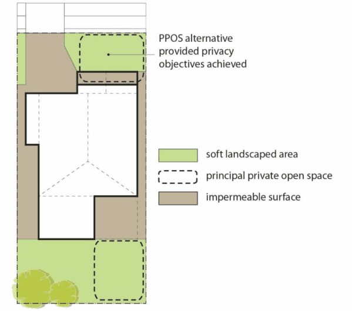

> [Picture on page 94: a picture, saved as a picture (images/vineyard-precinct-stage-1-development-control-plan-page-94-3.gif, 150 dpi).]

Figure 5-9 Soft landscaped area and principal private open space

#### 5.1.7 Private Open Space

#### Objectives

a. To provide a high level of residential amenity with opportunities for outdoor recreation and relaxation.

b. To enhance the spatial quality, outlook, and usability of private open space.

c. To facilitate solar access to the living areas and private open spaces of the dwelling.

#### Controls

1\) Each dwelling is to be provided with an area of Principal Private Open Space (PPOS) consistent with the requirements of the relevant Table 5-2 to Table 5-6.

2\) The location of PPOS is to be determined having regard to dwelling design, allotment orientation, adjoining dwellings, landscape features and topography.

3\) The PPOS is required to be conveniently accessible from the main living area of a dwelling or alfresco room and have a maximum gradient of 1:10. Where part or all of the PPOS is permitted as a semi-private patio, balcony or rooftop area, it must be directly accessible from a living area.

4\) Open space at the front of the dwelling can only be defined as PPOS where this is the only means of achieving the solar access requirements of Table 5-2 to Table 5-6. PPOS at the front of a dwelling must be designed to maintain appropriate privacy (for example raised level above footpath or fencing or hedging) and be consistent with the streetscape design controls in Part 5.1.2.

#### 5.1.8 Garages, Site Access and Parking

#### Objectives

a. To control the number, dimensions and location of vehicle access points. To reduce the visual impact of garages, carports, and parking areas on the streetscape.

b. To provide safe, secure and convenient access to parking within garages, carports and parking areas, with casual surveillance of private driveways from dwellings and from the street.

c. To minimise conflict between pedestrians and vehicles at the junction of driveways and footpaths.

d. To provide predominantly on-site parking for residents.

#### Controls

1\) Dwellings with 1-2 bedroom will provide at least one car space.

2\) Dwellings with 3 bedrooms or more will provide at least two car spaces.

3\) At least one car parking space must be located behind the building façade line where the car parking space is accessed from the street on the front property boundary.

Note: A car space may include a garage, carport or other hard stand area constructed of materials suitable for car parking and access. The required car parking spaces specified above may be provided using a combination of these facilities, including use of the driveway (within the property boundary only) as a parking space.

4\) Driveways are to have the smallest configuration a practical (particularly within the road verge) to serve the required parking facilities and vehicle turning movements and shall comply with AS2890.

5\) The location of driveways is to be determined with regard to dwelling design and orientation, street gully pits and trees and is to maximise the availability of on-street parking.

6\) Car parking and vehicle manoeuvring areas for all forms of residential development on battle axe lots and/or lots accessed from collector roads are to be designed so that vehicles can enter and exit in a forward direction.

Note: Part 4.2 requires plans of subdivision to nominate driveway locations and preferred building envelopes. The design of dwellings should refer to the approved subdivision plans and be consistent with the nominated driveway locations to the greatest practical extent.

7\) Controls for driveways and access to corner lots are contained in Part 4.1.4.

8\) Driveways are not to be within 1m of any drainage facilities on the kerb and gutter.

9\) Planting, fencing and walls adjacent to driveways must not block lines of sight for pedestrians, cyclists and motorists.

10\) Driveways are to have a soft landscaped area on the low side a minimum of 1m wide, suitable for water infiltration.

11\) Garages are to be designed and located in accordance with the controls in relevant Table 5-2 to

#### Table 5-6.

12\) Garage design and materials are to be consistent with the dwelling design.

#### For front loaded garages:

13\) Garage doors are to be visually recessive through use of materials, colours, and overhangs such as second storey balconies.

14\) Three car garages are only permitted in the Environmental Living zone where:

• at least one of the garage doors is not directly visible from a public road; or

• one of the car spaces is in a stacked configuration; or

• the total width the garage is not more than 50% of the length of the building facade.

#### 5.1.9 Visual and acoustic privacy

#### Objectives

a. To site and design dwellings to provide for visual and acoustic privacy and minimise the visual and acoustic impacts of development on adjoining properties.

b. To minimise the impact of noise from other non-residential uses such as parking and sport areas, restaurants and cafes and waste collection and goods deliveries.

#### Controls

1\) Figure 5-10 provides guidance to applicants on measures to mitigate the impacts of rail and traffic noise within the Precinct.

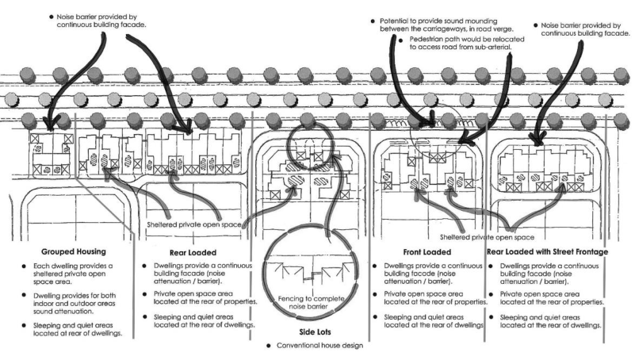

> [Picture on page 96: a picture, saved as a picture (images/vineyard-precinct-stage-1-development-control-plan-page-96-10.gif, 150 dpi).]

Figure 5-10 Measures to attenuate noise

2\) DAs will require an accompanying acoustic report where proposed development is:

• adjacent to a railway line, arterial or sub-arterial roads

• potentially impacted upon by a nearby industrial / employment use or area

• a subdivision or noise sensitive development within 300m of Windsor Road

• within the vicinity of 172 Commercial Road, Vineyard. Acoustic reports submitted with DAs for subdivision of land are to demonstrate that the subdivision has been designed to minimise acoustic treatments of future buildings on the proposed lots.  The report is to nominate noise mitigate requirements for future buildings.  These requirements are to be included as a Section 88B restriction as to user for the subdivision so as to inform future owners.

3\) Direct overlooking of main habitable areas and the private open spaces of adjoining dwellings should be minimised through building layout, window and balcony location and design, and the use of screening devices, including landscaping.

4\) Living area windows with a direct sightline to PPOS of the habitable room windows in an adjacent dwelling within 9 metres are to:

• be obscured by fencing, screens or appropriate landscaping; or

• be offset from the edge of one window to the edge of the other by a distance sufficient to limit views into the adjacent window; or

• have sill height of 1.5 metres above floor level; or

• have fixed obscure glazing in any part of the window below 1.5 metres above floor level.

5\) The design of dwellings must minimize the opportunity for sound transmission through the building structure, with particular attention given to protecting bedrooms and living areas.

6\) In attached and semi-detached dwellings, bedrooms of one dwelling are not to share walls with living spaces or garages of adjoining dwellings, unless it is demonstrated that the shared walls and floors meet the noise transmission and insulation requirements of the Building Code of Australia.

7\) No electrical, mechanical or hydraulic equipment or plant shall generate a noise level greater than 5dBA above background noise level measured at the property boundary during the hours 7.00am to 10.00pm and noise is not to exceed background levels during the hours 10.00pm to 7.00am.

8\) Dwellings along major roads (see Figure 4-11), or any other noise source, shall be designed to minimise the impact of traffic noise.

9\) The internal layout of residential buildings, window openings, the location of outdoor living areas (i.e. courtyards and balconies), and building plant should be designed to minimise noise impact and transmission.

10\) Noise walls are not permitted.

11\) Development affected by noise from rail or road traffic noise is to comply with State Environmental Planning Policy (Infrastructure) 2007 and NSW Department of Planning (2008) Development Near Rail Corridors and Busy Roads – Interim Guideline.

12\) Residential development impacted by traffic and rail noise shall comply with the criteria in Table 5-7. Figure 5-11 provides guidance on measures to manage internal noise levels.

Table 5-7 Noise levels permitted within habitable rooms for residential premises impacted by traffic and rail noise

|  | Sleeping areas | Living areas |
|---|---|---|
| Naturally ventilated/ windows open to 5% of the floor area (Mechanical ventilation or air conditioning systems not operating) | LAeq 15 hours (day): 50dBA LAeq 9 hour (night): 45dBA | LAeq 15 hours (day): 50dBA LAeq 9 hour (night): 45dBA |
| Doors and windows shut (Mechanical ventilation or air conditioning systems are operating) | LAeq 15 hours (day): 40dBA LAeq 9 hour (night): 35dBA | LAeq 15 hours (day): 40dBA LAeq 9 hour (night): 40dBA |

Note: These levels correspond to the combined measured level of external sources and the ventilation system operating normally. Where a naturally ventilated/windows open condition cannot be achieved, it is necessary to incorporate mechanical ventilation compliant with AS1668 and the Building Code of Australia. LAeq 1 hour noise levels shall be determined by taking as the second highest LAeq 1 hour over the day and night period for each day and arithmetically averaging the results over a week for each period (5 or 7 day week, whichever is highest).

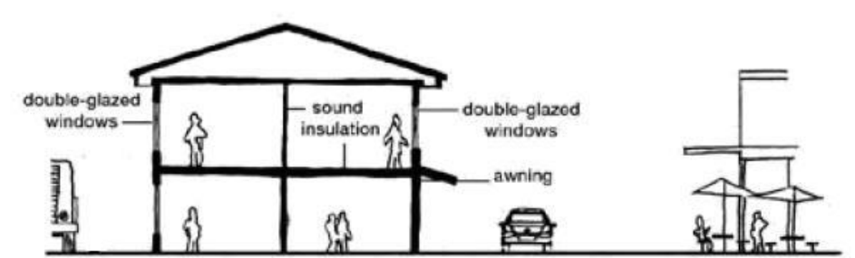

> [Picture on page 98: a picture, saved as a picture (images/vineyard-precinct-stage-1-development-control-plan-page-98-1.gif, 150 dpi).]

Figure 5-11 Strategies for minimising noise transmission

#### 5.1.10 Fencing

#### Objectives

a. To ensure boundary fencing is of a high quality and does not detract from the streetscape.

b. To encourage the active use of front gardens through provision of a secure area.

c. To ensure that rear and side fencing will assist in providing privacy to private open space areas.

d. To ensure that fence height, location and design will not affect traffic and pedestrian visibility at intersections.

#### Controls

1\) Front fencing shall be a maximum of 1.2m high.

2\) Front fences and walls are not to impede safe sight lines for traffic.

3\) Side and rear fences are to be a maximum of 1.8m high.

4\) Side fences not on a street frontage are to be a maximum of 1.2m high to a point 2m behind the primary building façade.

5\) On corner lots or lots that have a side boundary that adjoins open space or drainage, the front fencing style and height is to be continued along the secondary street or open space/drainage land frontage to at least 4m behind the building line of the dwelling. Principles for corner lots are illustrated at Figure 5-12.

6\) On boundaries that adjoin open space or drainage land, fencing is to be of a high quality material and finish. The design of the fencing is to permit casual surveillance of the public space by limiting fence height to 1.2m or by incorporating see through materials or gaps for the portion of the fence above 1.2m in height.

7\) Pre-painted steel or timber paling or lapped/capped boundary fencing is not permitted adjacent to open space or drainage land or on front boundaries.

8\) Fencing that adjoins mews or rear access ways is to permit casual surveillance.

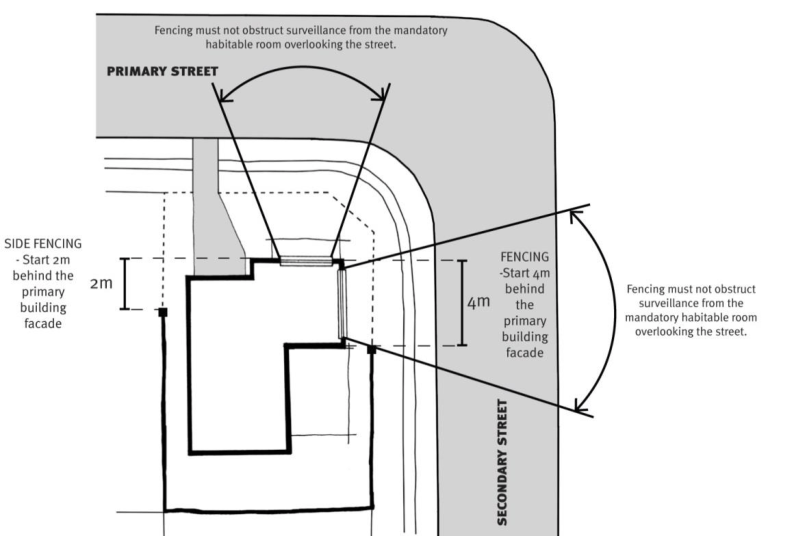

> [Picture on page 99: a picture, saved as a picture (images/vineyard-precinct-stage-1-development-control-plan-page-99-1.gif, 150 dpi).]

Figure 5-12 Fencing design for corner lots

### 5.2. Additional controls for certain dwelling types

#### 5.2.1 Residential development adjacent to transmission easements

#### Objectives

a. To minimise the visual and amenity impacts of transmission lines on surrounding residential areas.

b. To provide for passive surveillance of the public lands within and adjacent to the transmission easement.

c. To maintain the privacy of dwellings adjacent to the easements.

#### Controls

1\) Dwellings are to be set back as far as possible from the transmission easement.

2\) Landscaping is to permit views into the easement at ground level.

3\) The orientation of dwellings is to permit casual surveillance of the easement, while maintaining the privacy of occupants.

#### 5.2.2 Attached dwellings

Additional controls for attached dwellings are outlined below, and should be read in conjunction with those in Part 5.1.

#### Objectives

a. To ensure that the development of attached dwellings creates an architecturally consistent street character.

#### Controls

1\) It is preferred that garages for attached dwellings are located at the rear of the lot. Where attached dwellings have frontage to a collector road, all vehicle access and parking is to be located at the rear of the lot.

2\) Attached dwellings should have a consistent and logical rhythm and order when seen together as a group, rather than appearing as a random arrangement of competing dwellings. Each dwelling

should benefit from the unified design of the whole form, a co-ordinated style and base colour palette. Individuality can be added as small details or accent colours, rather than strikingly different forms.

#### 5.2.3 Secondary dwellings, studio dwellings and dual occupancies

Controls for secondary dwellings, studio dwellings or dual occupancies are in part determined by whether the secondary dwelling, studio dwelling or dual occupancy dwelling is proposed at the time of the application or at some point in the future to be strata subdivided. Strata subdivisions create the need for separate or common property dwelling entries, parking and open space to service each dwelling. The Glossary of this DCP (Appendix A) provides further explanation and examples of secondary dwelling, studio dwellings or dual occupancy types. The controls that follow apply to all forms of secondary dwellings, studio dwellings and dual occupancies.

#### Objectives

a. To enable the development of a diversity of dwelling types.

b. To contribute to the availability of affordable housing.

c. To promote innovative housing solutions that are compatible with the surrounding residential environment.

d. To provide casual surveillance to rear lanes.

#### Controls - Secondary dwellings and studio dwellings

1\) Secondary dwellings and studio dwellings are to comply with the controls in Part 5.1, except where the controls in this Part differ, in which case the controls in this Part take precedence.

2\) Secondary dwellings and studio dwellings are to comply with the key controls in Table 5-8.

3\) The maximum site coverage control for upper floors in the relevant Table 5-2 to Table 5-6 may be exceeded by the combined upper floor coverage of the secondary or studio dwelling and principal dwelling, provided that:

• the privacy of the principal dwelling and dwellings on adjoining land is not compromised; and

• solar access to the principal private open space of neighbouring lots is not significantly reduced.

4\) The maximum gross floor area of a studio dwelling is 60m2.

5\) The design of the secondary dwelling or studio dwelling is to be consistent in construction features, external finishes, materials and colours with the principal dwelling.

6\) For secondary dwellings, windows and private open spaces must not overlook the private open space of any adjacent dwellings. For studio dwellings, windows and private open spaces must not overlook the private open space of any adjacent dwellings including the principal dwelling. Windows that potentially overlook adjacent lots must either have obscured glazing, be screened or have a minimum sill height of 1.5m above floor level.

7\) Secondary or studio dwellings and associated garages may have a zero lot setback to one side boundary and may be attached to another garage/secondary dwelling on an adjoining lot, particularly where the secondary or studio dwelling is associated with an attached or semi-detached dwelling.

Table 5-8 Key controls for secondary dwellings and studio dwellings

| Element | Secondary Dwelling | Studio Dwelling (strata) |
|---|---|---|
| On-site car parking | No additional car parking space required. | One additional dedicated on-site car parking space. Car parking space to be located behind building facade line of principal dwelling. Car parking space not to be in a stacked configuration. |
| Principal Private open space | No separate private open space required. | Balcony accessed directly off living space having minimum size of 8m² with minimum dimension of 2m. |
| Subdivision | Subdivision from principal dwelling not permitted. | Strata title subdivision only from the principal dwelling on the land |
| Access | Separate direct access to a street, laneway or shared driveway not required. | Access to be separate from the principal dwelling and is to front a public street, lane or shared private access way or Combined access for the principal dwelling and studio dwelling to be through communal land as shown on the strata plan. |
| Services and facilities | No separate services or facilities required. | Provision for separate services, such as mail delivery and waste collection, and an on-site garbage storage area so that bins are not visible from public street or laneway. To be located on a street address that is able to be accessed by garbage collection and mail delivery services. May be serviced from the front residential street via the principal dwelling lot. |

8\) Where the secondary or studio dwelling is built to a zero lot line on a side boundary, windows are not to be located on the zero lot wall unless that wall adjoins a laneway, public road, public open space or drainage land.

9\) Studio dwellings are to have balconies or living areas that overlook laneways for casual surveillance.

10\) Rear garages with secondary or studio dwellings may have first level balconies facing the lane provided the balcony remains within the lot boundary. Where 2m deep, overhanging balconies for private open space requirements of studio dwellings are located along a lane, the application must demonstrate how garages setback underneath avoid creating an overly wide lane and ambiguous space opportunities for illegally parked cars, trailers, bins etc.

11\) Where a secondary or studio dwelling is built over a rear garage and separated from the upper levels of the principal dwelling, there must be a minimum separation of 5m between the upper floor rear façade of the principal dwelling and the secondary or studio dwelling.

12\) Studio dwellings are to be located at the rear of the lot only where the lot has access from a rear lane or secondary street on a corner lot.

13\) Studio dwellings are not permitted where the principal dwelling is an attached dwelling, unless:

• the studio dwelling is located above a rear loaded garage; and

• the studio dwelling has direct access to a public road or laneway; and

• garbage and mail facilities are accessible by residents and by service vehicles.

#### Controls – Dual occupancies

14\) Dual occupancies are to comply with the controls in Part 5.1, except where the controls in this Part differ, in which case the controls in this Part take precedence.

15\) The maximum site coverage control for second storeys in the relevant Table 5-2 to Table 5-6 may be exceeded by the combined 2nd storey coverage of both dwellings in a dual occupancy, providing that:

• the privacy of the principal dwelling and dwellings on adjoining land is not compromised; and

• solar access requirements for the principal private open space can be met for the principal dwelling and dwellings on adjoining lots.

16\) The design of both dwellings in a dual occupancy development is to be consistent in construction features, external finishes, materials and colours.

17\) Detached dual occupancy dwellings are not to include zero lot lines for the second dwelling where the second dwelling is located at the rear of the lot.

18\) Dual occupancy development is not permitted on a lot that contains an attached dwelling.

19\) Dual occupancy dwellings are permitted at the rear of lots (i.e. behind a dwelling that has frontage to a principal street, whether attached or detached to that dwelling) only where:

• each dwelling has direct pedestrian and vehicle access to a public road; and

• garbage and mail facilities are accessible by service vehicles and by the occupants of the dwellings.

20\) Dual occupancy development referred to in control 19 above is preferred to be located on corner lots.

21\) For dual occupancies on corner lots, the rear setback can be varied to be consistent with the side setbacks in Part 5.1.4 provided the minimum private open space and solar access requirements to the proposed and adjoining properties are met.

22\) Where the dual occupancy dwellings are to be strata subdivided:

• private open space is to be provided for each dwelling in accordance with the relevant controls in Table 5-2 to Table 5-6, or

• shared private open space is to be provided equivalent to 15% of the site area and shown as communal space on the strata plan, and a minimum area of private open space of 10m² with a minimum dimension of 2.5m is to be provided for each dwelling.

23\) The minimum landscaped area on a lot containing a dual occupancy development is to be 20% of the site area.

24\) Where practical for front loaded driveway access, shared driveway crossings of the nature strip are to be provided to service both dwellings.

#### 5.2.4 Multi dwelling housing

#### Objectives

a. To ensure that the design of multi-dwelling housing is consistent with the character of residential areas within the Precinct.

b. To ensure the quality of multi-dwelling housing is of a high quality and contributes to the amenity of residents.

#### Controls

1\) Multi-dwelling housing sites are to have direct frontage to a public road (i.e. not on battle-axe lots).

2\) Multi-dwelling housing is to comply with the controls in Table 5-9.

3\) In all multi-dwelling housing developments containing 10 dwellings or more, a minimum of 1 per each 10 dwellings are to be designed to be capable of adaption. Adaptable dwellings are preferably to be single level accommodation at ground level and be located on the street frontage and are to be designed in accordance with Australian Standard AS 4299-1995 Adaptable Housing.

4\) A landscape plan is to be submitted with every application for multi-dwelling housing.

5\) Where a multi dwelling housing development includes a studio dwelling with rear lane vehicle access, the controls for a studio dwelling shall apply to the studio dwelling component of the

development.

6\) Car parking and vehicle manoeuvring areas shall be designed so that vehicles can enter and exit in a forward direction.

Table 5-9 Key controls for multi dwelling housing

| Element | Controls |
|---|---|
| Site coverage (maximum) | 50% |
| Landscaped area (minimum) | 30% of site area |
| Principal Private open space (PPOS) | Minimum 16m² with a minimum dimension of 3m. 10m² per dwelling if provided as balcony or rooftop with a minimum dimension of 2.5m. |
| Front setback (minimum) | 4.5m to building façade line; 3m to articulation zone |
| Corner lots secondary street setback (minimum) | 2m |
| Side setback (minimum) | Ground floor 0.9m. Upper floor 0.9m |
| Rear setback (minimum) | 4m (excluding rear lane garages or studio dwellings) 0.5m to rear lane (garages or studio dwellings) |
| Zero lot line (minimum) | Not permitted on adjacent lot boundaries (except rear lane garages and studio dwellings) |
| Internal building separation distance (minimum) | 5m (unless dwellings are attached by a common wall) |
| Car parking spaces | 1-2 bedroom dwellings will provide at least 1 car space. 3 bedroom or more dwellings will provide at least 2 car spaces. 1 visitor space per 5 dwellings. Car parking spaces to be behind building line. Garages fronting the street are to be set back a minimum of 1m from the building setback Where garages front the street, the maximum width of a garage door is 6m and each garage is to be separated by a dwelling façade or landscaped area. |
| Garages and car parking dimensions (minimum) | Covered: 3m x 5.5m (single) 5.6m x 5.5m (double) Uncovered: 2.5m x 5.2m Aisle widths must comply with AS 2890.1 |

#### 5.2.5 Residential flat buildings, manor homes and shop top housing

The controls in Part 5.2.4 do not apply to residential flat buildings, manor homes and shop top housing, unless specifically referenced in the provisions that follow. The following parts set out the controls for these types of housing. Additional controls for residential flat buildings and shop top housing may be contained in State Environmental Planning Policy No 65 – Design Quality of Residential Apartment Development.

#### Objectives

a. To establish a high quality residential environment where all dwellings have a good level of amenity.

b. To encourage a variety of housing forms within residential areas.

c. To ensure the provision of housing that will, in its adaptable features, meet the access and mobility needs of any occupant.

#### Controls

1\) Manor homes may only be located on corner lots.

2\) Residential flat buildings are to:

• be located on sites with a minimum street frontage of 30m;

• have direct frontage to an area of the public domain (including streets and public parks), and

• not adversely impact upon the existing or future amenity of any adjoining land upon which residential development is permitted with respect to overshadowing impact, privacy impact or visual impact.

3\) All residential flat buildings are to be consistent with:

• the guidelines and principles outlined in State Environmental Planning Policy No 65 – Design Quality of Residential Apartment Development; and

• the primary controls set out in Table 5-10.

4\) In all residential flat building developments containing 10 dwellings or more, a minimum of 10% of all apartments are to be designed to be capable of adaptation for access by people with all levels of mobility. Dwellings must be designed in accordance with the Australian Standard AS 4299-1995 Adaptable Housing. Where possible, adaptable dwellings are to be located on the ground floor. Dwellings located above the ground level of a building may only be provided as adaptable dwellings where lift access is available within the building. The lift access must provide access from the basement to allow access for people with disabilities.

5\) The DA must be accompanied by certification from an accredited ‘Access Consultant’ confirming that the adaptable dwellings are capable of being modified, when required by the occupant, to comply with the Australian Standard AS 4299-1995 Adaptable Housing.

6\) Car parking and garages allocated to adaptable dwellings must comply with the requirements of Australian Standards for disabled parking spaces.

7\) Car parking and vehicle manoeuvring areas shall be designed so that vehicles can enter and exit the property in a forward direction.

8\) A landscape plan is to be submitted with every application for residential flat buildings. Table 5-10 Key controls for residential flat buildings, manor homes and shop top housing

| Element | Shop top housing | Residential flat buildings | Manor homes | Residential flat buildings and shop top housing in Business zones |
|---|---|---|---|---|
| Site coverage (maximum) | 50% of site area | 50% | 50% of site area | N/A |
| Landscaped area (minimum) | 30% of site area | 30% of site area | 30% of site area | N/A |
| Communal open space | 15% of site area where the development includes 4 or more dwellings | 15% of site area | Not required | 15% of site area - this control is able to be varied where the applicant demonstrates the development has good access to public open space or where the area of private open space is more than the minimum specified below |
| Principal Private open space (PPOS) | Minimum 8m² per dwelling with a minimum dimension of 2m | Minimum 10m² per dwelling with a minimum. dimension of 2.5m | Minimum 16m² per dwelling with a minimum dimension of 3m; or Minimum 8m² per dwelling with a minimum dimension of 2m if provided as balcony or rooftop. | Minimum 8m² per dwelling with a minimum dimension of 2m |

| Element | Shop top housing | Residential flat buildings | Manor homes | Residential flat buildings and shop top housing in Business zones |
|---|---|---|---|---|
| Front setback (minimum) | Determined by ground floor setback | 6m Balconies and other articulation may encroach into the setback to a maximum of 4.5m from the boundary for the first 3 storeys and for a maximum of 50% of the façade length | 4.5m to building façade line 3m to articulation zone 5.5m to garage line and 1m behind the building line | Residential flat buildings: 4.5m to building façade line Shop top housing: 0m for first floor 4m for floors above first floor |
| Corner lots secondary street setback (minimum) | 3m | 6m | 2m | Residential flat buildings: 4.5m to building façade line Shop top housing: 0m for first floor 4m for floors above first floor |
| Side setback (minimum) | 2m | Buildings up to 3 storeys: 3m Buildings above 3 storeys: 6m | Buildings up to 2 storeys 1.5m | Refer to Part 6 Centres Controls |
| Rear setback (minimum) | 4m (excluding garages) | 6m | 4m (excluding rear garages) | 8m |
| Zero lot line (minimum) | Not permitted | Not permitted | Not permitted to adjacent lots | Permitted on side boundaries only |
| Habitable room/balcony separation distance (minimum) for buildings 3 storeys and above | 12m | 12m | N/A | Refer to Part 6 Centres Controls |
| Car parking spaces | 1-2 bedrooms: 1 space (minimum) 3 bedrooms or more: 2 spaces (minimum) – may be provided in a ‘stack parking’ configuration Garages to be set back 1m behind the building line | 1 space per dwelling, plus 0.5 spaces per 3 or more bedroom dwelling - may be in a ‘stack parking’ configuration Car parking spaces to be located below ground or behind building line 1 visitor car parking space per 5 apartments Bicycle parking spaces: 1 per 3 dwellings | 1-2 bedrooms: 1 space (minimum) 3 bedrooms or more: 2 spaces (minimum) – may be provided in a ‘stack parking’ configuration | 1 space per dwelling, plus 0.5 spaces per 3 or more bedroom dwelling - may be in a ‘stack parking’ configuration Car parking spaces to be located below ground or behind the building 1 visitor car parking space per 5 dwellings (may be above ground) Bicycle parking spaces: 1 per 3 dwellings |
| Garage Dominance | N/A | A maximum of two garage doors per 20m of lot frontage facing any one street frontage | A maximum of two garage doors facing any one street frontage | N/A |
| Garages and car parking dimensions (minimum) | Covered: 3m x 5.5m Uncovered: 2.5m x 5.2m Aisle widths must comply with AS 2890.1 |  |  |  |

### 5.3. Other development in residential and environment protection zones

The residential and environment protection zones within the Vineyard Precinct Plan under the Growth Centres SEPP permit a range of non-residential land uses that, depending on their scale, suitability, location and design, may be compatible with adjoining residential uses. Reference should be made to the Precinct Plan for the permissibility of specific non-residential uses in each zone, including the zoning table in Part 3 and the local provisions in Part 6. For some land uses, the local provisions in Part 6 specify additional requirements that must be met for Council to grant consent to these uses. The Precinct Plan recognises that allowing non-residential development in the residential and environment protection zones is appropriate providing controls are in place to minimise the negative impacts of noise, loss of privacy, traffic, parking and other nuisances on local residential amenity. The controls for non-residential development consist of:

• general requirements, which apply to all non-residential development in the residential and environment protection zones; and

• specific provisions covering land uses such as child care centres, neighbourhood shops, educational establishments and places of public worship, in addition to, or overriding, the general requirements.

Notes: In the event of an inconsistency between the general and specific provisions in this part of the DCP, the specific controls will prevail. These controls are not intended to apply to non-residential uses that are carried on in dwellings, such as home occupations and home businesses. Council may require the submission of additional information to demonstrate that the development will not adversely affect the existing or future amenity of the surrounding residential area. Such information may include a noise impact assessment, advice on traffic generating potential and parking provision, solar access and evidence that the proposed land use will contribute to the amenity, character and liveability of the residential area in which it is to be located. Applicants should consult with Council prior to submitting a DA to determine specific information requirements.

#### 5.3.1 General requirements

#### Objectives

a. To establish appropriate controls to minimise the adverse effects of non-residential development on surrounding residential development.

b. To maintain consistency in development standards between non-residential and residential land uses and ensure that buildings are similar in height, bulk and scale to surrounding buildings.

c. To ensure that non-residential development is appropriately located.

d. To avoid concentrations of non-residential uses in any particular area where the cumulative impact on residential amenity would be unacceptable.

#### Controls

1\) Site analysis information as required by Part 2 of this DCP is to be submitted with all applications for non-residential development in residential or environment protection zones.

2\) Except as provided for in the specific controls below, non-residential development in residential or environment protection zones land is to be located on allotments that have a frontage width of greater than 15 metres.

3\) Non-residential development in residential or environment protection zones is to comply with the requirements of Part 2 and Parts 5.1.9 and 5.1.10 of this DCP in relation to residential amenity and sustainable building design.

4\) For all non-residential development, the controls relating to lots with frontages greater than 15 metres in the following parts of this DCP apply:

• Part 5.1.3 Front setbacks;

• Part 5.1.4 Side and rear setbacks;

• Part 5.1.5 Dwelling height, massing and siting; and

• Part 5.1.8 Garages, site access and parking.

5\) The maximum site coverage of buildings is 60% of the total site area.

6\) The minimum landscaped area for non-residential development is 20% of the total site area of the allotment.

7\) Provision of car parking for non-residential uses will be assessed by Council on an individual basis but must be sufficient to meet demand generated by staff and visitors.

8\) Car parking and vehicle manoeuvring areas shall be designed so that vehicles can enter and exit the property in a forward direction.

9\) Where there is an inconsistency between the general requirements of this Part and the specific controls, Parts 5.3.2 to 5.3.5 prevail.

10\) Council will have particular regard to the effects of non-residential development in the residential and environment protection zones. Council will consider whether:

• the proposed development will be out of character with surrounding residential development, particularly in relation to the height and/or scale of any proposed buildings;

• the proposed development will contribute to an undesirable clustering of that type of development, or non-residential uses in general, in the area;

• an undesirable effect on the amenity of the surrounding area will be created;

• the proposed use will draw patronage from areas outside of the surrounding neighbourhood, and the extent to which that patronage might impact on the amenity of residents through factors such as traffic generation, noise or the overall scale of the non-residential use;

• a noise nuisance will be created;

• the development will generate traffic out of keeping with the locality;

• adequate facilities are provided for the purposes of parking, loading and deliveries; and

• adequate provision is made for access by disabled persons.

11\) Non-residential development in residential or environment protection zones should be similar in bulk, scale, height and siting to the surrounding buildings.

12\) Finishes, materials, paving and landscaping are to be consistent with those of surrounding residential development.

#### 5.3.2 Educational Establishments and Places of Worship

#### Objectives

a. To ensure appropriate provision and equitable distribution of education establishments and places of public worship within the Precinct.

b. To ensure that buildings are not out of character with the type, height, bulk and scale of surrounding buildings.

c. To encourage the appropriate location of facilities to create community focal points, centres of

neighbourhood activity and enhance community identity.

d. To mitigate the impacts of noise, privacy, increased traffic and nuisance on surrounding residential development.

e. To foster iconic and landmark building design within each Precinct.

#### Controls

1\) Places of worship are to be located within centres or co-located with other community facilities in residential areas so as to create a community focal point, to share facilities such as parking, and to minimise impacts on residential areas.

2\) Places of public worship and educational establishments are preferably to be located on land with frontage to a collector road. Corner sites are preferred.

3\) In assessing applications, Council will consider the following:

• the privacy and amenity of adjoining developments;

• the need and adequacy for provision of buffer zones to surrounding residential development;

• urban design;

• location;

• the size of the land where the development is proposed;

• traffic generation and the impacts of traffic on the road network and the amenity of nearby residents;

• the availability of parking;

• the scale of buildings and their capacity; and

• hours of operation and noise impacts.

4\) A traffic and transport report/statement is to accompany the DA addressing the impact of the proposed development on the surrounding road system and defining car parking requirements.

Note: Due to the high level of traffic generation and peak nature of traffic volumes accessing these types of land uses, assessment of traffic impacts and pedestrian requirements is required and mitigation measures may need to be incorporated in the design. Such measures may include pedestrian crossings, speed control devices, pedestrian refuges on streets to which the development fronts and the provision of bus and drop off bays. School zones will require additional safety measures such as school crossings, 40 km/h school speed zones and flashing lights in accordance with RMS requirements.

5\) A landscape plan and associated documentation is to be submitted with the DA identifying existing vegetation and community plant species and/or existing design elements of the site layout, and the proposed landscaping treatment of the development.

6\) Car parking spaces shall be provided on site in accordance with Table 5-11.

Table 5-11 Car parking requirements for places of public worship and educational establishments

| Land use | Parking requirement |
|---|---|
| Places of Public Worship | 1 space per 4 seats or 1 space per 10m² of seating area (whichever is greater) |
| Primary and Secondary Schools | 1 space per staff member plus 1 space per 100 students |
| Senior High School | 1 space per staff member 1 space per 5 students in Year 12 |
| Tertiary and Adult Educational Establishments | 1 space per 5 seats or 1 space per 10m² of floor area (whichever is greater) |

7\) For certain uses, the provision of overflow parking may be necessary particularly where such developments incorporate halls used for social gatherings. Overflow parking areas could be provided on open grassed areas and need not be formally sealed or line-marked. Proposed overflow parking areas are to be clearly shown on plans submitted with the DA.

8\) Development must comply with the noise guidelines contained in Part 5.1.9.

9\) Where appropriate, buffers should be put in place to limit noise impacts on the surrounding area.

10\) Sources of noise such as garbage collection, machinery, parking areas and air conditioning plants are sited away from adjoining properties and screened/ insulated by walls or other acoustic treatment. Noise levels are not to exceed specified limits at the most affected point of the property boundary.

#### 5.3.3 Neighbourhood Shops

#### Objectives

a. To ensure the appropriate provision of retail uses to serve the needs of the local community.

b. To minimise the impacts of retail activities on surrounding residential areas.

c. To ensure that retail activities in residential areas do not detract from the function or viability of nearby centres.

d. To ensure the appropriate location of neighbourhood shops.

#### Controls

1\) Neighbourhood shops in residential zones may only be developed on an allotment of land with a minimum frontage width of 10 metres or more.

2\) Neighbourhood shops in residential zones are to be located:

• adjoining land zoned RE1 Public Recreation or SP2 Infrastructure or that is separated from land zoned RE1 Public Recreation or SP2 Infrastructure only by a public road, or

• with frontage to a collector road, or

• within 90 metres of public transport stop, or

• adjoining an educational establishment or a community facility or separated from an educational establishment or a community facility only by a public road.

3\) The minimum site area for neighbourhood shops is 500m2.

4\) For neighbourhood shops, the controls relating to lots with frontages greater than 9 metres in the following parts of this DCP apply:

• Part 5.1.2 Streetscape and architectural design;

• Part 5.1.3 Front setbacks;

• Part 5.1.4 Side and rear setbacks;

• Part 5.1.5 Dwelling height, massing and siting; and

• Part 5.1.8 Garages, site access and parking.

5\) Shops fronts are to encourage active and interactive street frontages that are sympathetic to the streetscape with similar materials to adjoining buildings to be used.

6\) Any area of land between the front property boundary and the building alignment, exclusive of approved driveways and parking areas, is to be landscaped.

7\) Address and entry points for any residential use on the same allotment of land are to be separate from the retail use access points and be readily identifiable.

8\) Design of the building frontage, front and side setbacks are to include safe and convenient pedestrian facilities such as weather protection, shade, seating and landscaping.

9\) On corner sites, shop fronts are to wrap around the corner and zero setbacks are permitted.

10\) Entrances are to be readily visible from the street and well lit.

11\) The site should not gain direct access to:

• a road with clearway or other parking restrictions; or

• a restricted access road (sub-arterial or arterial).

12\) At least 3 car parking spaces are required to be provided on site in addition to parking required for the dwelling (if applicable). The design of the building and parking areas is to provide suitable access for deliveries.  Parking areas, loading/unloading areas, and vehicle manoeuvring areas shall be designed so that vehicles can enter and exit the site in a forward direction.

13\) Bicycle parking must be provided in a location that is secure and accessible with weather protection for employees.

14\) Car parking must be clearly signposted to indicate its availability from the street.

15\) Plant and equipment (particularly cooling or heating plant), is to be located so as to not cause noise annoyance to neighbours.

16\) Waste storage areas must be designed to minimise visual impact and should be screened and properly positioned so as to not to attract pests and cause odour problems for neighbours.

17\) External storage areas are not permitted unless adequately screened from view.

#### 5.3.4 Seniors Housing

#### Objectives

a. To ensure that the design of seniors housing is consistent with the character of surrounding residential areas.

#### Controls

1\) Applications for seniors housing are to comply with the controls in State Environmental Planning Policy  (Housing for Seniors or People with a Disability) 2004.

#### 5.3.5 Farm Buildings and Outbuildings

“Farm Buildings” are structures which are ancillary to an agricultural use of the land on which it is situated and includes hay sheds, stocks holding yards, machinery sheds, shearing sheds, silo, storage tank, outbuildings or other forms of structure used for storing agricultural machinery, farm produce and supplies.

“Outbuildings” are buildings that are used for the storage of possessions of the owners/occupiers of the land and are considered as structures which are ancillary to an existing land use. These buildings are generally ancillary to a dwelling house and are associated with the normal domestic use of the land.

Outbuildings are not commercial in nature and are typically used by the land owners/occupiers for:

• the storage of equipment used to maintain the property

• hobbies

• parking of non-commercial vehicles.

#### Objectives

To ensure that farm buildings and outbuildings are consistent with the character of the Environmental Living area.

#### Controls

1\) Development for farm buildings and outbuildings are to comply with the controls contained within the relevant chapter of the Hawkesbury Development Control Plan 2002 or such other Development Control Plan (or equivalent) that might replace it.
