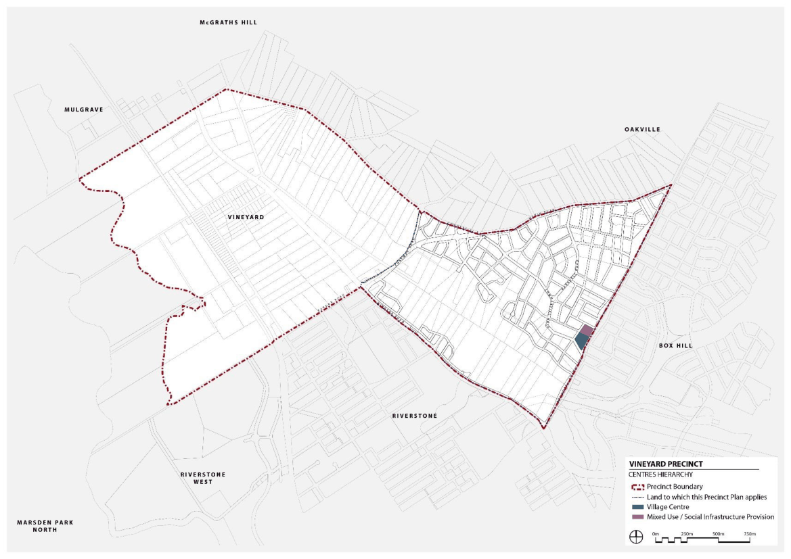
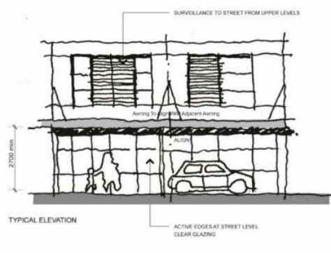
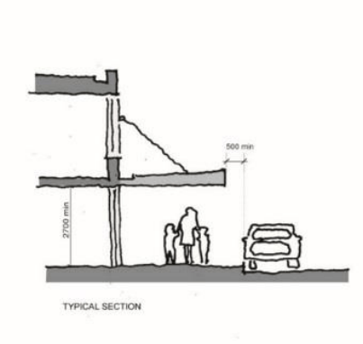
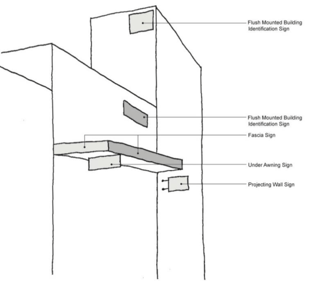

## 6. Centres Controls

### 6.1 Introduction

This Part of the DCP outlines principles, objectives and design controls to achieve quality, consistency and coordination in the development of the business or mixed use zones.  It applies to land identified in Figure 6-1. The objectives of the controls in this Part of the DCP are to:

a. create a vibrant centre that functions as the heart of the community within the Precinct;

b. establish design principles that achieve high quality coordinated urban design outcomes and high standards of amenity;

c. encourage social interaction and the development of places that are safe and desirable for all users;

d. provide flexible controls to accommodate change within the centre over time; and

e. ensure that development in the centre takes advantage of access to public transport.

### 6.2 Development controls

#### 6.2.1 Streetscape and architectural design

#### Objectives

a. To achieve high standards of streetscape amenity and building design.

b. To encourage pedestrian activity in the streets of the centre and other public spaces.

c. To clearly define the character of the main street and other elements of the public domain.

#### Controls - active frontage and street address

1\) Active street fronts, built to the street boundary, are required on the ground level of all retail and commercial development fronting the main streets.

2\) Residential, commercial and retail uses on the upper floors are to be designed to overlook streets and other public places to provide casual surveillance.

3\) The ground and first floor of all buildings on active street frontages are to be built to the front property boundary (i.e. a zero front setback) to define the street edge. If the first floor contains residential uses, internal spaces may be set back where balconies are built to the property boundary.

4\) The primary means of pedestrian access to retail, commercial and upper floor residential uses is to be from the street rather than from the rear or internal areas of the building.

> [Picture on page 114: a picture, saved as a picture (images/vineyard-precinct-stage-1-development-control-plan-page-114-1.gif, 150 dpi).]

Figure 6-1 Centres Hierarchy

5\) Vehicle access to basement level parking or parking located behind buildings is not to be from active street frontages.

6\) Blank walls on primary and secondary building elevations visible from the public domain are to be avoided.

7\) Retail shops are to have a variety of shop frontage widths.

8\) Restaurants, cafes and the like are encouraged to provide openable shop fronts.

9\) On corner sites, active shop fronts are to wrap around the corner and address both street frontages.

10\) Developments that have multiple street frontages are to provide entrances to internal/upper floor uses on each street frontage.

11\) In mixed-use buildings, separate access from the street is required for retail, commercial and residential uses.

12\) Entrances are to be readily visible from the street and well lit.

13\) Only open grill and transparent security shutters (at least 80% open/visually transparent) are permitted to retail and commercial frontages.

14\) All buildings on active street frontages are to include awnings above the ground floor for the full length of the street frontage.

15\) Parking is to be screened by buildings, from the main street and other streets with active frontages, or be below ground.

#### Controls – building facades

16\) Building facades at street level are to have a minimum of 80% glazing and be open to the street.

17\) At night, internal lighting is to fall onto the footpath, or under-awning lighting is to be provided.

18\) Solid elements are preferably to be finished with rendered masonry, tiles or face brick.

19\) Coordinated colour schemes are required, and colours and materials are to be consistent with adjoining buildings and the general character of the street.

20\) Façade articulation is encouraged above the ground floor through the incorporation of balconies, openings and other design elements that modulate the façade, providing rhythm and interest.

21\) Articulated corners are to be provided to building facades on active street frontages. Articulated elements may include verandahs, awnings, upper level balconies, use of materials or roof designs that accentuate the corner. Articulation elements are to address both street frontages.

22\) Design of corner buildings on the ground floor is to facilitate free pedestrian movement. Open corners at ground level are encouraged.

23\) Building height, massing, materials and parapet/roof expression should be used to accentuate corner elements.

#### Controls – Landscape design and public spaces

24\) DAs that propose works in public streets to be undertaken by the developer are to be consistent with any relevant public domain landscape or urban design plans prepared by Council or on behalf of Council.

25\) All signage and advertising is to be designed in a co-ordinated manner (refer to Part 6.2.3 for detailed controls).

26\) Plant selection is to take into account the following:

• the preferred trees in Appendix D to this DCP;

• species that complement remnant native vegetation;

• level of on-going maintenance;

• potential impacts on road and footpath pavements;

• focus on hardy, drought tolerant, easily maintained species;

• scale in relation to the function of the area; and

• contribution to the character of the local centre.

27\) Street tree and open space planting is to provide generous shade for pedestrians in summer and allow for sunlight penetration to street level in winter.

28\) All paving materials must conform to relevant standards for durability, non-slip textures, strength and surface treatment to withstand use by light automobiles, service vehicles, pedestrians and bicycles.

29\) Paving materials are to be certified colour stable for a period of at least 20 years to ensure a reasonable match to existing paving when damaged sections are replaced.

30\) All paved areas are to be adequately drained and follow ‘best practises’ in installation, including sub-surface preparation and stormwater management.

31\) All paved areas must be designed to facilitate use by older people and people with a disability.

#### Controls – solar access and weather protection

32\) Continuous awnings are required to be provided along the ground floor street frontages in accordance with Figure 6-2 and all buildings fronting public open space or plazas.

33\) Awnings should be a minimum height of 2.7m (3.2m desirable) above footpath level.

34\) The front fascia of the awning is to be set back a minimum of 500mm from the kerb of the street carriageway, including at street corners.

35\) Awnings are generally to project horizontally from the building façade and be horizontal along the length of the façade. Stepped awnings are appropriate on sloping streets.

36\) The design of awnings is to be consistent with adjoining buildings. Awnings that are significantly different in terms of materials, finishes and dimensions will not be permitted.

37\) Under awning lighting is to be provided to enhance pedestrian amenity and safety.

38\) The placement of any awning must not obstruct the line of sight for motorists to traffic control signals, driveways, regulatory signposting or critical road infrastructure. Awnings in the vicinity of traffic control signals may have additional setback requirements imposed to ensure a clear line of

> [Picture on page 116: a picture, saved as a picture (images/vineyard-precinct-stage-1-development-control-plan-page-116-28.gif, 150 dpi).]

sight for motorists to traffic control signals are maintained.

> [Picture on page 116: a picture, saved as a picture (images/vineyard-precinct-stage-1-development-control-plan-page-116-30.gif, 150 dpi).]

Figure 6-2 Awnings

#### 6.2.2 Building bulk, scale and design

#### Objectives

a. To ensure a high standard of building design.

b. To ensure that buildings are appropriate to the scale and character of the centre.

c. To provide for appropriate air circulation and solar access, and to maintain view corridors to and through the centre.

#### Controls

1\) The maximum allowable depth of residential building envelopes is 22m (maximum 18m glass line to glass line).

2\) Floors above the second floor are to be set back a minimum of 4 metres from the boundary of the property with any public street.

3\) Larger upper floor setbacks from the street may be required to:

• achieve adequate solar access at street level;

• maintain the privacy of dwellings;

• maintain view corridors; and

• minimise the bulk of the building.

4\) Zero side setbacks are required on the ground floor and first floor and the side wall shall contain no windows or other openings (except where the side setback is to a public street, where the façade controls in Part 6.2.1 apply).

5\) Zero side setbacks are permitted for the upper floors providing the side wall contains no windows or other openings (except where the side setback is to a public street, where the façade controls in Part 6.2.1 apply).

6\) Where windows, balconies or other openings are to be provided on upper floors, the minimum side setback for upper floors is 6 metres from the side property boundary and the minimum separation distance between habitable rooms or balconies between buildings is 12 metres.

7\) For floors above the fourth floor, the minimum separation distance between buildings is to be 18 metres.

8\) Buildings are to include distinctive roof forms that contribute to the architectural design of a building. Elements such as parapets, skillion roofs and eaves should be utilised where appropriate.

9\) Roof forms should not result in excessive bulk or overshadowing.

10\) All plant and lift over-runs are to be concealed within roof forms to minimise visual impact.

11\) The use of roof areas for private / communal open space and gardens is encouraged. Such spaces should be designed to minimise privacy impacts on neighbours.

12\) For development in close proximity to a rail corridor, balconies and windows are to be designed so as to prevent objects being thrown onto Railcorp’s facilities (refer to the relevant Building Code of Australia standards and the Railcorp Electrical Standards).

13\) Ground floors are to have a minimum floor to ceiling height of 3.3 metres.

14\) First floor commercial and retail spaces are to have a minimum floor to ceiling height of 3 metres.

#### 6.2.3 Signs

#### Objectives

a. To ensure that signs and advertising structures are unobtrusive and coordinated in their appearance and design, and complement buildings and the streetscape.

b. To limit the purposes for which signs may be erected to those that identify businesses and buildings.

#### Controls

1\) Signs are permitted within centres where they advertise the business carried on at a particular property or identify the name of a building.

2\) Signs are to be designed and located to:

• be visually interesting and have a high level of design quality;

• be integrated with the architecture and structure of the building on which they are located;

• be consistent with the scale of the building or the property on which they are located;

• consider existing signs on the building, adjoining buildings or elsewhere in the streetscape, and not obscure views of existing signs or the potential for signs to be viewed on adjoining premises;

• cover no more than 25% of glazed surfaces; and

• project minimally from the building.

3\) Signs are not to be supported from, hung from or placed on other signs.

4\) The preferred locations for business or building identification signs are shown on Figure 6-3 and include:

• fascia signs, located on the front or side fascia of an awning;

• under-awning signs;

• flush wall mounted signs (e.g. above windows or doors); and

• projecting wall signs, where there is no awning or the fixture of the sign to the awning is not appropriate due to the style of the awning.

5\) Awning fascia signs are not to project within 500mm of the kerb.

6\) The minimum clearance from the footpath to the bottom of any sign (apart from flush mounted wall signs) is 2.4 metres.

7\) Projecting wall signs and under-awning signs are to be perpendicular to the building façade and horizontal.

8\) Above awning signs are not permitted.

9\) Flush mounted building identification signs are permitted above the first floor on the building parapet only where they are integrated with the design of the building and where they do not project more than 100mm from the building. The maximum area of the sign face is 3m².

10\) Under-awning or projecting wall signs are to be a minimum of 3.5 metres apart.

11\) Free standing signs (signs that are not affixed to a building) are not permitted on active street frontages.

12\) Flashing, animated or bright neon signage is not permitted.

13\) All buildings are to have clearly displayed and legible street numbering.

14\) The location of signs is not to obscure views of traffic signs or traffic signals, or have the potential to cause confusion with traffic signs or signals (e.g. signs that look like traffic signals or stop signs located near a public road).

> [Picture on page 119: a picture, saved as a picture (images/vineyard-precinct-stage-1-development-control-plan-page-119-1.gif, 150 dpi).]

Figure 6-3 Preferred locations for signs

#### 6.2.4 Acoustic and visual privacy

#### Objectives

a. To ensure that appropriate standards of amenity and privacy are maintained for residents in the centre.

b. To ensure that noise sources such as road and rail traffic do not impact on the amenity of residents or detract from the character of the centre.

#### Controls

1\) Development in the centres must comply with NSW EPA’s  noise attenuation requirements and the controls for visual and acoustic privacy in Part 5.1.9.

2\) A combination of the following measures is to be used to mitigate the impacts of rail or road traffic noise within centres:

• setbacks and service roads;

• internal dwelling layouts that are designed to minimise noise in living and sleeping areas;

• changes in topography;

• higher than standard fencing constructed with a suitably solid mass; and

• locating courtyards and principal private open space areas that will comply with the criteria in Part 5.1.9 away from the noise source.

#### 6.2.5 Safety, surveillance and maintenance

#### Objectives

a. To provide for a safe and attractive local centre with high levels of activity and amenity.

b. To ensure that the design quality and amenity of the centre is maintained.

#### Controls

1\) The principles of Crime Prevention through Environmental Design (CPTED) are applicable to all development within centres. An assessment of the development’s consistency with these principles must be submitted with any DA.

2\) Balconies, terraces and other private open spaces are to be oriented to public open spaces to

optimise casual surveillance.

3\) The design of all buildings, fences and landscape elements shall take sight lines, both horizontal and vertical, into consideration to minimize blind spots and promote a sense of security.

4\) Lighting is to be installed on all circulation routes and major pedestrian thoroughfares.

5\) Large open areas such as parking lots and public open spaces are to be floodlit.

6\) Lights should be positioned so that they highlight landmarks and other special building features.

7\) Lighting fixtures must be sturdy, durable, vandal resistant and easily maintained.

8\) Fixtures on primary and secondary building elevations that are visible from the public domain are to be mounted at a height of at least 2.7 metres, and their appearance should complement the architectural and landscape character of the location.

9\) The installation of lighting is to take into account and minimise its impacts on surrounding commercial premises and residential properties.

10\) Durable and easily cleaned materials are to be selected in all areas exposed to the public, and all masonry surfaces to a height of 3 metres should be protected with an approved anti-graffiti treatment.

11\) Fencing and street plantings are to be designed to achieve a balance between screening and security/surveillance.

12\) Traffic calming measures are to be installed to ensure pedestrian safety.

13\) Safety features such as tactile surfaces and handrails are to be provided in appropriate locations.

#### 6.2.6 Site servicing

#### Objectives

a. To ensure that servicing of premises within the centre is efficient.

b. To minimise the amenity impacts of servicing activities including loading/unloading, waste storage and collection.

#### Controls

1\) Services and structures such as transformers, waste collection, storage and deposit areas, and loading bays are generally to be located to the rear of the property. Where this cannot be achieved services must be integrated into the overall design of buildings and landscaping of the street front through screening measures.

2\) Service areas are not permitted on active street frontages.

3\) The following controls relate to the screening of services:

• all services, transformers, storage and deposit areas, and wheeled rubbish bins must be effectively screened from view;

• screening walls or plant masses shall be at least 2.4 metres high;

• all screening shall be designed to allow free and easy access to the facilities, as required to permit maintenance and checking by all relevant parties, including service authorities, Council officials, tenants and property owners; and

• screening wall materials and plants shall be selected which have no adverse impacts on the operation of the facilities.

4\) Service access is permitted from rear lanes, side streets and right of ways for the use of parking, loading docks and waste collection areas.

5\) Adequate space should be provided for the unloading and loading of service vehicles in accordance with the relevant Australia Standard.

6\) Structures shall be painted according to the required standards of the relevant service authority, in

colours that limit their visual impact.

7\) All air conditioners must be located in areas where any noise and dripping condensation will have minimal impact on the public domain. No roof or wall mounted air conditioners on primary and secondary building elevations shall be visible from the public domain.

8\) Television antennas and other telecommunication devices on primary and secondary building elevations are not to be visible from the public domain.

#### 6.2.7 Traffic circulation, parking and access

#### Objectives

a. To ensure that vehicular traffic (including cars, public transport and service vehicles) is able to access the centre, including retail destinations, service areas and railway stations or other transport interchanges.

b. To minimise conflicts between the pedestrian oriented areas of the centre and those areas required for vehicular traffic.

c. To minimise the land area required for car parking and to encourage the efficient utilisation of car parking for multiple purposes.

#### Controls

1\) On-site car and bicycle parking is to be provided in accordance with the standards set out in Table 6-1.

Table 6-1 Parking requirements in centres

| Land use | Car parking requirements |
|---|---|
| Commercial/office premises | 1 space per 40m²GFA |
| Retail shops/showrooms (less than 200m² GFA) | 1 space per 30m² GFA |
| Retail shops/showrooms (greater than 200m² GFA) | 1 space per 22m² GFA |
| Restaurants/cafes | 1 space per 10m² of dining area 1 space per 3 employees |
| Residential development | Refer to Part 5.2.5 |
| Bicycle parking | Bicycle parking facilities must be provided in accordance with Australia Standard AS 2890.3 Parking Facilities - Bicycle parking |

2\) Opportunities for shared parking provision for complementary uses within centres are to be provided.

3\) In mixed developments, dedicated onsite parking is to be provided for the residential component of the development in accordance with the controls in Part 5.2.5.

4\) Rear lanes and right of ways are to be used to provide access to parking areas, loading docks and waste collection areas. Lanes will need to accommodate heavy vehicles where access to loading areas and waste collection is required.

5\) On-street parking is to be provided on all streets to create a buffer between pedestrian and street traffic and promote casual surveillance.

6\) Basement, semi-basement or decked parking is preferred over large expanses of at-grade parking.

7\) At grade or decked parking areas are to be located behind building lines. Notwithstanding this, Council will consider transitional arrangements for parking where an application is supported by a staging plan that indicates compliance with the above desired parking location principles upon ultimate development.

8\) Outdoor parking areas are to be screened and landscaped to minimise their visual dominance

within the centre.

9\) At grade car parks must contain shade tree plantings so that trees shade 50% of the car space surface area within 10 years.

10\) Car parking and vehicle manoeuvring areas shall be designed so that vehicles can enter and exit the property in a forward direction.

11\) Bicycle parking is to be in secure and accessible locations. Bicycle parking for employees is to have weather protection.

#### 6.2.8 Residential flat buildings, manor homes and shop top housing

Refer to the Part 5.2.5 of this DCP.
