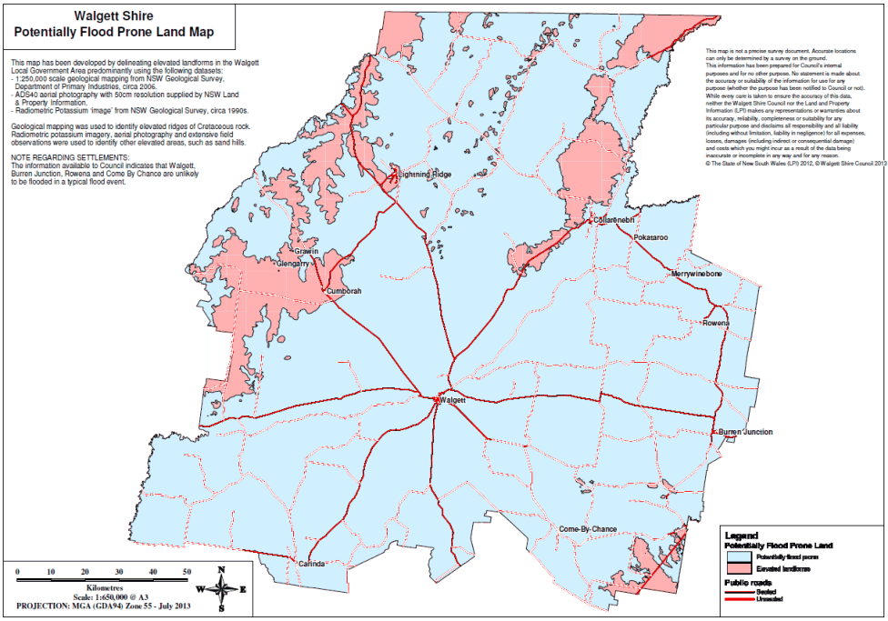

### 3.2. Flooding

Definitions within this section are as per the Floodplain Development Manual (NSW Government)

#### 3.2.1. Flood Affected Land

A significant amount of land within the Shire (about 85%) consists of a flood plain land form and is potentially floodprone. The Walgett LEP states that development on land at or below the flood planning level must not be granted consent unless the consent authority is satisfied that the provisions of Clause 6.2 of the LEP have been met. Council will be satisfied that clause 6.2 has been complied with if the floor of a dwelling house is at least 500mm above the historical flood peak for the site. As a general rule, flood affected land within the Shire is that land that is black

soil. Red soil is generally considered not to be floodprone. If a development is proposed for land on the black soil is, in the opinion of Council’s Director of Planning & Regulatory Services, likely to be flood affected, then it is deemed to be flood affected land for the purposes of this DCP. The urban area of Walgett is protected by a flood levee bank which reduces the risk of flooding.  For the purpose of the DCP, land within the levee bank is not regarded as flood affected land.

> [Picture on page 13: a picture, saved as a picture (images/walgett-shire-development-control-plan-2016-page-13-1.gif, 150 dpi).]

| LOCATION | GEOMORPHOLOGY | FLOOD HISTORY | FLOOD PRONE |
|---|---|---|---|
| Walgett 1731 people (2006 census) | Located on the flood plain of the Namoi River 1.8km upstream of confluence with the Barwon River. Surrounded by a levee bank currently being upgraded to withstand a 1% AEP flood event. | Current levee system was constructed 1961 to a level 0.6m higher than 1890 flood levels. It has never failed since it was constructed. | No |
| Collarenebri 477 people | Adjoins the Barwon River. | 21/02/1976 8.89m flood where floodwater surrounded town & inundated the low-lying areas on the eastern, northern and western edges of town. Three homes in lower Maitland St flooded by water half way up the houses. Only small islands of high ground remained above floodwater that inundated about two thirds of the town. | Yes |
| Burren Junction 130 people | Located on a flood plain 4.0km south of the nearest named watercourse, Pian Creek, and 4.5km north of Cubbaroo Warrambool. | Anecdotal evidence indicates urban area has never been inundated by floodwater. The village has been surrounded by water due to localised flooding from heavy rainfall in the past, but dates and duration are unknown. | No |

| Rowena 23 people | Located on a flood plain, 7.4km south-west of the nearest named watercourse, Thalba Creek. | Anecdotal evidence indicates village area has never been inundated by floodwater. During Feb 2012 the village was isolated by what was considered record flooding of Thalba Creek system. | No |
|---|---|---|---|
| Carinda 94 people | Located on a flood plain 0.5km east of Marthaguy Creek. | Anecdotal evidence indicates village has never been inundated by floodwater. Significant development of cotton farms (including levees and irrigation channels) upstream of Carinda has taken place in recent decades. Some residents believe that a flood event equivalent to the 1950’s may render village vulnerable due to the altered flow paths. Floodwater has reached the edges of the village in more recent flooding events and it has been surrounded by water due to localised flooding from heavy rainfall in the past, but dates and duration are unknown. | Yes |
| Come by Chance <12 people | Located on a flood plain 0.4km west of Baradine Creek. | Anecdotal evidence indicates the ‘urban’ area of Come by Chance has never been inundated by floodwater. Floodwater has reached the northern and western edge of town during previous flooding events. | No |
| Pokataroo < 12 people | Located on a flood plain, 5.7km east of the nearest named watercourse, Big Waterhole Creek. | Anecdotal evidence indicates that the ‘urban’ area of Pokataroo has never been inundated by floodwater. During Feb 2012 it became isolated by what was considered record flooding spilling from the Moomin and Thalaba Creeks. At the time a temporary levee was erected by a local landholder around the area which diverted water and prevent flooding of the three dwellings at the location. | Yes |

#### 3.2.2. Access

Flood free vehicle access is desired for all lots created by residential subdivision. Where flood free vehicle access is not possible, the development must be able to achieve safe wading criteria as specified in Figure L1 of the Floodplain Development Manual and historically access routes only have been subject to inundation for brief periods (eg, less than one week).

#### 3.2.3. General Development Requirements

No building or work (including land filling, fencing, excavation) shall be permitted on flood affected land where in the opinion of the Director of Planning & Regulatory Services, such building or work will obstruct the movement of floodwater or cause concentration or diversion of floodwaters. The Development Application must demonstrate the building or structure can withstand the force of flowing floodwaters, including debris and buoyancy forces as appropriate.

All materials used in construction shall be flood compatible.

> [Picture text on page 15 is stored in the PDF without readable letters (no character map), so it could not be copied; see the original PDF.]

#### 3.2.4. Residential Development

Floor levels of all habitable rooms, or rooms with connection to sewer infrastructure including an on-site sewage management system shall not be less than the flood planning level. Where additions are below the flood planning level, Council must be satisfied that the addition will not increase risk to inhabitants in the event of a flood. Rebuilding part of a dwelling may be permitted provided the building maintains the same dimensions which result in the same impact on flood behaviour.

#### 3.2.5. Commercial / Retail / Industrial Development

Development shall incorporate measures to seal or flood proof buildings, to avoid activities or fittings susceptible to flood damage, or to store the contents of buildings above the flood planning level.

#### 3.2.6. Landfilling

Survey plan prepared by a registered surveyor is required, showing the contour levels of natural surface, any existing fill and the designed contour levels for the finished work. A report certified by a consulting engineer is required to detail the impact of the proposed fill on adjoining properties and, where levee banks are proposed, the methods of internal drainage. Applications shall be accompanied by a construction management plan to show: source of fill, including contamination assessment; an assessment of the impact of haulage vehicles on roads; precondition report of all haulage routes; details of method of compaction of fill and associated impacts: control of dust, sedimentation, water quality impacts, noise and vibration; and contingency for containment of fill in the event of a flood during placement.

#### 3.2.7. Non‐residential rural buildings

Not permitted in “floodways”. Floor areas shall be located above the flood planning level.
