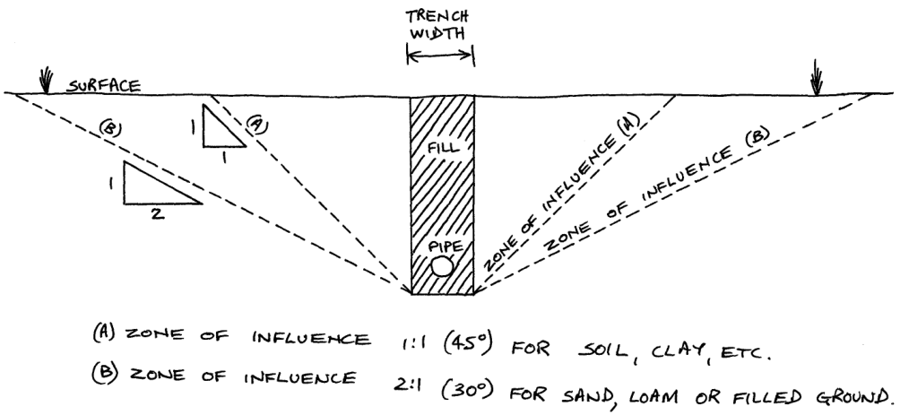

#### A2.0 Zone of influence

#### A2.1 Concept

Council expects that new buildings should not be established within the “zone of influence” of any Council owned water, sewer or stormwater main.  The zone of influence concept of is shown in Figure 1 below.

> [Picture on page 56: a picture, saved as a picture (images/walgett-shire-development-control-plan-2016-page-56-24.gif, 150 dpi).]

#### Figure 1 – Zone of influence

Council can provide maps which show the approximate location of Council owned water, sewer and stormwater infrastructure.  Developers are encouraged to review such mapping at the earliest opportunity when drafting a development proposal to ensure that they avoid any development within the zone of influence.
